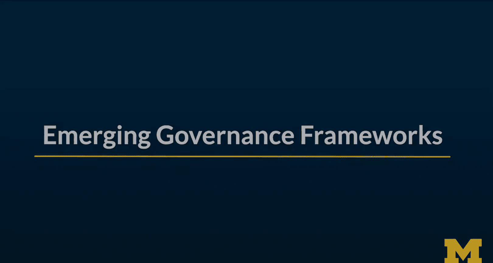
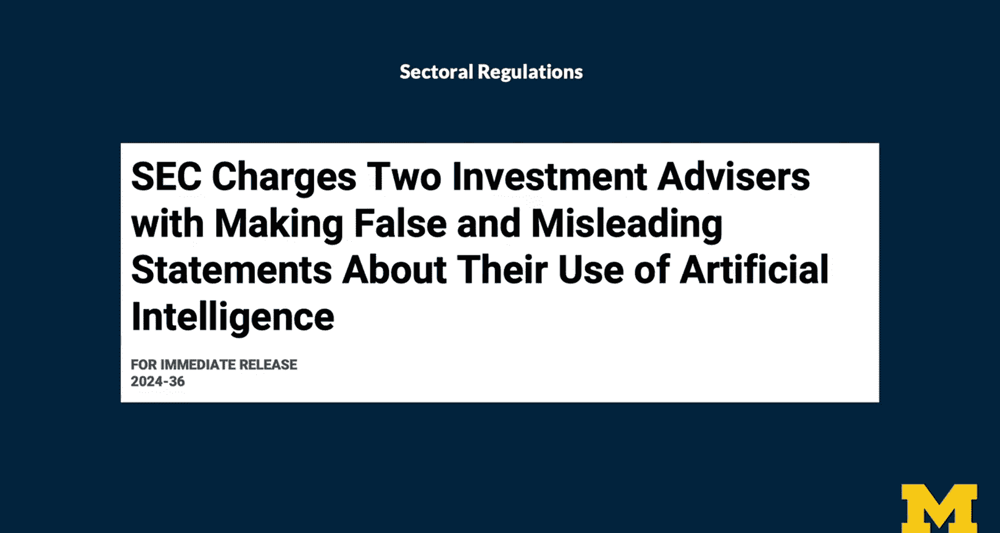
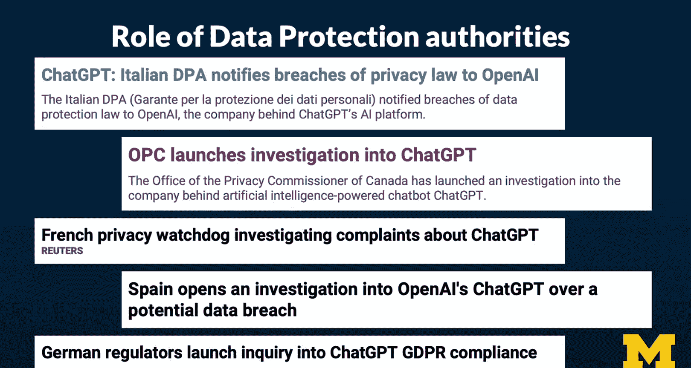
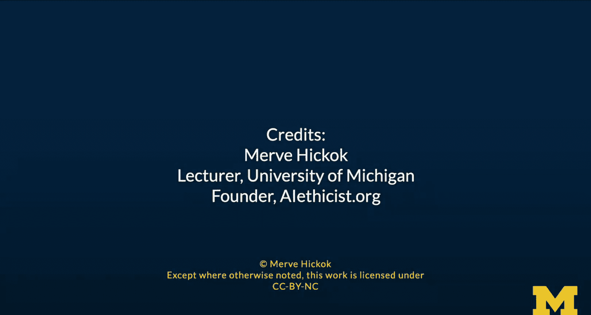

# 2：新兴治理框架演进 🏛️

在本节课中，我们将探讨生成式AI领域新兴治理框架的演进。我们将了解现有法律如何被应用于AI领域，以及全球监管机构如何利用现有权力进行执法。同时，我们也会介绍欧盟《人工智能法案》的风险分级方法，并解释自愿性治理机制（如技术标准制定）在填补监管空白中的作用。

## 现有法律的适用与解释

上一节我们讨论了治理的必要性，本节中我们来看看现有法律框架如何应对生成式AI的挑战。

正如之前提到的，目前有多起法庭案件正在检验现有法律的应用和解释。例如，版权与知识产权问题，以及责任与诽谤索赔，正在全球各地的法院中被积极讨论。国际贸易协定和数据流动安排仍然适用，但正根据生成式AI系统的特性被重新解读。

## 监管机构的执法行动

在之前的课程中提到，世界各地的监管机构也在运用其现有的调查和执法权力。这是为了确保销售生成式AI服务或产品的公司不会损害消费者权益，或以不公平或欺骗性的方式进行商业活动。

现有法规适用于这些技术。过去几年，例如美国的联邦贸易委员会，在该领域发布了许多警告和指导。FTC也采取了执法行动，处以巨额罚款，甚至做出了要求公司删除其数据集及基于这些数据集训练的模型的裁决。

以下是监管机构采取行动的几个例子：
*   美国联邦贸易委员会对违规公司处以罚款，并命令其删除数据集和模型。
*   部门监管机构也可能介入，例如美国证券交易委员会就曾对两家投资顾问公司就其声称使用AI的虚假和误导性陈述达成和解。
*   在存在数据保护或隐私法规的司法管辖区，相关当局也可能采取执法行动，以确保数据主体的权利在生成式AI系统和商业模式中得到保护。

## 数据保护与隐私法规

访问个人数据的权利、更正或反对使用数据的权利、被遗忘权以及私人诉讼权，是许多隐私法规的核心。尽管当前的许多调查都集中在一家公司身上，但这更多是因为它是市场的先行者，并不意味着其他参与者已被认证完全符合数据保护或隐私法规。这些数据保护机构的行动和指导将适用于在生成式AI领域使用个人数据的任何公司。

正如本课程前面提到的，关于法规遵从性的问题应在数据收集和模型训练阶段提出，同时也应针对用户提示和响应中所使用和创建的数据提出。

## 欧盟《人工智能法案》

接下来，我们将目光转向一个专门针对AI的立法框架——欧盟的《人工智能法案》。

2024年通过的欧盟《人工智能法案》为预测性AI系统和通用AI系统都带来了义务。该法案采用了一种基于风险的方法来监管AI用例和实践。法案首先列出了一份禁止使用的用例清单。随后，一系列用户或领域被列为高风险。换句话说，在医疗保健、招聘、教育、执法等领域使用的AI系统，由于可能影响个人的健康、安全或获取资源和机会，被认为具有高风险潜力。

对于这些高风险AI系统，法案要求系统提供者进行合格评估，记录数据集和模型的技术细节，并建立风险和质量管理系统。

欧盟《人工智能法案》也涵盖了生成式AI技术，尽管对提供者规定了不同层级的义务。通用AI系统是指能够执行各种通用功能（如文本、音频、视频识别或生成）的系统，并且可以被下游用户重新用于原始开发者预期或非预期的任务。根据其影响，欧盟《人工智能法案》将这些系统区分为两个层级。

以下是法案对不同类型AI系统的要求：
*   **基础模型提供者**：需要遵守欧盟版权法，拥有关于数据集和模型的技术文档，以帮助下游用户做出更明智的决策。
*   **具有系统性风险的高影响力模型**：有更严格的义务，包括系统性风险评估和缓解、监控严重事件、进行对抗性测试以及报告能源使用情况。
*   **仅用于生成式AI目的的其他系统**：有标签要求。

## 自愿性治理机制

最后，我们来看看当没有强制要求时，行业如何通过自愿机制进行自我规范。

当组织没有被强制要求采取行动，但被行业规范和标准、市场惯例、声誉问题甚至投资者期望去这样做时，半自愿的治理机制就出现了。其中一种机制是标准制定。在立法尚不存在或不需要存在的领域，这是为新技术和行业设定期望的最有效方式之一。此时，专业社群和相关方会聚集在一起，就这些新技术的开发、部署和管理的最重要要素达成共识。他们设定了组织应遵守的最低标准。

在某些情况下，监管机构可能认定遵守既定的技术标准就足以履行法律义务。换句话说，技术标准成为法规的操作性解释。目前，这对于欧盟《人工智能法案》来说是一种可能性。技术标准制定机构正在努力解释欧盟《人工智能法案》的评估和文档记录义务。

---

本节课中我们一起学习了生成式AI治理框架的演进。我们了解到，现有法律（如版权法、消费者保护法）正通过法庭案例和监管执法被应用于AI领域。同时，欧盟《人工智能法案》作为专门立法，引入了基于风险的分级监管体系。此外，行业自愿制定的技术标准也在填补监管空白、引导负责任实践方面发挥着关键作用。这些法律、监管和行业标准共同构成了当前生成式AI治理的多元框架。