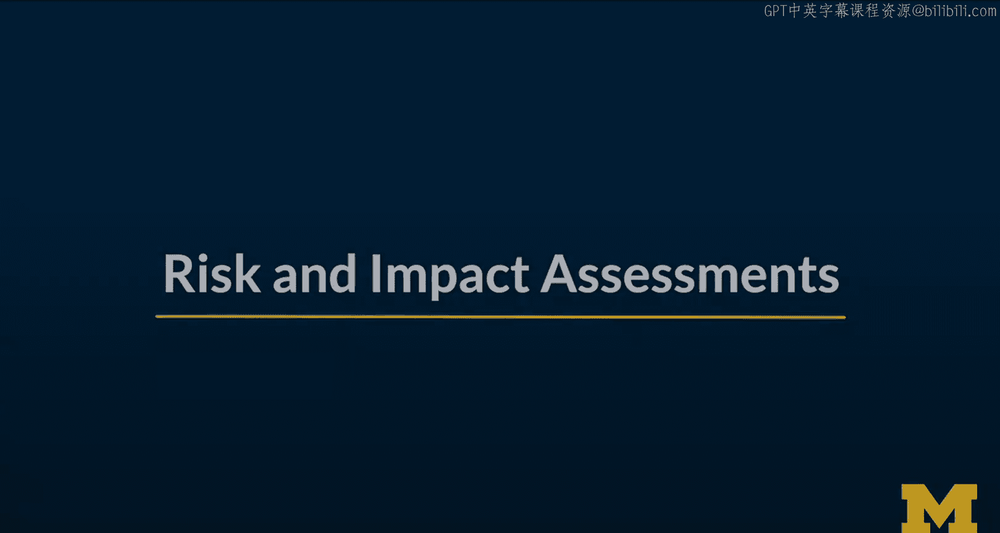

# 3：风险与影响评估体系 🛡️

在本节课中，我们将学习风险与影响评估体系。这一体系要求开发者和部署者对其工作可能产生的后果进行评估，并采取负责任的治理措施。我们将了解事前、事后和持续分析的重要性，以及如何通过记录和监控来确保问责。

## 评估的必要性

开发者和雇主也被期望进行风险与影响评估。尽管目前可能没有强制要求，但未来有可能会立法规定。

## 数据生命周期中的不同角色

当我们在整个数据生命周期中使用数据或开发基于数据的产品和服务时，不同的参与者会介入其中。

我们的意图通常是解决问题、提高流程效率或降低成本，以及改善结果。除非我们怀有恶意，否则问责制的概念本身就不相关。我们的目标是为个人或整个社会带来利益。

## 识别与减轻潜在危害

在我们享受工作成果的同时，负责任的方法也要求我们理解可能造成的危害或负面影响，并在伤害发生之前减轻它们。

负责任的治理要求我们进行事前、事后和持续的分析，并采取相应行动。事前分析意味着在事件发生之前。

## 事前分析：决策与评估

当我们对数据集和设计做出决策时，我们会与一组利益相关者合作，描绘出可能的危害并评估其影响。

一旦我们通过事前分析理解了可能出错的地方，我们就面临着做出决策的需要。在某些高风险、高利害的情况下，你所揭示的危害可能令人无法接受，从而需要停止开发；或者可能需要进一步投入，直到这些危害变得可接受，并且造成伤害的风险被消除或减轻。

## 记录决策的重要性

通过发现、描绘和减轻这些过程，记录我们所做的决策至关重要。

通过设计实现责任和问责，要求我们记录数据集的定性和定量特征。我们的数据来源是什么，它们是在什么背景下收集的？我们应用了哪些数据预处理步骤？我们将如何训练模型？我们的数据集、模型和系统有哪些已知的局限性？

## 事后问责：反馈与改进

有时，即使怀着最好的意图，一旦被不同的参与者使用或应用于新的情境，事情也会出错。我们需要能够理解为什么会发生这种情况，并建立控制措施以确保它不再发生。这就是事后问责发挥作用的地方。事后意味着事件之后。用户、媒体、民间社会和审计员都可以以不同的方式参与进来，以保持参与者的问责。

理想情况下，我们希望这种反馈能对产品和服务有所贡献，并且我们希望这种反馈尽可能成为一个建设性的过程。

## 持续监控与治理机制

除了事前问责，我们还有责任持续监控数据集和结果的变化。虽然预测性AI系统是围绕特定的目标函数和性能评估方法构建的，但生成式AI系统并非如此。用户将创造出许多先前无法预见的用例，并与这些系统进行交互，其中一些甚至是出于恶意目的。

由于用例可能多种多样且不断增多，开发和部署生成式AI系统的组织必须有一种有效的方式来监控用户行为的变化，接收并响应用户的反馈，应对事件，并积极防止系统被用于禁止或危险的领域。

稳健的治理机制要求在组织内为特定角色分配明确的责任，并为他们提供有效的工具来监控变化、记录和报告影响。

## 总结

本节课中，我们一起学习了风险与影响评估体系的核心框架。我们了解到，负责任的AI开发不仅需要事前分析潜在危害并做出决策，还需要建立事后问责机制以应对问题，并持续监控系统在实际使用中的演变。通过清晰的记录、明确的角色责任和有效的治理工具，我们可以更好地管理生成式AI带来的风险，确保其发展符合社会利益。