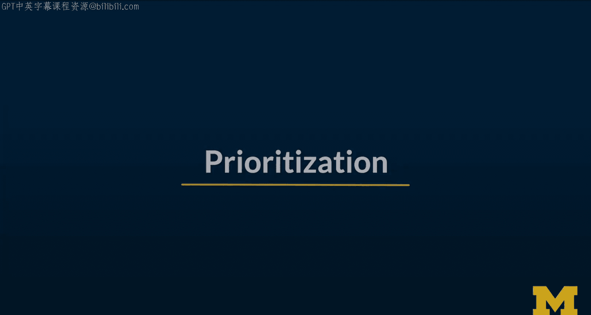
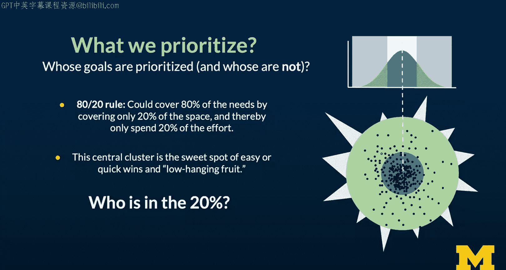
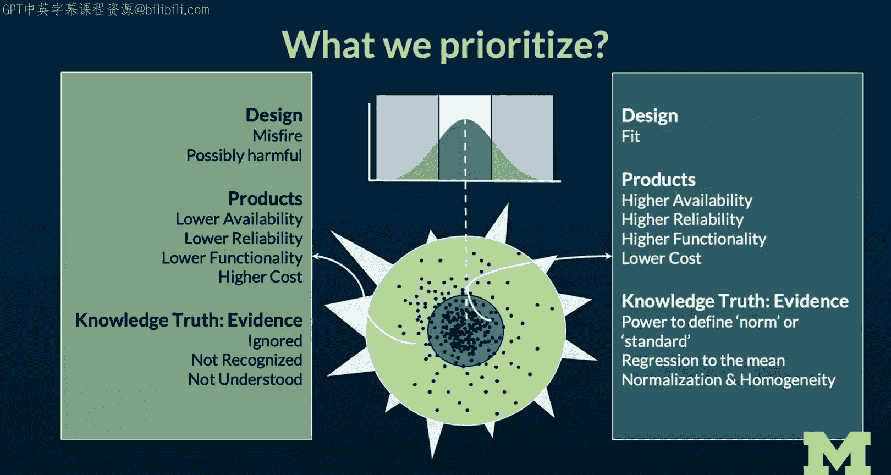
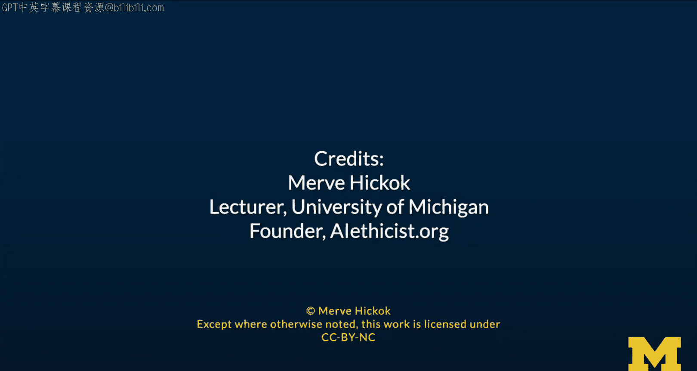

# 负责任生成式AI简介：4：优先级划分原则 🎯

在本节课中，我们将探讨在开发和部署生成式AI系统时，如何划分优先级，以及这种划分可能带来的社会影响。

## 概述

本节内容将分析开发者在资源有限的情况下，如何决定优先满足哪些用户群体的需求。我们将看到，基于“二八法则”的效率优先策略，虽然能快速覆盖大部分用户，但也可能导致对少数群体需求的忽视，从而引发公平性和包容性问题。

## 外部反馈的局限性

正如之前提到的，外部参与者可能会发现系统的意外反应，并向组织提供反馈。

然而，这并不意味着外部参与者应该承担这项工作的主要责任。😔

生成式AI系统应该在开发者能够确保其安全、可靠和值得信赖之后再进行部署。

## 开发能力与决策权的不均衡分布

但是，正如之前提到的，谁有能力开发这些先进系统，以及谁有权做出这些决策，其分布是极不均衡的。

你可能熟悉**二八法则**。

它可以转化为一种以效率为中心的方法。这意味着，你只需覆盖20%的范围，就能满足80%的需求。因此，只需付出20%的努力。

这意味着在一个快速变化的决策或产品领域，你会追求容易且快速的胜利，而不一定花费精力去理解为什么有些人会落在“外部空间”。

## 忽视少数群体的后果

Tverrans教授促使我们思考忽视那20%人群需求的后果。😔

我们知道，在统计学中，分布总会存在差异。然而，我们也会有意识地决定如何定义“均值”、“规范”和“平均值”，然后将人群与这个决定进行比较。

当我们决定优先考虑谁的目标和需求时，我们也在选择我们有多重视那20%处于外部空间的人。

如果我们忽视那20%，会发生什么？我们忽视了8%的知识领域，会错过什么？😔

如果你发现自己身处那些“困难”的人群中，会发生什么？

对于那些不符合大多数人或既定规范的人来说，结果可能会截然不同。

这种排斥的重复模式，也可能在多个领域产生累积效应。

以下是可能出现的几种情况：
*   **设计不匹配**：设计可能不适合这个人，或具有相似特征的一群人。
*   **造成伤害**：有时甚至可能直接造成伤害。
*   **产品可用性差**：之前，我们在生成式AI系统的语言或图像多样性背景下讨论过这个问题。适用于这些“外部”人群的产品，可能更难以获得。😔
*   **性能低下**：产品的可靠性、准确性或功能性可能较低。

## 主动理解的重要性

如果没有付出有意识的努力去理解这些群体的需求，换句话说，**这些数据代表了谁？是什么导致他们处于边缘？这是一个缺陷还是一个特性？这是一个反复出现的问题吗？**

那么，他们将持续面临伤害、风险和代价。😔

## 市场与消费者的期望

尽管是一项新兴技术，消费者和许多企业已经期望供应商在生成式AI方面承担一定水平的责任和指导。

消费者既兴奋又担忧。

开发和部署这些系统的企业将需要满足这些期望并建立信任。

投资者和消费者期望组织能够负责任地行事。

---

## 总结

本节课中，我们一起学习了优先级划分原则在生成式AI开发中的关键作用。我们认识到，单纯追求效率的“二八法则”可能导致对少数群体需求的系统性忽视，从而引发公平性、包容性和产品可靠性等问题。作为开发者和企业，有责任主动理解并考虑所有用户群体的需求，以建立可信赖的、负责任的AI系统。