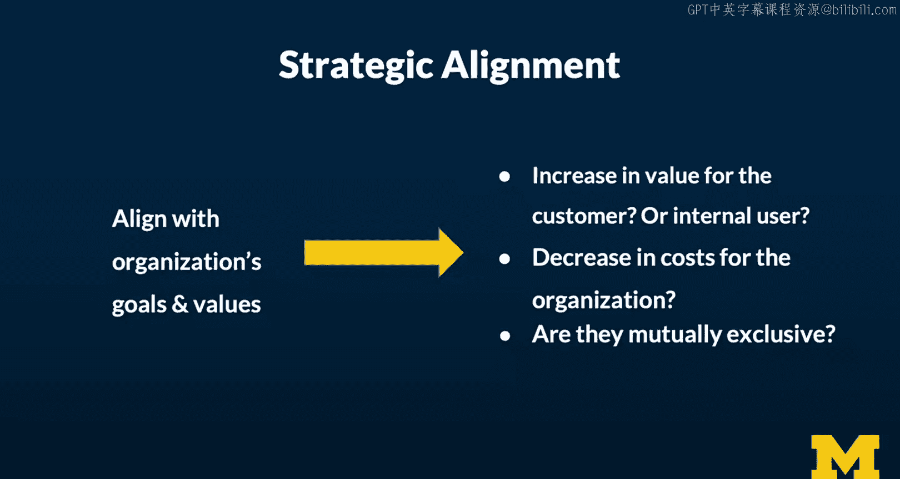
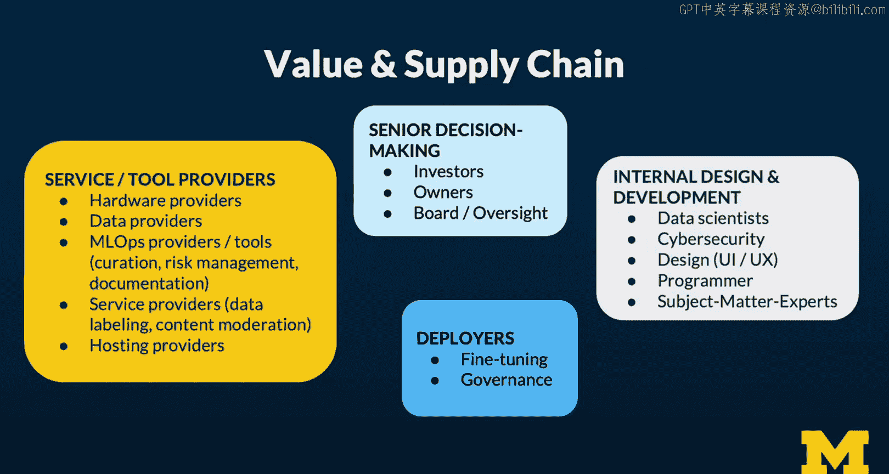
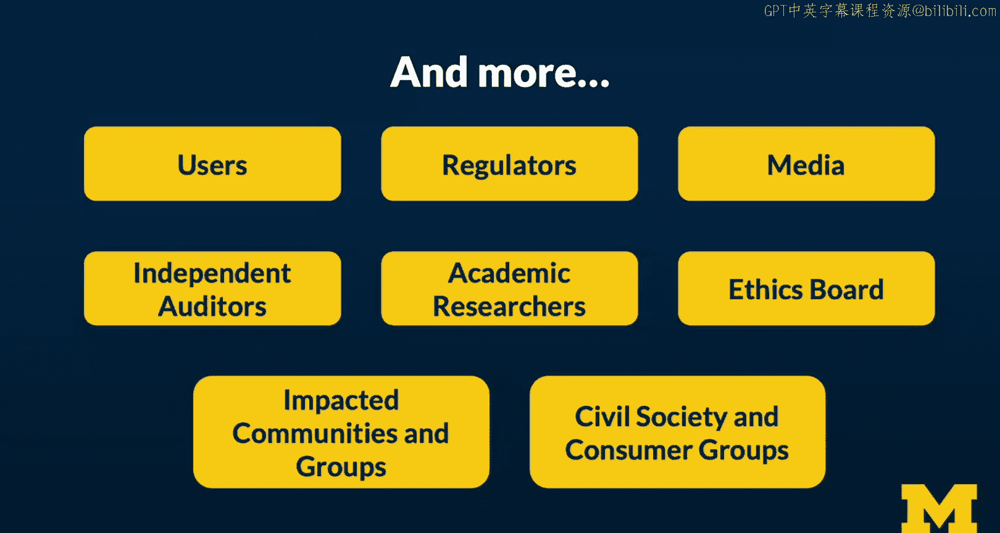
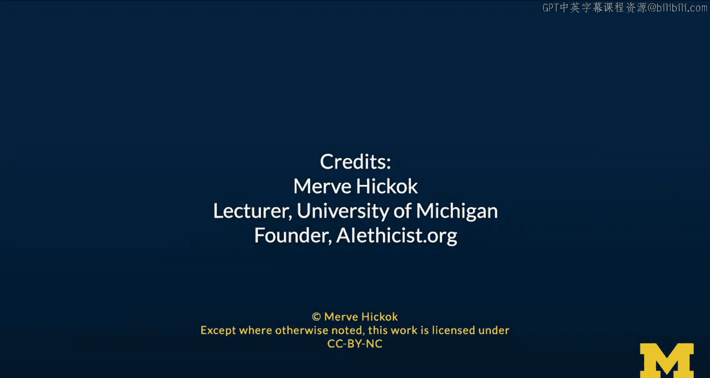

# 5：战略协同与利益相关方

在本节课中，我们将探讨企业在部署生成式AI时需要考虑的战略协同、利益相关方参与以及成本效益等商业考量。我们将了解如何超越技术炒作，从组织价值和目标出发，负责任地评估和引入生成式AI。

## 商业应用现状与信任基础

上一节我们讨论了全球治理框架，本节中我们来看看企业在实际应用生成式AI时面临的商业考量。

Salesforce进行的《生成式AI快照研究》系列调查涵盖了多个行业的4000多名全职员工，以及美国、英国、澳大利亚和印度的4000多名普通成年人。调查显示，这些国家的企业可能已经越过了当前或计划使用生成式AI的门槛。在接受调查的员工中，五分之三的人表示他们目前正在使用或计划使用生成式AI。回应调查的领导者们预计生成式AI将很快在其组织中扮演重要角色，并且几乎一致同意他们的企业必须采取措施以负责任的方式使用生成式AI。

同一调查显示，当员工被问及“确立生成式AI作为一项可信技术需要什么条件”时，他们的主要回答包括：
*   人工监督与安全措施
*   可信的客户数据
*   道德使用准则

这些结果凸显了信任的重要性，以及在决定是否为组织部署生成式AI系统时，采取负责任AI实践的必要性。

## 超越炒作：以价值为导向的决策

在评估是否部署生成式AI时，问题不应聚焦于这项新兴技术的炒作，或对错失机会的恐惧。换句话说，问题不应始于“我们应该使用生成式AI，然后找一个用例”。

相反，组织内的利益相关方应先识别出内部或外部需要改进的特定流程或方法，然后询问生成式AI是否能用于该目的。同样，不应只关注竞争对手在做什么或不做什么，而应思考：什么用例能为我们的组织或品牌创造竞争优势？

沿着这个思路，战略价值协同至关重要。在此背景下，可以从多个层面进行讨论：
*   生成式AI的使用是否符合我们的组织价值观和目标？
*   它是否会为我们的外部利益相关方（客户、公民等）增加价值？
*   如果内部部署，它是否会帮助我们的员工？
*   它是否会降低组织的总体成本？
*   我们能否同时实现成本降低和为利益相关方增加价值？如果不能，我们优先考虑哪一个？

## AI价值链的复杂性与责任归属

回答上述问题并确保协同的一个主要复杂因素，与AI及生成式AI产品的价值链有关。没有任何单一实体能控制从数据创建或标注、托管或计算架构到模型训练决策的整个开发过程。

不同的激励、动机和权衡为这些系统构建了复杂的层级。价值链中的每个参与者对最终产品的贡献和控制程度不同，他们所处的权力状态也不同。从治理或法律角度来看，责任和义务的分配也很困难。自然，最终决定部署商业产品的供应商，以及任何可能在这些通用产品之上构建进一步应用的实体，承担最终责任。然而，即便如此，也可能存在不平衡。换句话说，部署系统的组织可能过于依赖最初开发通用AI系统的组织。

除了价值链中的所有参与方，组织在AI模型的整个生命周期中，可能还需要与许多其他外部方合作。这一长串的利益相关方强调了治理不能是事后才考虑的事情，并且需要多学科参与才能有效。

## 利益相关方参与与全组织方法

外部利益相关方的参与在合作与共同创造的过程中最为有益。在这种方法中，各方共同设计，优先考虑最终用户的需求。这种参与不仅有助于发现影响和风险，还能改进功能、数据的代表性和可用性，从而增强产品。不言而喻，受影响社区的利益相关方的参与必须是实质性和公平的。

为了建立生成式AI的战略协同和治理机制，需要采取全组织方法，让组织内多个职能部门参与进来，共同解决关键问题。

## 长期投资与成本考量

生成式AI系统需要持续的维护投入，会产生持续的成本，是一项长期投资。需要考虑对人才、技术基础设施、数据获取、确保模型质量、模型训练和维护、事件响应（包括可能的公关成本）以及网络安全和合规性等方面的投资。

此外，部署生成式AI将对现有的内部业务或决策流程产生影响。换句话说，评估我们通过生成式AI在业务某一领域产生的成本或时间效率，是否会增加组织内其他领域的成本和时间，这一点很重要。

## 总结

本节课中，我们一起学习了企业在部署生成式AI时需要考虑的战略协同与利益相关方问题。我们认识到，决策应始于组织的具体需求和价值目标，而非技术本身。生成式AI的引入涉及复杂的价值链和多方责任，需要采取全组织、多学科的方法进行治理。同时，它是一项需要持续投入的长期投资，必须全面评估其对组织整体流程和成本结构的潜在影响。建立信任、确保负责任的使用，是成功整合这项技术的关键基础。