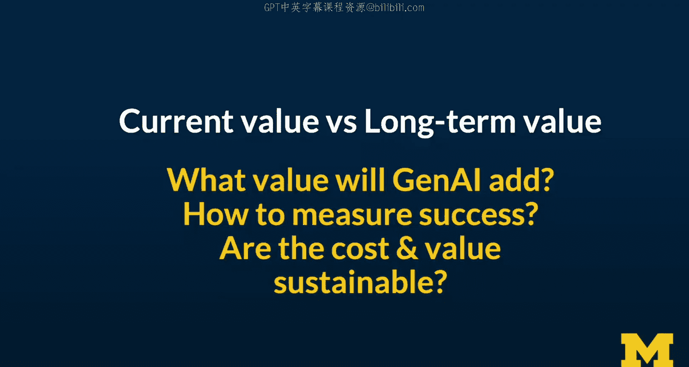
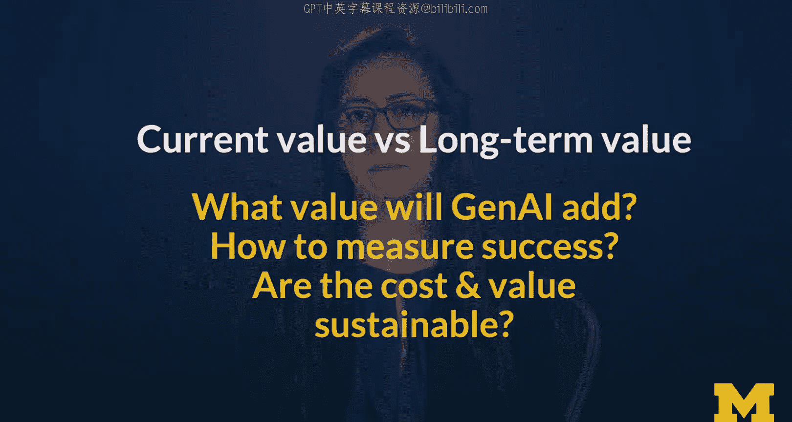

# 6：价值与成本平衡模型

在本节课中，我们将学习如何为生成式AI的部署构建一个治理框架，并理解其价值与成本之间的平衡关系。我们将探讨组织在采纳生成式AI时需要提出的关键问题，以及如何评估其长期价值。

## 治理框架的关键问题

一旦确定了生成式AI的用例，治理工作就应围绕一系列关键问题展开。以下是组织在构建自身治理体系、确保负责任地部署和使用AI时，需要考虑的初始问题列表。

*   **风险识别**：部署生成式AI预见到哪些风险？
*   **控制措施**：我们是否已具备相应的控制措施？
*   **政策与流程**：需要进一步实施哪些政策和流程？
*   **法规义务**：哪些现有法规义务适用于生成式AI？
*   **监管指引**：监管机构对此技术提供了哪些警告或指导方针？
*   **知识产权保护**：使用生成式AI时，如何保护我们自身及客户的知识产权？
*   **合同协议**：我们是否需要与模型提供商或我们自己的客户修订或签订任何合同协议？
*   **决策影响**：生成式AI将如何影响内部决策过程？
*   **人员准备**：我们应如何让内部利益相关者和员工做好准备？
*   **意见收集**：我们的员工如何分享他们对生成式AI的想法（无论是关于采用的用例，还是他们可能存在的风险或担忧）？
*   **应对机制**：对于可能影响组织的滥用或恶意活动，我们有哪些机制和计划？

## 内外部考量

上一节我们介绍了治理需要提出的内部问题，本节中我们来看看组织在外部层面需要考虑的因素。

在外部，组织首先需要考虑部署商用生成式AI产品或通过API连接现有基础模型所产生的**上游依赖**。此外，还需评估部署对其**下游客户**的影响，以及这种影响对客户体验、信任和品牌忠诚度是积极的还是消极的。

## 成本构成与环境影响

除了治理问题，成本是另一个核心考量因素。生成式AI系统的成本产生于模型开发、训练和微调阶段，以及在用户提示产生推理的**运营阶段**。事实上，从长远来看，推理成本可能远高于初始训练成本。

除了财务成本，企业还需考虑**环境影响**。排放量可能受多种因素影响，例如：
*   所使用的硬件
*   执行代码或运行推理所需的时间和持续时间
*   甚至所连接的能源电网类型

在比较不同供应商时，企业可能需要了解其环境影响。然而，当前能源使用情况缺乏透明度，使得这种比较极其困难甚至不可能。

## 价值评估与决策

在考虑了所有不同的对齐和成本因素后，**价值确定**成为最终问题。是否采纳生成式AI系统的决策，需要考虑其为组织带来的持续增值，并就如何衡量成功达成一致。

价值公式必须长期成立。用公式表示即：

**长期价值 (V_longterm) ≥ 部署生成式AI的总成本 (C_total)**

换句话说，部署生成式AI的价值从长期来看必须保持不变或上升。

---

本节课中我们一起学习了构建生成式AI治理框架的关键问题，分析了其内外部影响、成本构成（包括环境影响），并最终理解了评估其长期价值的核心公式。这有助于组织在采纳技术时做出全面、负责任的决策。