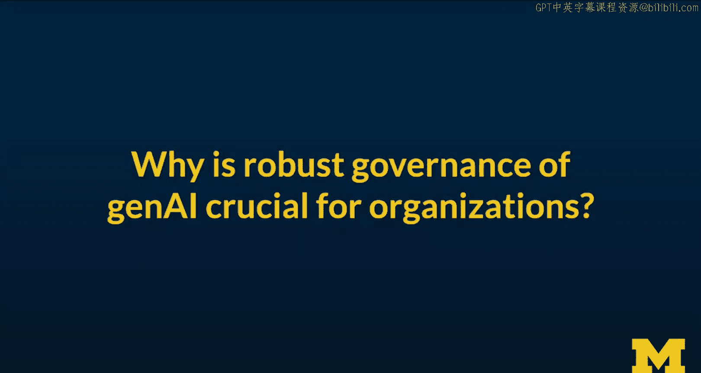

# 7：Susannah Shattuck访谈：生成式AI治理重要性

## 概述
在本节课程中，我们将通过Susannah Shattuck的访谈，探讨生成式人工智能治理的重要性。我们将了解她从早期AI部署中获得的经验教训，以及为何为生成式AI建立强大的治理框架和“安全沙盒”环境至关重要。课程还将讨论如何在AI供应链中管理责任与安全。

---

## 早期AI部署的经验与教训 🧠

AI治理对我而言至关重要。我投身这项工作，是因为我曾是2016年早期IBM Watson实施团队的一员。虽然距今不算遥远，但从技术角度看，那仿佛是几个时代之前。当时，我们对部署AI系统知之甚少。当然，那时还是基于预测性机器学习的狭义AI系统。

我们对于将这些系统投入生产环境存在大量未知，因此也出现了许多问题。我有时会分享一个统计数据：当时我们为许多缺乏深厚数据科学专业知识的大型传统企业构建部署方案，但在六个月内，这些部署往往就无法在生产环境中正常运行了。这是因为，与构建和部署无需特别“照料”的程序化软件不同，监控AI系统的数据漂移和性能在当时并未被深入理解。

这些AI系统的经历让我深刻认识到，将AI部署到现实世界会带来新颖且关键的风险。在Watson实施团队工作几年后，我有机会加入一个新团队，专注于构建全新的产品——首个用于机器学习系统的模型监控平台。

我非常幸运地被指派负责该平台中的偏见检测与缓解功能集。

最后我想分享一点，这让我深刻理解了负责任AI和技术的重要性，以及推动组织负责任地部署AI所面临的挑战。我曾与几家大型银行开会，介绍我的产品和偏见检测缓解方案，但我被要求离开会议室。因为他们有一种观念认为，如果组织不知道其模型中存在偏见，就不会为此承担责任；但一旦有任何书面记录表明他们对此有所了解，就会面临法律风险。律师们因此要求我离开。这段经历极大地激励了我，让我决心将职业生涯投入到研究如何改变激励机制，并说服组织真正承担起责任，为其AI系统可能造成的伤害或引入的新风险（包括社会风险和组织风险）负责。此后，我的职业生涯便专注于这一领域。

---

## 为何生成式AI治理至关重要 ⚖️

上一节我们回顾了早期AI部署的挑战，本节中我们来看看为何生成式AI的治理尤为关键。

对生成式AI进行强有力的治理至关重要，因为生成式AI与任何新兴技术一样，不仅对于考虑部署它的组织，甚至对于处于开发大语言模型和基础模型前沿的专家技术人员而言，都仍处于被理解的过程中。

回想我早期的职业生涯，当时我们对如何在现实世界中安全、负责任地管理和部署预测性机器学习系统存在大量未知。对于这些极其庞大、复杂的模型，未知数更大。即便是世界顶尖专家，也无法完全解释这些系统的工作原理，也不完全清楚它们所有可能的失败方式。

我们几乎每天都在持续发现新的失败模式、新的“越狱”或攻击这些系统的方法，我认为这恰恰表明我们仍在努力理解这些系统。因此，再次基于在预测性机器学习领域的亲身经历，我深知对于一个组织而言，如果你使用的技术是新的、未被充分理解的，那么建立适当的防护措施以确保你不是在现实世界中“学习”、不是在实时处理真实数据时才发现失败模式和风险、不是在涉及真实人类的情况下做出决策，是至关重要的。因为这是让你的组织登上新闻头条、导致糟糕事件发生的最快途径之一。

我绝对不反对我们通过实验、测试来更好地理解这项技术。我认为尝试使用生成式AI系统来改善生活和工作至关重要。但你需要在一个安全的环境中进行，这样即使发生意外，你也不会登上新闻头条，不会伤害到他人，也不会因为组织发生可怕的事情而丢掉工作。我亲眼见过这些事情发生。

我认为，当前的生成式AI治理，核心在于确保你拥有一个安全的空间、一个安全的环境来测试、探测，甚至诚实地尝试“破坏”这些系统，以真正更好地理解，如果你想把一个生成式AI系统投入生产，究竟需要设置哪些防护措施。

---

## 建立安全的实验环境 🧪

上一节我们强调了治理的重要性，本节我们将探讨如何开始实践。

以下是建立安全实验环境的关键步骤：

**1. 设置“沙盒”环境**
我总是建议考虑试验或测试生成式AI的组织建立一个“沙盒”。可以把它想象成一个铺有橡胶衬里的房间——一个安全空间。即使出现问题，该系统也不会接触现实世界或敏感数据，也不会与可能不完全了解该系统风险性或实验性质的普通用户互动。建立一个沙盒环境，让一个核心团队专注于理解该系统的硬性边界和失败模式，对其进行充分测试，并尝试各种不同的方法。在企业实践中，我们通常看到组织会建立一个数据清洁环境，将模型部署到一个不接触任何敏感公司数据的环境中，并且与系统交互的人员都经过培训，知道不要向其输入现实世界或敏感数据。以此作为了解这些系统潜力的方式。

**2. 从狭窄用例开始，而非聊天界面**
ChatGPT确实激发了全世界的想象力，在很多方面，这很好，因为它清晰地展示了这些系统的潜在力量。但我认为ChatGPT带来的真正危害是，它让每个人都立刻认为聊天界面是大语言模型的最佳或首选交互方式。实际上，我认为聊天界面是企业组织最糟糕的起点，因为它有太多需要应对的失败模式。用户与聊天系统交互的方式几乎是无限的，因此你需要设置数量惊人的防护栏，以防止用户输入有害话题或“越狱”提示，导致模型输出有害内容。对于聊天界面，你需要应对的失败模式太多了。

因此，我鼓励组织首先考虑将大语言模型嵌入到现有的工作流程中，该工作流程中原本就存在某种语言理解或非结构化数据理解的环节，可以用大语言模型实现自动化。**将大语言模型放在一个非常狭窄的“盒子”里，不要给它太多自由，也不要给用户太多与之交互的自由。** 这样，为保护这个狭窄的用例设置一套狭窄的防护栏会容易得多。当然，随着组织更熟练地理解LLM的所有失败模式、用户可能“越狱”或与之交互的所有不同方式（这些最终会导致有害行为），你可以扩大允许人们与这些系统交互的范围。但请从非常狭窄的用例开始，因为这样更容易建立一套有针对性的防护措施。

---

## 管理AI供应链中的责任与安全 🔗

上一节我们讨论了如何安全地开始实验，本节我们来看看一个更宏观的挑战：如何管理生成式AI整个供应链中的责任、问责和安全。我认为这是生成式AI治理与预测性机器学习系统治理之间最大的区别之一。

预测性机器学习系统通常是在内部构建，或者被构建并嵌入到一个非常具体的应用程序中。因为预测性机器学习系统是“狭义”的，你在特定类型的数据上训练它们，它们无法与其他类型的数据交互并产生有意义的输出。

生成式AI系统、大语言模型则根本不同。像OpenAI这样的组织训练了一个大语言模型，现在可以被成百上千个不同的应用程序用于截然不同的目的。与我合作的许多客户（通过Cto AI）并不构建自己的大语言模型，他们没有资源或专业知识，坦率地说，他们也不需要。因为现实是，与仅仅使用正确的提示词并将一个通用大语言模型嵌入到具有适当用户交互的应用程序中相比，微调在性能上带来的投资回报率提升并不显著。因此，越来越多的组织使用由他人训练好的现成模型。

我们在管理供应链、责任和问责方面看到的最大挑战之一是，大语言模型提供商在向市场其他方面提供透明度方面存在不足。这包括：用于训练这些系统的数据是什么、这些系统具体是如何训练的、如何测试的，以及可能采取的任何内部模型开发防护栏或安全措施。特别是在用于训练这些系统的数据方面，透明度非常低，因为大语言模型提供商声称这是他们的“秘方”，是他们的竞争优势所在。但对于市场的其他参与者来说，这非常危险，因为他们无法就是否以及如何部署这些模型做出明智的决策。

实际上，我认为我最期待监管发挥作用的一点，就是强制要求整个AI价值链的透明度。在3月14日，也就是欧盟《人工智能法案》实际上通过后的第二天，我对其要求模型提供商明确、透明地披露模型的某些方面感到非常兴奋。我相信这将有助于供应链上游的应用程序构建者或部署者，就是否愿意使用某个特定模型、使用某个特定模型是否安全做出明智的决策。

除了透明度要求，供应链管理中另一个非常重要的环节是**在供应链的每个环节进行测试**。仅仅由模型提供商进行测试，然后应用程序构建者就将其视为真理并直接采用，这是不够的。这是由于大语言模型极其灵活的特性所决定的。模型提供商所做的测试，不足以深入理解模型在特定上下文中的失败模式。因此，应用程序提供商需要进行自己的测试，部署者也应该进行自己的测试，以深入理解该模型在将要部署的特定上下文中究竟如何行为和表现。

这是预测性机器学习与大语言模型的另一个重大区别。过去，构建模型的数据科学家说“我运行了所有这些测试”，你完全可以相信他，然后部署到你的应用程序中，就万事大吉了。但现在情况不再如此。因此，我也对新的测试工具和方法、以及“红队测试”方面不断增长的专业知识感到兴奋，这些正开始渗透到整个供应链中。我认为这对于那些仅仅是购买包含大语言模型的现成应用程序的公司来说，也将是一个非常重要的教育点。他们需要接受培训，了解如何测试该模型，以确保它符合他们的风险承受能力和特定环境的要求。

---

## 总结
在本节课中，我们一起学习了生成式AI治理的重要性。我们从Susannah Shattuck的早期AI部署经验出发，理解了缺乏治理可能带来的现实风险。我们探讨了为何生成式AI因其复杂性和未知性更需要强大的治理框架，并学习了建立安全“沙盒”实验环境和从狭窄用例开始实践的具体方法。最后，我们深入分析了管理生成式AI供应链中责任与安全的挑战，强调了透明度要求和在各个环节进行独立测试的必要性。核心在于，在充分利用生成式AI潜力的同时，必须通过负责任的治理来管控风险，确保技术发展安全、可控且有益。