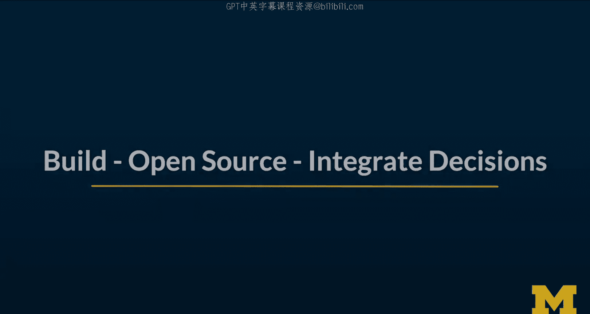
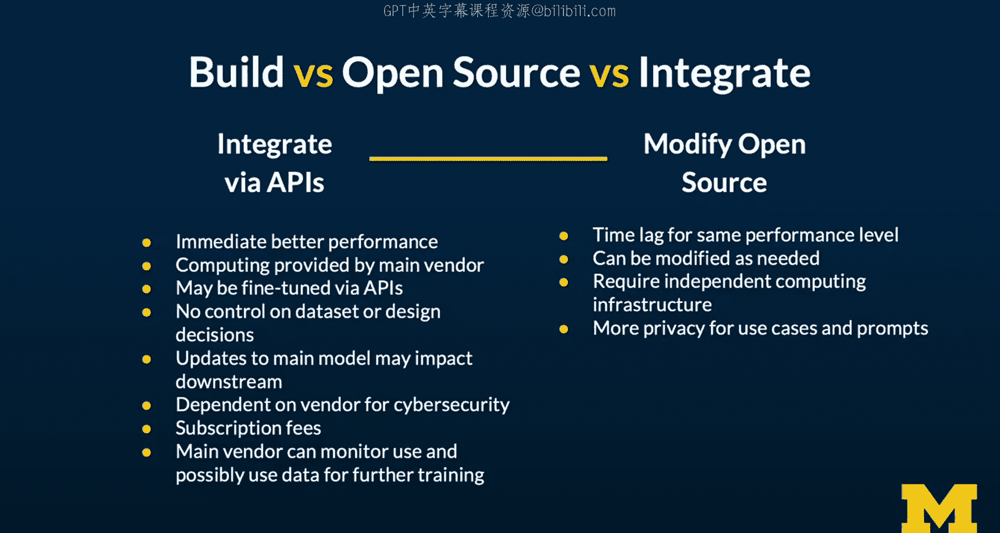
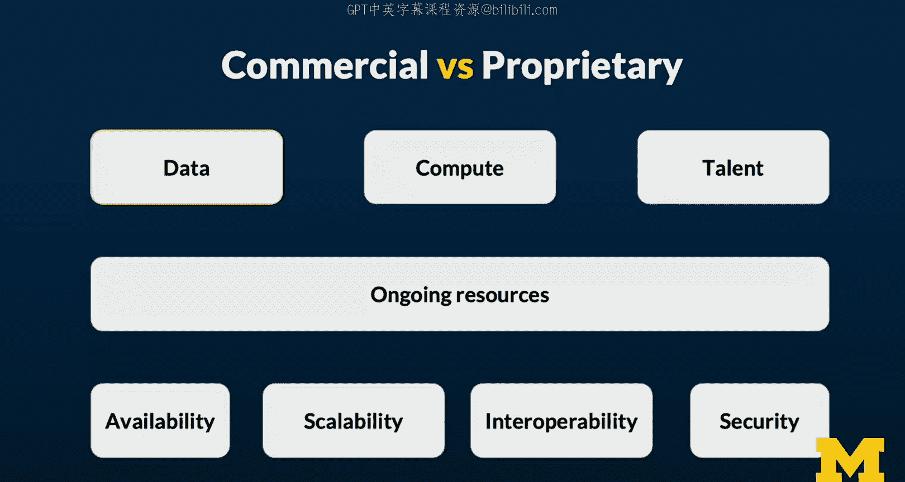
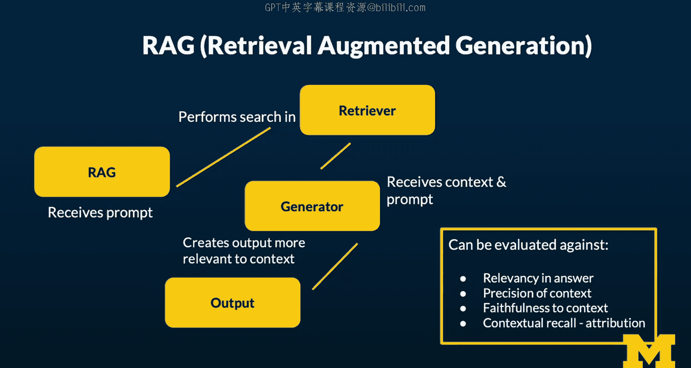
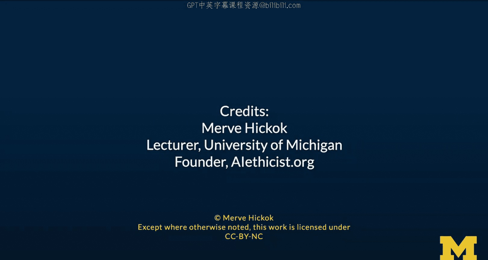

# 负责任生成式AI简介：8：构建开源集成决策体系

在本节课中，我们将探讨企业在决定采用生成式AI时面临的核心决策：是自行构建、修改现有模型，还是通过API集成商业模型。我们将分析每种选择的利弊，并介绍两种提升模型性能的关键技术：检索增强生成和微调。

## 决策框架：构建、修改还是集成？

当决定使用生成式AI时，首要决策之一是在“构建”、“修改”和“集成”之间做出选择。

以下是三种主要路径的概述：

*   **自行构建模型**：从零开始训练模型。这种方式让你能完全掌控**数据集**的构成与质量、整体**基础设施与架构**、**分词器**、**网络安全**以及**持续维护**。然而，对于许多中小型企业而言，由于产生的**显著成本**，从零开始训练生成式AI系统可能并不可行。
*   **修改开源模型**：使用现有的开源模型，并为其特定目的进行修改。开源模型的性能水平通常**落后于商业模型几个月**，并且要求组织拥有自己的**计算资源**。但另一方面，它在**模型更新**和**隐私**方面提供了更多控制权。
*   **集成商业模型**：通过API使用商业模型。商业化的基础模型通常能提供**更好的性能**，并且在训练所需的**计算资源**方面是现成的。但它们可能在**模型更新**、**网络安全**甚至**订阅费用**等方面造成对供应商的依赖。此外，主要供应商可以监控使用情况，并且根据设置或协议，**可能使用你的数据来进一步训练模型**。

在做出选择时，还需持续考虑所需的资源（即**数据**、**算力**和**人才**）是否可用，以及业务能否管理产品的**可扩展性**、**互操作性**和**安全性**。

## 提升模型性能：RAG与微调

上一节我们介绍了选择模型的基本路径。本节中我们来看看，当选定基础模型后，如何针对特定需求提升其性能。当考虑将大语言模型用于商业目的时，你可能会注意到，这些通用模型擅长高级信息检索和生成，但在**特定领域**表现不佳。或者你可能考虑将这些系统用于内部，应用于组织的**知识库**。无论哪种情况，通用模型都可能需要进一步的微调，或通过方法来为其补充额外的上下文或领域特定数据。

这时，**微调** 或 **检索增强生成** 就派上了用场。

### 检索增强生成

RAG允许模型连接到一个额外的**数据集**，该数据集可能包含更多与领域相关或组织内部的信息。当用户向系统提问时，RAG会在领域数据集中执行搜索，然后利用该**上下文信息**来生成输出。

当连接到可能存在**知识截止日期**的通用模型时，RAG还可以提供**更新、更及时的信息**。通过这种数据库集成，输出的**准确性和相关性**可以得到改善，但并非百分之百可靠。即使使用了RAG，模型仍然基于**统计关系**，而非真正的推理或意识。

### 模型微调

另一方面，**微调**是利用**人类反馈**、**技术护栏**或其他AI模型来调整大语言模型的输出，或为其提供额外上下文。微调可用于评估或减少**有害**、**冒犯**、**有毒偏见**或不准确的结果，或用于编程**技术护栏**。

在之前专注于生成式AI系统基础知识的课程中，我们已经讨论过**基于人类反馈的强化学习**和其他微调活动。本质上，预训练的通用模型被提供了**带标签的数据点**，这些数据点包括示例和正确结果。标注数据必须具有**高质量**，以便模型能更清晰地学习模式和联系，从而改进其输出。这比从头开始训练模型的成本要低。

微调还可以减少在技术护栏和评估方面所需的**重新训练频率**，或者也可以考虑编程**额外的控制措施**。需要提醒的是，对RAG的谨慎同样适用于微调：这些都是改进性能和输出的方法，但并非无错误的增强手段。

---

本节课中，我们一起学习了企业在采用生成式AI时的核心决策路径（构建、修改、集成），并深入探讨了两种关键的模型优化技术：检索增强生成和微调。理解这些选项的利弊以及技术的适用场景，对于制定负责任且有效的AI集成策略至关重要。