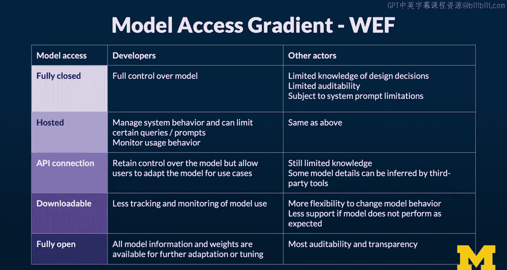
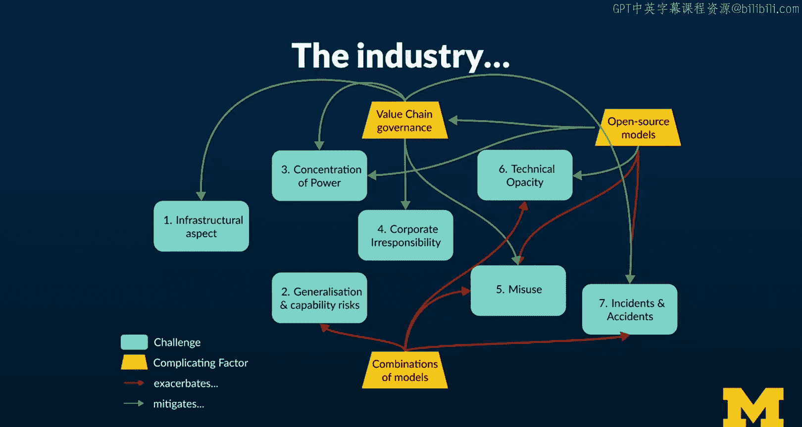
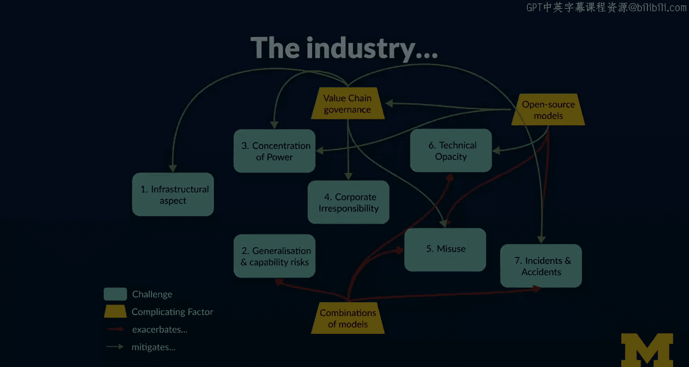

# 9：模型访问控制要素 🔐

在本节课中，我们将探讨生成式AI模型开发与应用中的一个关键决策点：访问与控制。我们将了解不同角色（开发者与使用者）面临的决策问题，并分析“黑箱”设计带来的透明度与风险挑战。

---

另一个决策点关乎模型访问。如果你是开发者，这个问题涉及你应向他人提供多少访问权限和控制权。

如果你是正在比较可用模型、为组织使用做决策的实体，问题则转变为：你需要多少信息来做出明智的决策？你是否需要调整模型行为的灵活性？你是否希望你的使用被追踪和监控？

世界经济论坛的框架为开发者和其它参与者之间不同访问与控制级别的考量提供了进一步建议。

---

在探讨这些关于访问与控制的问题时，我们也需要意识到这些系统的“黑箱”设计。

当前许多生成式AI产品是付费的。供应商选择不披露某些信息，即使他们在技术上可以做到。这造成了透明度问题，并影响了客户和用户做出明智决策的能力。

由于这些模型的规模，它们在设计上本就复杂。要理解模型为何以某种方式运行或表现出特定行为并不容易。

生成式AI系统本质上是概率性的。即使提示词保持不变，模型也可能提供不同的输出。作为机器学习系统，由于用户与系统交互的方式，模型行为也可能随时间而改变。

“黑箱”系统，无论是预测性AI还是生成式AI，都给开发者带来了另一个主要风险。当模型行为结果发生变化时，很难确定这种变化是由于系统的固有特性、数据和模型漂移，还是由于恶意攻击所致。

---

作为一种新兴技术和产业格局，决策过程还存在更多复杂因素。

其中许多因素源于一个事实：从头开始构建这些模型所需的基础设施需要巨额投资。这反过来又导致了权力集中、不透明性以及问责与控制的问题。

与企业参与者决策相关的挑战，还因误用、事故和意外事件的可能性而变得更加复杂。

---

本节课中，我们一起学习了模型访问与控制的核心要素。我们了解到，开发者需要决定开放多少权限，而使用者则需要评估所需的信息和控制级别以做出决策。同时，我们认识到“黑箱”特性带来的透明度缺失、行为不确定性以及归因困难等风险，这些都与当前产业集中化投资的背景紧密相关。理解这些要素是负责任地开发和使用生成式AI的重要基础。