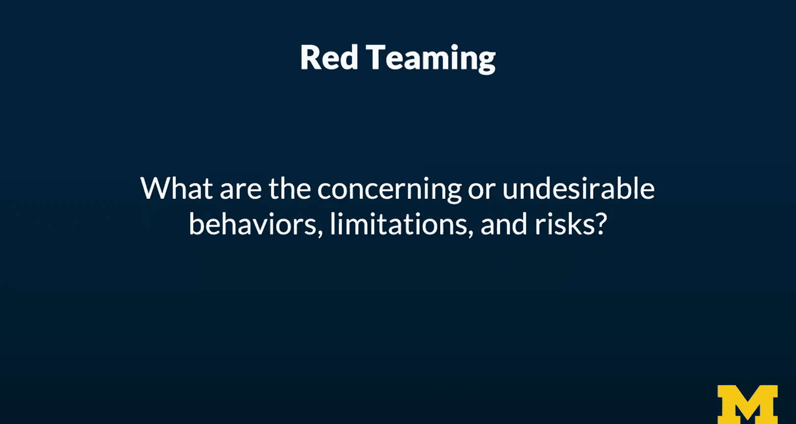
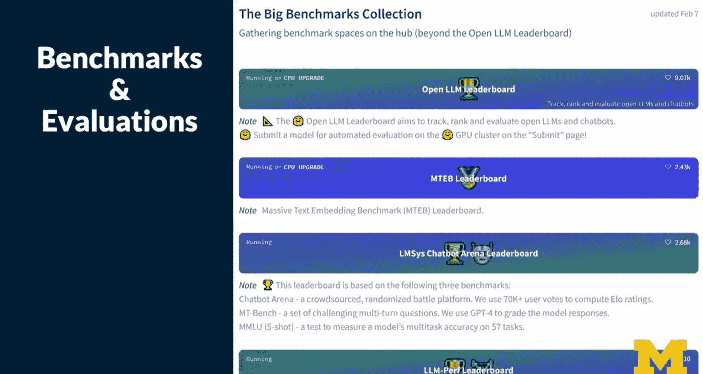
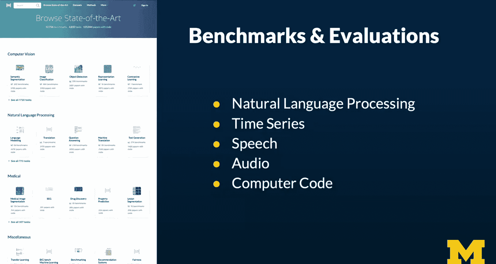
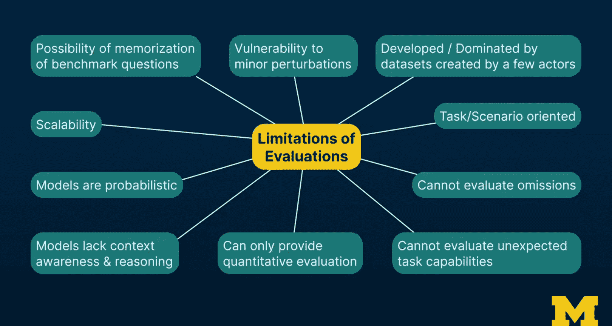
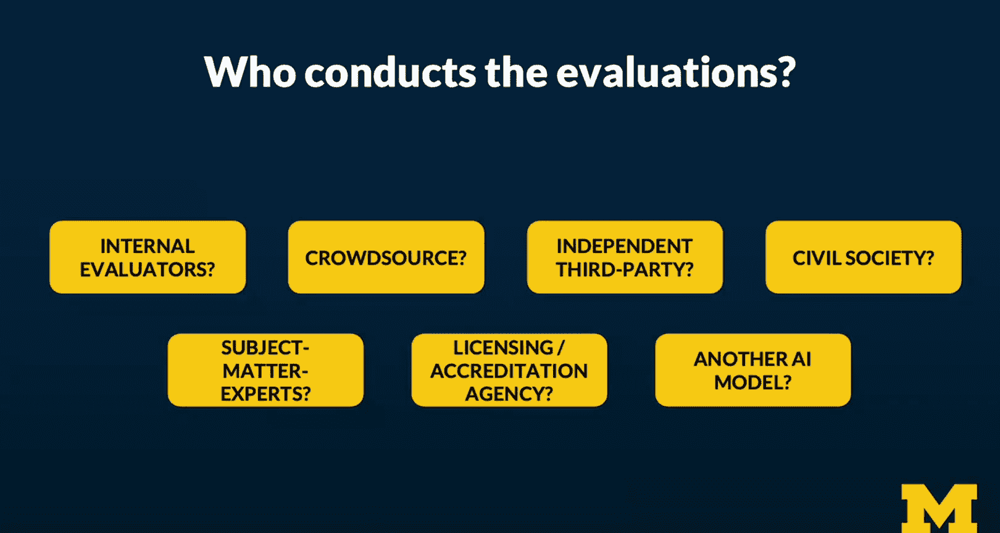

# 10：透明度考量维度

在本节课中，我们将要学习在决定开发、部署或使用生成式AI系统后，需要考虑哪些治理机制。我们将探讨贯穿模型生命周期的治理活动、红队测试、性能评估基准以及评估过程中的主观性问题。

上一节我们介绍了影响AI系统透明度的因素，本节中我们来看看为确保负责任地开发、部署和使用生成式AI系统，需要建立哪些具体的治理机制和评估方法。

## 贯穿生命周期的治理活动

组织可以考虑在生成式AI模型的整个生命周期中实施治理。在这个生命周期中，与利益相关者参与、风险管理、可解释性和文档记录相关的活动适用于每个阶段。

此外，在从开发到运营监控的每个阶段，还应考虑以下方面：
*   **训练数据集的质量**
*   **系统的性能和韧性**
*   **关于输出内容生成或合成性质的披露与标记**

在系统部署之前，组织还需要确保监控机制到位。一旦部署到真实世界环境中，系统的性能是否能够保持？如果系统连接到互联网，数据和响应质量是否会发生变化？是否有任何意外、未预见或恶意的用例出现？

所有这些治理措施确保了生成式AI系统的负责任开发、部署和使用。它们同时也是数据和AI开发的最佳实践。换句话说，这些不应被视为额外的、“锦上添花”的活动，而实际上反映了创新的质量和最佳实践。

## 红队测试方法

到目前为止，我们讨论了上述几种防护措施。另一种方法是**对生成式AI模型进行红队测试**。

红队测试是一种评估过程，通过在模型训练完成后，探测模型是否存在令人担忧或不希望出现的行为来进行。红队测试起源于军事演习和规划，其中一些人被要求像敌方一样思考。这种方法后来被网络安全专业人员采用，用于寻找漏洞。

红队测试比其他安全和治理方法吸引了更多的媒体关注。它无疑是评估的一个关键组成部分，允许来自不同专业知识和背景的人员评估系统。然而，它应仅被视为更广泛治理工具包中的一个单一工具。

以下是红队测试当前存在的一些局限性：
*   **资源密集**：与评估基准类似，红队测试需要大量资源。
*   **缺乏标准化流程**：目前没有标准或稳健的流程。
*   **可能产生错误的安全感**：红队测试是一种暴露性干预，仍需正式化和结构化。
*   **定义模糊**：关于什么算作“令人担忧的行为”的定义需要达成一致。
*   **模型访问问题**：AI模型的访问问题也需要解决。
*   **方法普适性不足**：一种红队测试方法可能不适用于所有风险领域或情境。

尽管如此，了解红队测试的益处和局限性有助于确定哪些其他治理机制可以补充这些工作。

## 性能评估与基准测试

在部署之前或整个用户操作生命周期中，您可能还需要比较系统的性能。

生成式AI系统的基准测试和性能评估仍在发展中。私营供应商、学术机构以及计量学机构都在致力于开发不同的评估方法。

对于Transformer模型，比较包括计算内存使用量以及进行训练和推理所需的时间。在输出方面，有些领域存在客观的“基本事实”，例如物理或化学，可以据此评估响应的准确性或上下文精确性。

然而，由于评估的主观性或审美性质，评估语言或图像响应的质量要困难得多。在许多情况下，如果您是一家试图评估商业产品以做出决策的企业，您最终可能会陷入被迫进行“苹果与橙子”比较的境地。

评估中的另一个复杂因素是，目前可用的大多数基准测试都是为特定任务或场景创建的，而不是为了全面评估一个系统。例如，您可以评估模型在算术任务、解决编码问题的能力或总结给定文本的准确性方面的表现。您可以评估一系列任务的组合。然而，鉴于不同的架构或训练方法，系统之间的比较更加困难。

## 当前评估的局限性

目前，评估存在一些局限性，需要随着更多研究在未来加以克服。

以下是当前评估框架的一些局限性：
*   **侧重统计元素**：一些评估框架侧重于响应的统计元素，例如计算词嵌入之间的相似度。然而，它们在识别或评估遗漏或意外的任务能力方面可能效果较差。
*   **难以扩展**：这些基准评估目前也不容易扩展，需要付出努力以确保它们能正确应用于您的模型。
*   **存在数据泄露风险**：基准测试可能存在数据泄露，模型可能记住了答案，从而使结果看起来更高。
*   **易受扰动影响**：同样，基准测试可能容易受到扰动的影响。

简而言之，不应轻视基准评估。

## 评估执行者的考量

关于评估的最后一个重要考虑是：谁为生成式AI产品执行评估。

正如我提到的，可能有许多参与者，或参与者的组合，被纳入这个过程。在缺乏标准和全面的评估方法以及强制披露要求的情况下，已经存在主观性和不透明性的因素。这个问题由于人类主观性很容易渗入过程而进一步复杂化。

例如，在比较模型结果并选择危害较小的选项反馈给训练时，人类评估者的选择可能会受到其文化、教育、专业背景的影响。一些评估者可能无法完全访问训练数据集和模型。一些内部评估者可能不一定拥有多样化的背景，从而无法考虑和评估大部分的社会影响。

---

本节课中我们一起学习了确保生成式AI系统透明和负责任的多种治理与评估机制。我们探讨了贯穿模型生命周期的治理活动、作为关键但非唯一工具的红队测试、仍在发展中的性能基准测试及其局限性，以及评估过程中难以避免的主观性因素。理解这些维度有助于组织构建更全面、有效的负责任AI治理框架。