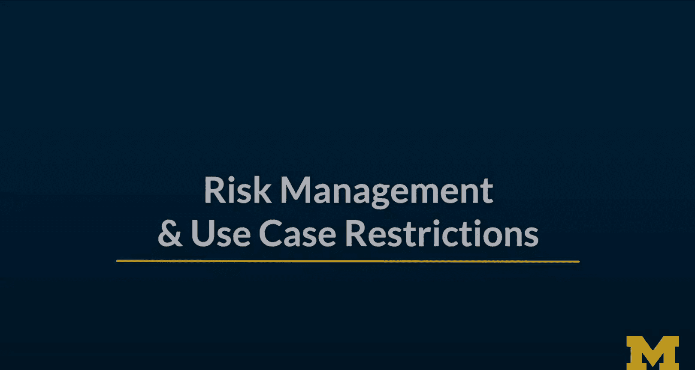
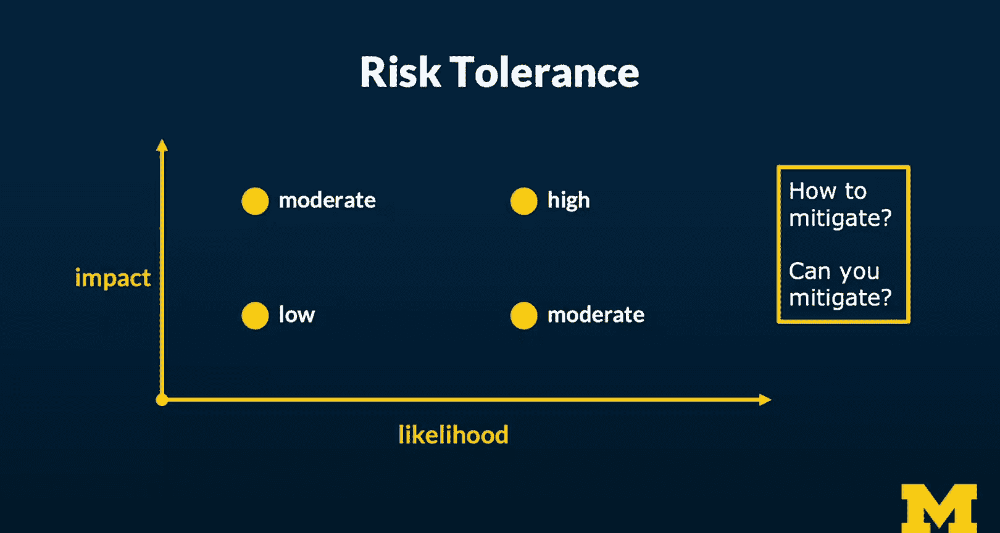
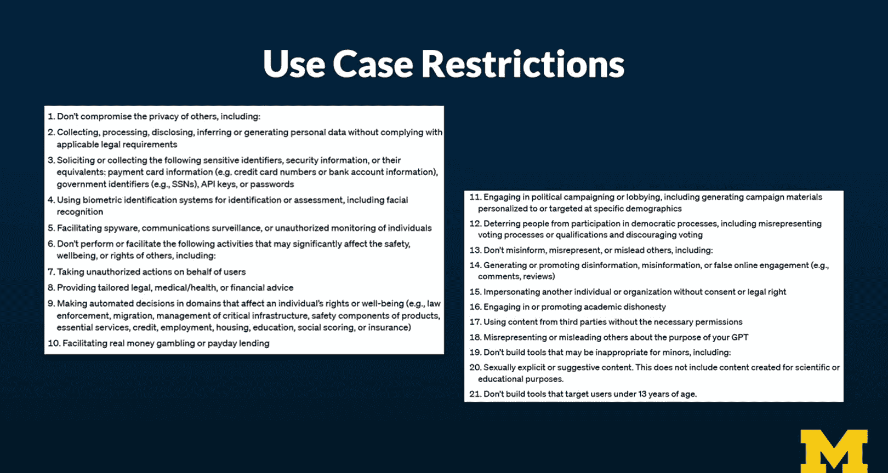

# 11：风险管理与场景限制机制 🛡️

在本节课中，我们将要学习在生成式AI的设计、开发与部署过程中，如何进行持续的风险评估，以及如何通过设定使用限制和部署策略来管理风险。我们将探讨风险容忍度的评估、限制机制的建立，以及负责任部署的关键决策。

---

上一节我们介绍了风险评估的框架，本节中我们来看看如何根据评估结果来管理风险并设定限制。

随着组织在设计、开发或部署阶段推进，会对已广泛讨论过的风险进行持续评估。

性能指标以及对所有风险的思考和检查，能让组织更好地评估其风险容忍度。某些风险发生的可能性较低，但如果真的发生，其影响可能很大。将每个风险置于特定的发生可能性和影响概率中，有助于组织优先缓解这些风险。

---

在完成风险容忍度评估后，或者由于现有法律，某些风险可能变得不可接受。

所有生成式AI产品都附带使用条款和条件。其中一些工具还附有一份不允许的使用案例清单或相关限制。尽管这些系统可能为商业和个人用户创造重大机遇，但它们也可能被用于生成有害内容或被恶意目的滥用。这些系统降低了恶意行为者从技术中获益的成本和技术知识门槛。认识到此类风险，就需要将模型的使用限制在预期用途之内。

---

当然，仅仅注明某些用例不被允许，并不能阻止许多行为者实际尝试。

因此，在部署生成式AI产品时，可能需要对某些用例进行追踪。这应伴随着明确的违规处理机制。建立边界，以便尽可能避免无意中的违规案例。

以下是可采取的额外机制：
*   为用户提供反馈机制。
*   建立客户或讨论论坛。
*   提供健全的事件报告工具。

因此，如果您希望开发一个生成式AI系统，或部署一个供个人用于不同目的的系统，您可能需要思考您的组织对哪些情况感到舒适，对哪些不舒适，以及如何监控和执行您的决策。如果您是受此类生成式AI使用影响的个人，您也可以询问相关的监控和响应机制。

---

另一方面，正如本课程系列前面许多案例所提到的，目前市场上一些大型模型本身就可能违反这些内容准则。政策制定者和法院正在试图决定是否以及如何追究其中一些大公司的责任。当大型语言模型或图像模型自身产生有毒、欺骗性、误导性或有害内容时，数据保护、隐私和企业监管机构正在就使用个人信息训练这些系统做出决策。

---

另一个商业决策是选择在内部部署模型、外部部署模型，还是两者结合，以及选择分阶段部署还是全面部署。

当然，内部部署与外部部署很大程度上取决于具体用例。在流程最初阶段确定的价值主张可能已经推动了这一决策。然而，组织可能会先与少数部门进行试点部署，然后再全面铺开。

同样，即使一个生成式AI系统是用于外部用例，组织也可能选择分阶段部署，即先在内部使用该系统，与利益相关者合作完善系统，然后再决定全面外部部署的方法。

---

负责任意味着我们应该有意识地决定如何开发和部署系统，避免陷入技术解决方案的陷阱。换句话说，仅仅因为我们有能力部署，并不意味着我们就应该部署。

有时，组织风险评估的结果可能导致需要采取关键行动。负责任的生成式AI意味着，如果对安全、安保和人权的风险无法缓解，则不应部署系统。如果我们部署的系统出现了新的安全、安保和人权风险，且此风险无法缓解，那么负责任也意味着终止该系统。

---

本节课中我们一起学习了风险管理与场景限制机制。我们了解到，持续的风险评估和容忍度分析是基础，而通过明确的条款、监控和反馈机制来限制使用场景是必要的风险控制手段。此外，负责任的部署决策，包括内部/外部、分阶段/全面部署的选择，以及当风险无法缓解时终止系统的决心，都是构建可信、可靠生成式AI生态系统的关键组成部分。