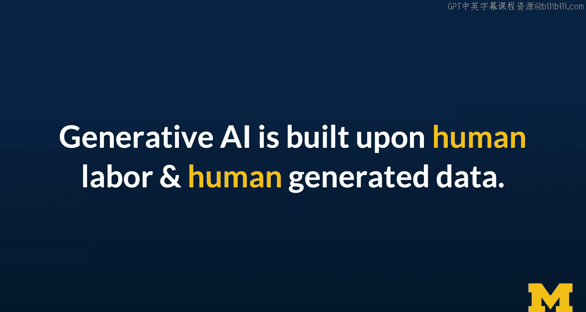
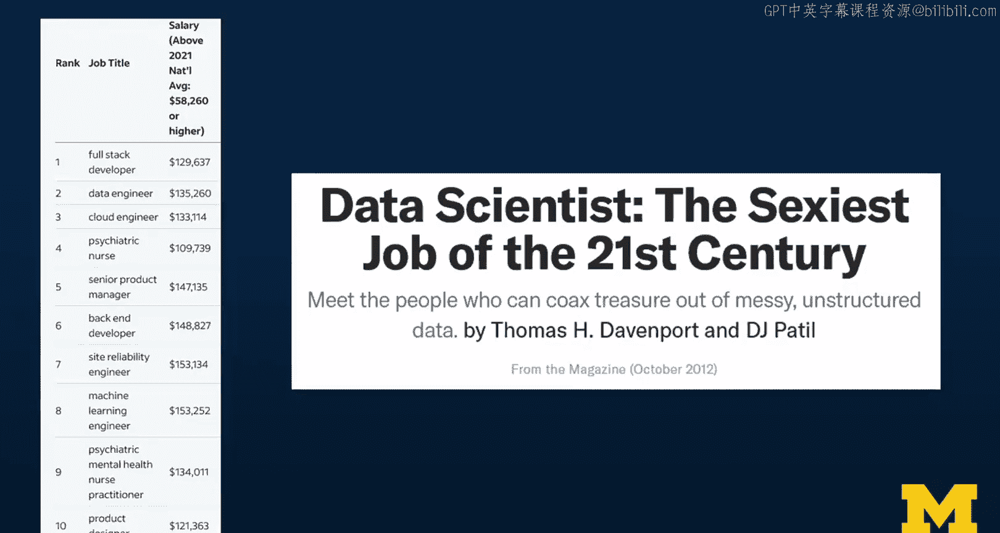

# 12：生成式AI的隐性劳动力 👥

在本节课中，我们将探讨生成式AI系统背后一个常被忽视的关键组成部分：人类劳动。我们将了解这些系统不仅依赖于算法和数据，更依赖于大量、分散且往往被低估的人力工作。

生成式AI是一项令人兴奋的新兴技术，它为各种应用场景创造了众多机会和可能性。与任何其他算法系统一样，生成式AI的能力和性能也依赖于数据。

然而，可以认为，生成式AI比预测性AI系统更加依赖于人类劳动和人类生成的数据。

## 数据来源：系统的根基

上一节我们提到了数据的重要性，本节中我们来看看这些数据的来源。即使在新的生成式AI系统被构思和开发之前，数据就已经由数百万人创造出来了。

以下是构成AI系统训练数据基础的主要人类劳动成果：
*   作者和专利持有者的作品。
*   个人博主和内容创作者的产出。
*   记者和学者的文章。
*   艺术家的创作。
*   甚至数百万人的社交媒体帖子都被抓取来为这些系统提供动力。

在之前的课程中，我们讨论了版权考量问题。现有法规的解释和新政策的制定将决定版权和知识产权的未来。我们也将看到更多合成生成的数据被纳入训练数据集。

然而，人类生成的数据凭借其多样性、适应性和边缘案例，将始终是这些系统的根基。

## 显性劳动：系统开发与部署

一旦萌生开发并部署一个生成式AI系统的想法，过程中当然会投入大量的人类劳动。

从构思系统到设计模型架构，再到创建数据结构和接口，以及对这些系统进行评估、监控和管理，这些都是当今劳动力市场中更受关注和获得更高报酬的任务。

大约十多年前，《哈佛商业评论》曾将数据科学家称为21世纪最性感的职业。快进到现在，与数据和AI相关的职位头衔，在招聘报告中占据了最佳工作的主体。

与此同时，美国劳工统计局预测，此类职位的增长速度将远快于所有其他职业。

## 隐性劳动：数据准备与质量保障

然而，人类劳动并未止步于此。仍然需要有人来执行以下关键但常被忽视的任务。

以下是支撑AI系统运行却常被低估的“隐性”工作：
*   聚合数据集。
*   进行质量增强。
*   标注数据。
*   测试和审核产品。
*   向开发团队和客户提供反馈与支持。

这些才是我们真正要讨论的任务，因为从事这些工作的人，在很大程度上是**隐形**的、**分散**的且**未被充分重视**的。

在IBM最近一项针对28个国家、跨越三个行业的3000多位CEO的调查中，围绕数据来源或数据倾向性的担忧被列为采用生成式AI的最大障碍，其次是对数据安全的担忧。

没有数据，AI就不存在。没有高质量的数据和稳健的数据质量控制，我们的生成式系统将更容易产生**有偏见**、**有害**或**有毒**的结果。

AWS首席数据官议程的另一份调查报告同样将数据质量列为采用生成式AI系统的最大挑战。然而，我们对待这些数据劳工的方式，与对待供应链中其他人员的方式并不相同，甚至相差甚远。

## 幽灵工作：被低估的贡献

这些任务通常是**重复性**的、**手工**的且**劳动密集型**的。劳工可能是在用关键词标记视频、捕捉图像、分析文本情感或转录音频。工作内容可能涉及监控数据集中已有的或用户提交的**有毒**、**暴力**或**非法**内容。这些数据标注员也在模型训练前帮助标记此类内容。

他们为CEO们所担忧的数据质量做出了重大贡献。这是至关重要的工作。例如，**准确标注的数据**有助于机器学习模型更精确地从数据集中学习。**高质量的标注**有助于减少偏见。同样，**人类反馈的调用**有助于实现这些模型的**对齐**目标。

然而，这项工作被外包，且报酬低廉。劳动力市场将前一类任务（如开发数据和模型的架构与结构）归类为**知识工作**，而这些基础任务在文献中则被视为**体力劳动**，也被称为**点击工作**。这些数据工作者所需的语言知识、文化背景和地方性知识虽然必要，却未得到相应的回报。

事实上，尽管生成式AI承诺提高任务效率并减少枯燥工作，但在系统的开发和维护中，实际投入了**大量**此类人类劳动。

“**幽灵工作**”一词由人类学家玛丽·L·格雷和计算机科学家西达尔特·苏里首次提出，它强调了这些系统所依赖的、**隐形**、**被低估**且**报酬不足**的劳动。同样，萨拉·罗伯茨教授对商业内容审核行业进行的广泛人种学研究，揭示了屏幕背后匿名且不为人知的工作者的劳动。

罗伯茨教授提出了我们在上一门课程中问过的类似问题，例如需要编纂、处理用户创建的某些内容被允许保留而其他内容被移除的流程。谁做出这些决定？如何做出？对谁有利？

通过用关键词对视频、图像或文本进行**标注**或**标记**，这些劳动者处理原始信息，并**提高了AI系统的准确性**。

本节课中，我们一起学习了生成式AI系统背后庞大而复杂的人类劳动生态。我们区分了备受瞩目的“显性”知识工作与常被忽视的“隐性”数据准备工作。理解“幽灵工作”的存在及其重要性，是负责任地开发、部署和评估生成式AI的关键一步，它提醒我们关注技术光环之下那些不可或缺的人类贡献与代价。