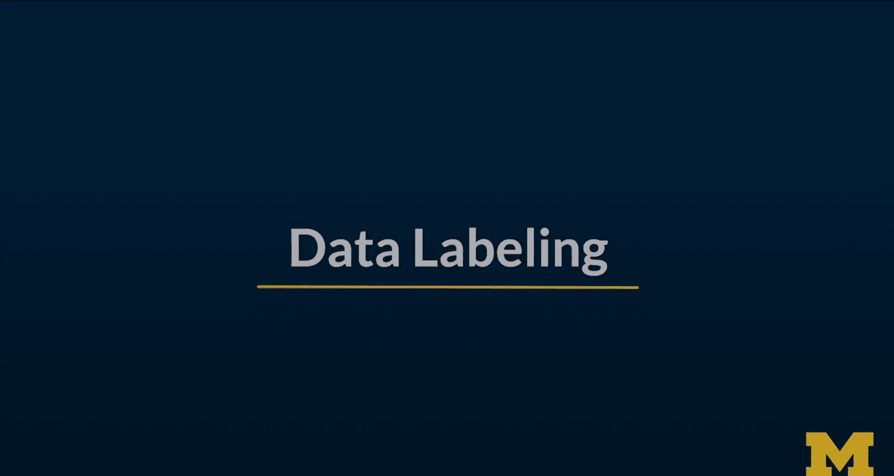
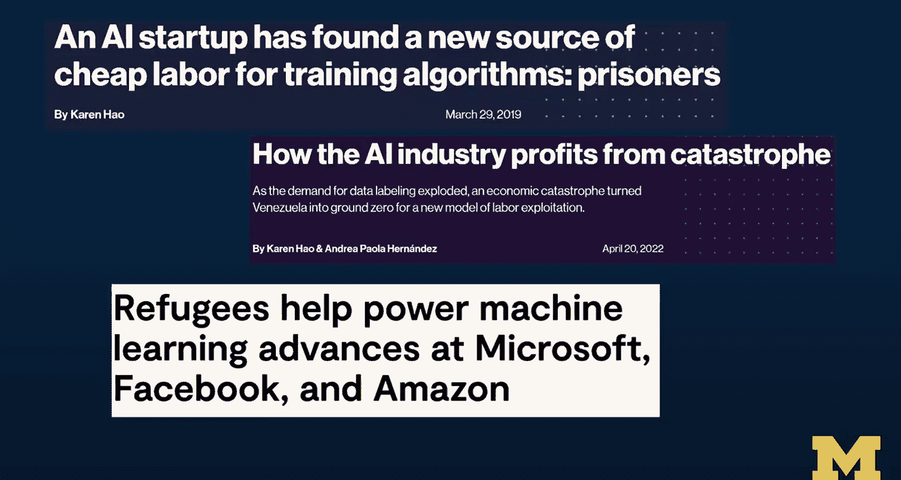

# 1：数据标注流程 👷‍♀️📝

在本节中，我们将探讨生成式AI系统背后一个常被忽视但至关重要的环节：数据标注流程。我们将了解为何即使在“无监督”学习系统中，人类劳动依然不可或缺，以及这一流程背后所涉及的伦理与劳工问题。

上一节我们介绍了生成式AI系统的局限性，本节中我们来看看为了弥补这些不足，业界采取了何种措施。

生成式AI等无监督机器学习模型，能够从未标注的数据中发现模式和关系，无需明确的指导或编码指令。

然而，这并不意味着人类的标注、反馈或审核工作会完全消失。

在每个主要产品的背后，仍有成千上万的工作人员，他们的工作使产品更安全、更可用。

以下是数据标注工作可能涵盖的范围：

*   **自动驾驶领域**：为视频标注骑行者、行人、移动设备、车辆或障碍物。
*   **内容审核领域**：为暴力内容、仇恨言论、创伤性内容进行数据注释。
*   **情感分析领域**：判断一段音频对话中的情感倾向。

如今，由于调查记者和举报人的工作，我们更多地了解到标注员和内容审核员所面临的非理想工作条件及其承受的心理创伤。

在全球范围内，这些工作者通常过度劳累、薪酬过低，并且由于持续接触令人不安的材料而长期承受压力。

AI系统的脆弱性也使得这种必要但不光鲜的人力劳动成为必需。尤其是在以语言为基础的应用中。尽管这些模型的训练数据集非常庞大，但它们仍可能遇到数据集中未包含的数据或词汇。

在之前的课程中，我们讨论了生成式AI系统在语言多样性方面的局限性。

当模型无法很好地泛化到其未训练过的查询或词汇时，人类可能不得不介入干预。几年前，我们在语音助手领域首次看到了此类干预的公开案例。

当时有大量工作人员参与监听用户在家中、学校或工作中可能使用的设备录音。公司为其行为辩护，称需要将音频片段交由人类转录，用于模型训练。

一家公司指出，其承包商仅听取了所有录音的 **0.2%**。

若按全球每日使用量推算，这仍意味着需要极其庞大的劳动力。

撇开所有隐私和数据保护问题不谈，此类行为揭示了系统的脆弱性，以及无法完全依赖自动化手段来标注数据或审核内容。

众包平台和供应商为AI公司提供所需的劳动力。一些人认为，这些公司在就业机会稀缺或没有机会的地方提供了工作可能性。

这些劳动力的来源甚至延伸至监狱、难民营或处于经济灾难中的国家。

另一些人则认为，这些做法是对劳动力和数据的剥削。

在大多数情况下，这些工作不附带劳工权利、工作保障，甚至在数据标注或审核方面，薪酬也往往达不到最低工资标准。

这类工作可能需要审核仇恨言论，甚至涉及虐待儿童、强奸、谋杀或其他暴力活动的描绘，这给劳动者带来了严重的心理创伤。

然而，这类工作通常不提供有意义的健康支持。

本节课中，我们一起学习了数据标注流程在生成式AI系统中的关键作用及其背后的复杂现实。我们了解到，尽管AI技术追求自动化，但人类的介入对于处理边缘案例、审核有害内容、提升模型表现仍然必不可少。然而，这一流程也暴露了严重的伦理问题，包括劳动者的心理健康、工作条件、薪酬公平性与数据隐私。认识到这些“隐形”劳动的存在及其代价，是迈向负责任AI的重要一步。