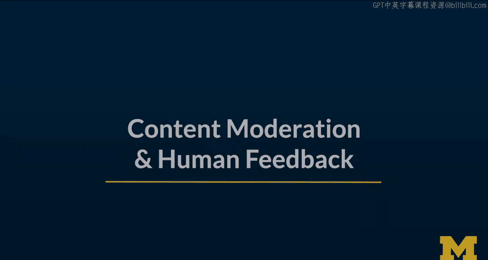
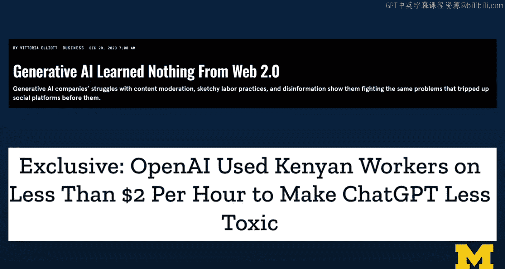
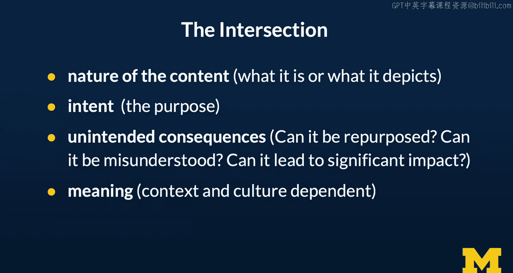
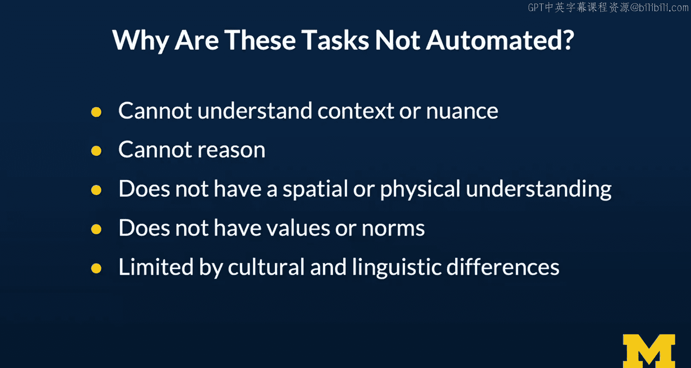
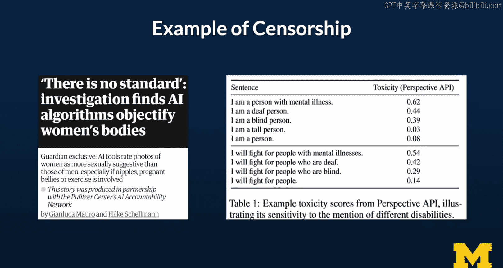
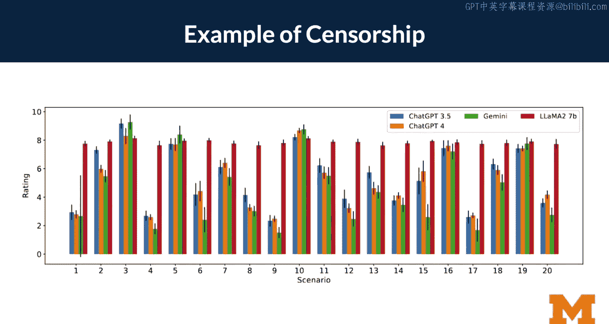
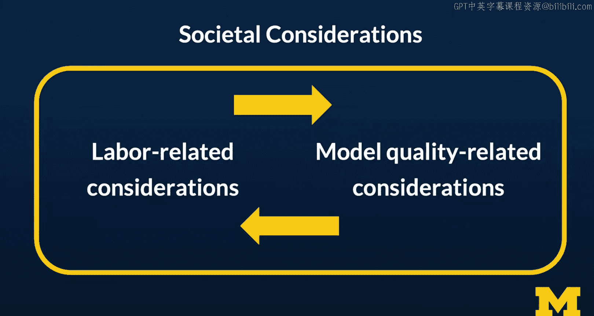
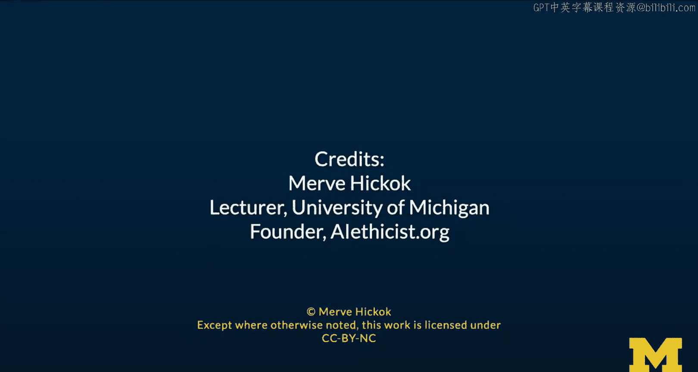

# 负责任生成式AI简介：2：内容审核与人工反馈机制 📝

在本节课中，我们将要学习生成式AI系统中的内容审核与人工反馈机制。我们将探讨AI如何使内容审核工作复杂化，以及为什么在AI时代，人类劳动和监督仍然不可或缺。我们还将分析当前自动化审核技术的局限性，以及这些因素如何共同影响模型质量和社会。

---

## 概述：生成式AI带来的审核挑战

生成式AI系统为制造有害内容提供了更简便的途径，这使得社交媒体公司和内容审核员的工作变得更加复杂。

社交媒体审核领域的管理实践仍不透明，其商业决策的影响波及全球众多社群。尽管公司也利用AI系统进行自动标记、自动检测和自动过滤，但对人类劳动和监督的需求始终存在。

## 人工审核的劳动实践

以下是当前人工审核劳动实践的几个关键点：

*   **低成本外包**：此类劳动通常以每小时1至2美元的价格外包。
*   **保密协议**：数据标注员和内容审核员通常需要签署保密协议，并被警告不得谈论其工作内容。
*   **孤立的工作环境**：他们远程工作，在地理和物理上与同事及其共享经验隔绝。
*   **信息不透明**：这些工作者通常不了解他们所贡献产品的具体细节。他们不清楚自己的工作是在帮助提高监控或武器系统的精确度，还是在优化语言模型以更好地回应人类，亦或是在改进自动驾驶系统以避免碰撞和伤亡。

上一节我们介绍了生成式AI带来的审核挑战，本节中我们来看看生成式AI公司自身面临的类似问题。

## 生成式AI公司面临的审核与反馈需求

生成式AI公司在内容的多样性和规模方面，面临着与社交媒体公司相同的挑战。这些都是目前没有简单答案的技术难题。

然而，劳动实践是商业选择。目前，生成式AI的数据劳动选择与社交媒体公司并无不同。

如前所述，向模型提供人工反馈的需求同样巨大，这样系统才能区分相关和不相关的回应。生成式AI模型仍然需要人类来帮助比较、纠正和调整其回应，以实现更好的对齐。当然，对于受限使用场景，持续的审核和提示词响应也是必要的。

## 内容审核在AI生命周期中的角色

我们可以将罗伯茨教授对内容审核的解释，推及到生成式AI生命周期中的数据标注、反馈和审核任务。

换句话说，这些任务处于语言内容的**本质、意图、后果和意义**的交汇点。无论是正确理解用户的提示，还是向用户提供相关的回应，生成式AI在这个交汇点上的可靠表现都存在局限性。

## 生成式AI的技术局限性

生成式AI系统拥有长达数千个标记的上下文窗口。这意味着，在任何给定时间，它们在回应提示时可以考虑相当于数十页文本的内容。得益于更宽的上下文，AI系统可能正确解读提示的语境。

或者，其解读可能取决于训练数据集中相关内容的出现频率。

你可能会问，为什么我们不能用AI来自动化这些需要大量人力的任务？这是因为生成式AI系统的技术和根本局限性，都体现在这些任务中。

作为一个统计系统，生成式AI模型无法理解语境或细微差别，也无法独立推理经验。即使拥有长上下文窗口，随着对话的推进，模型也可能会忘记最初的指令，转而开始关注对话的后半部分。其回应在大部分情况下可能听起来连贯且符合语境。然而，如果你想使用讽刺、比喻性语言，如反讽、修辞或象征性引用，语言模型可能无法理解其深层含义或意图。或者，如果你沿着这些思路转换对话，模型可能无法捕捉到对话的转变。通过更多的提示，模型可能会纠正其后续回应。但如果未被发现，最初的不准确之处（即“幻觉”）可能会引发问题。

由于文化和语言差异，自动化手段可能无法完全有效地正确检测、识别和标注数据。

## 自动化审核的缺陷与影响

这个问题反过来会降低系统性能。在内容审核方面，它也可能导致非预期的审查和歧视。

自动化内容审核通过**哈希匹配、AI分类器和过滤机制**进行。这些机制使公司能够大规模、高效率地进行这项工作。然而，如前所述，这些方法并非没有错误。

例如，图像模型可能将医学检查或孕妇腹部的照片归类为本质上的露骨色情或明确裸露。而语言模型可能将使用“盲人”或“聋人”等词来表达自身身份的人标记为使用仇恨言论，或者将使用某些LGBTQ词汇叙述自身经历的人标记为“有毒”。

换句话说，这些算法可能将表达自我的人等同于从事仇恨言论的人，并拒绝回应他们的提示，甚至审查他们的参与。

使用大语言模型进行的自动情感分析和审查，在不同语言间也可能不一致。研究人员发现，当前模型在评估相同提示时存在差异。这项研究还表明，同一个模型可能对同一文本在不同语言中的评估结果不同。

在这项特定研究中，研究人员向这四个模型提供了20段不同的文本，描述了各种场景，反映了不同的情感。模型被要求用10种不同的语言处理相同的文本。虽然模型常常无法识别反讽或讽刺，但有些模型如果用德语、波兰语和俄语，会对同一场景做出更积极的评估；反之，如果用法语、意大利语和日语，则会做出更消极的评估。

模型会更新，训练数据也会随时间变化。然而，重要的是要承认这种不一致性可能持续存在，并理解这些差异背后的原因。

## 总结：劳动问题与模型质量的交织

总而言之，理解劳动问题和模型质量问题相互交织至关重要。

无论我们讨论的是系统开发还是已部署的系统，劳动和模型质量问题都相互影响。在宏观层面，这也可能引发关于社会和劳动力市场影响的进一步问题。

人们可能认为将数据工作外包给点击工人只是一个组织内部的成本决策。然而，大规模来看，这实际上可能随着时间的推移产生滚雪球效应。

---

本节课中我们一起学习了生成式AI时代内容审核的复杂性、人工反馈的必要性，以及自动化审核技术的局限性。我们认识到，劳动实践的选择与AI模型的质量紧密相连，共同塑造着技术的社会影响。理解这些交织的问题，是迈向负责任AI的重要一步。