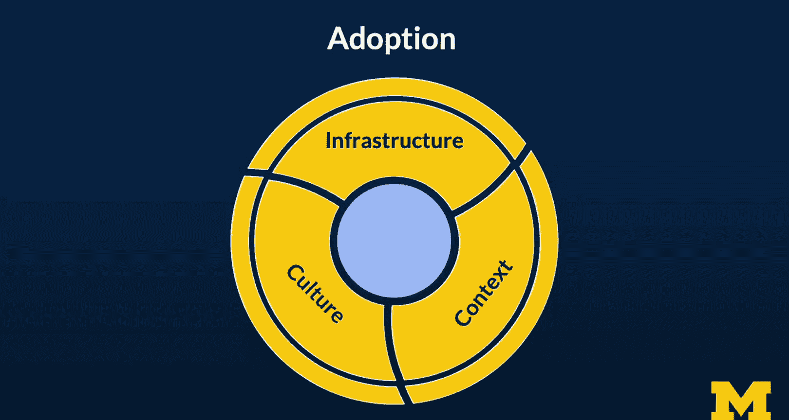
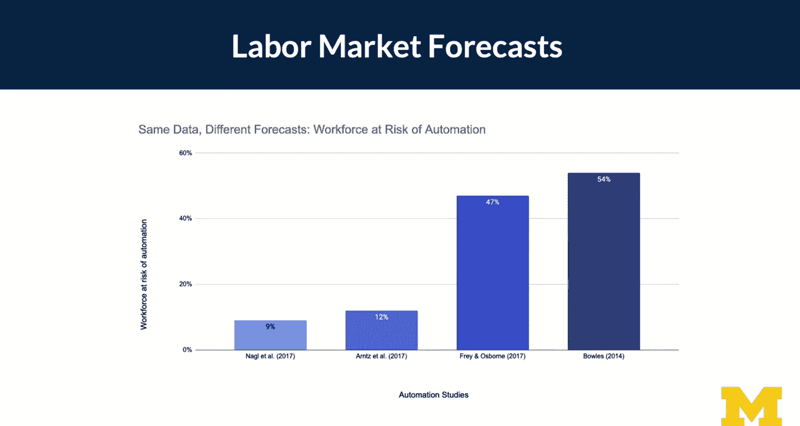
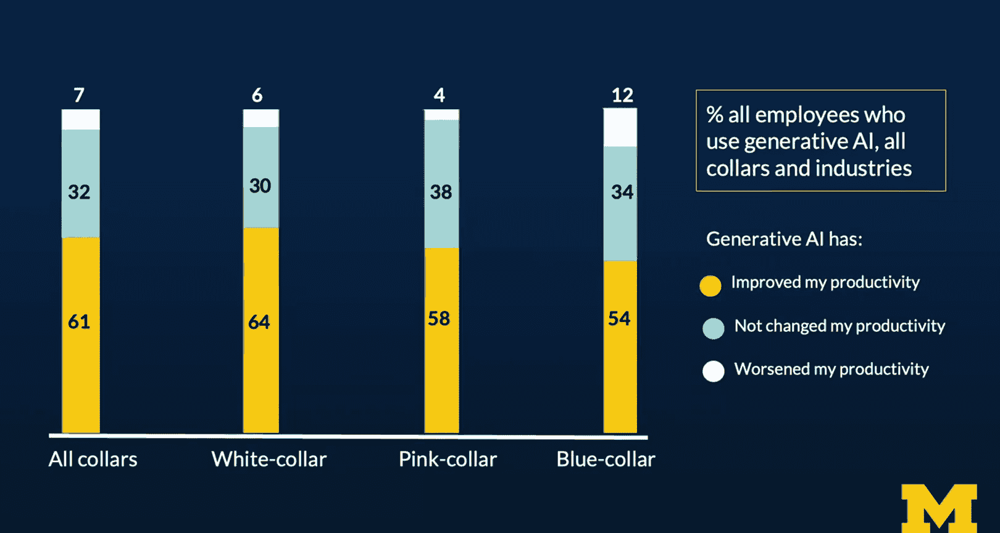

# 负责任生成式AI简介：3：劳动力市场预测模型 📊

在本节课中，我们将探讨生成式AI对全球劳动力市场的潜在影响，分析不同预测模型的结果，并理解影响这些预测的关键因素。

---

我们知道，随着AI和生成式AI工具的进一步成熟以及企业对这些产品的采用，新兴技术将对工作的未来产生持久影响。同样重要的是要注意，每个国家对生成式AI的应对将取决于其基础设施、文化和具体情境。

## 基础设施与文化的影响

上一节我们提到了技术发展的宏观趋势，本节中我们来看看具体的社会经济因素如何塑造AI的应用前景。

在基础设施方面，不同行业和国家以不同的速度和出于不同的用例采用这些技术。公共和私营部门都需要投资于基础设施和人才以适应AI。必要的资本投入、组织重组和技术成熟都需要时间。考虑到收入水平的差异，某些国家的采用速度可能更快。

文化差异也将影响未来的可能性。每个社会对知识和劳动的重视程度不同。一个文化可能珍视专业知识和质量，而另一个则可能优先考虑产量和效率。被认为更有价值的工作类型会影响每种文化中哪些任务更容易受到生成式AI的影响。

以下是影响AI采用的关键文化与社会因素：
*   **人口结构**：在老龄化社会，生成式AI可能被用来弥补劳动力短缺；或者，由于老龄人口比例较高，AI的采用可能不会那么快。
*   **对技术的态度与信任**：特定文化中对技术的态度和信任度，可能会阻止组织将某些任务委托给生成式AI。
*   **具体情境**：高风险领域或需要人际互动的职业，也可能有不同的适应水平。

例如，我们可能无法接受生成式AI从医生、建筑师、法官手中接管高风险任务。或者，你可能不希望教育完全由AI导师来进行。简而言之，全球各地将以不同的方式和速度感受到其影响。

## 劳动力市场预测的挑战

在过去的十年里，我们已经看到了许多关于劳动力市场未来的分析，预测机器人技术、业务流程自动化、AI以及最近的生成式AI的影响。尽管使用相似或有时相同的数据，这些预测在失业率估计值上差异巨大。

一项牛津互联网研究所的研究显示，估计值范围从近10%到超过一半的劳动力人口被认为面临技术性失业的风险。这表明，评估技术的影响是出了名的困难。

当然，鉴于其出现时间较短，预测影响存在困难并不意味着没有预测。尽管生成式AI是一项相对较新的技术，我们没有足够的数据来做出结论性的预测，但目前已有一些劳动力市场和经济价值预测可供参考。

## 现有预测模型概览

以下是当前一些主要的预测数据：
*   **高估预测**：一些预测认为，未来三年内超过40%的职业可能受到生成式AI影响，或估计有3亿个工作岗位面临自动化风险。
*   **对比预测**：另一些预测显示，在美国，因生成式AI而流失的工作岗位比例将低于受通用AI影响的比例。
*   **经济价值预测**：
    *   埃森哲估计，到2038年，生成式AI将创造**10.3万亿美元**的额外经济价值。
    *   麦肯锡估计，在他们分析的客户运营、市场营销与销售、软件工程和研发等用例中，生成式AI每年可增加相当于**2.6万亿至4.4万亿美元**的价值。
    *   高盛预测，全球GDP将增加近**7万亿美元**，并在十年内将生产率提高**1.5个百分点**。

经济价值被预测为如此高的数字，是因为通用生成式AI被认为提供了创造新商业机会的工具和方法。无论你是用它来创建自己的内容，还是在现有的生成式AI模型上构建可以出售的产品，都存在着许多新的可能性。

## 生成式AI影响的广泛性

与之前对蓝领和制造业工作影响较大的技术相比，生成式AI有潜力在每个行业和几乎每个工作类别中实施。这意味着白领和粉领工作者现在也进入了视野。

生成式AI在白领工作者中的采用率更高，这也意味着未来这些工作者可能更多地感受到自动化或增强的影响。虽然推理、团队管理、危机应对、复杂决策、情商或任何需要人类伦理判断的任务超出了生成式AI的范围，但这项技术有望在不同行业中提高更多可量化任务的生产率。

## 态度调查数据

奥纬咨询定期在20个国家进行调查，收集关于生成式AI态度的数据。调查结果显示，虽然生成式AI对生产率的影响并非100%积极，但这已是一个充满希望的开端。

---

本节课中我们一起学习了生成式AI对劳动力市场影响的复杂性。我们看到，其影响程度和速度受到基础设施、文化、人口结构等多重因素的制约。尽管各种预测模型给出的数据差异很大，但普遍共识是生成式AI将创造巨大的经济价值，并广泛影响包括白领在内的各类职业。理解这些预测及其背后的假设，对于负责任地规划和应对未来的工作变革至关重要。