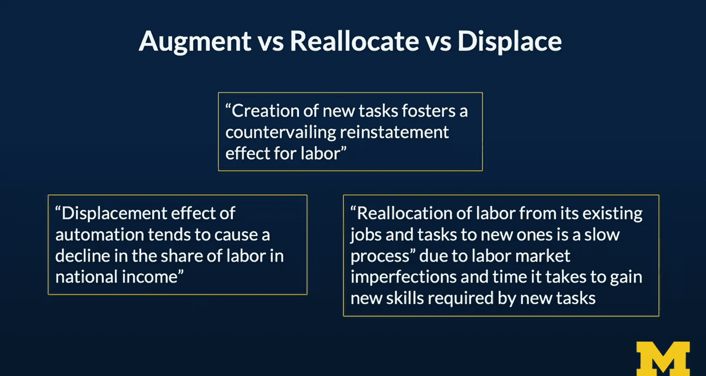
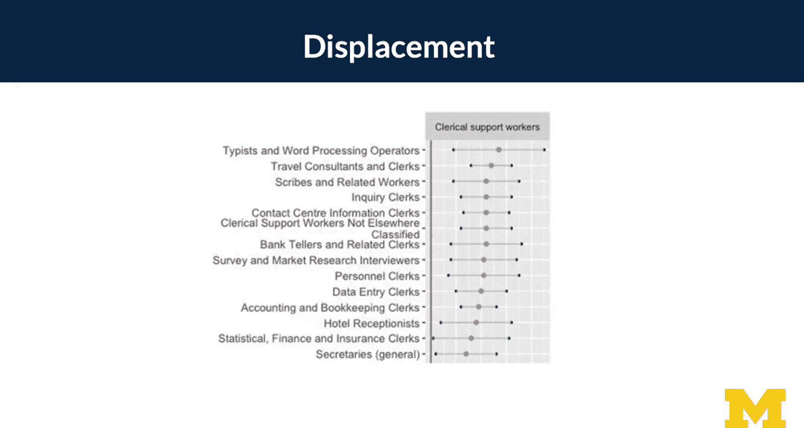
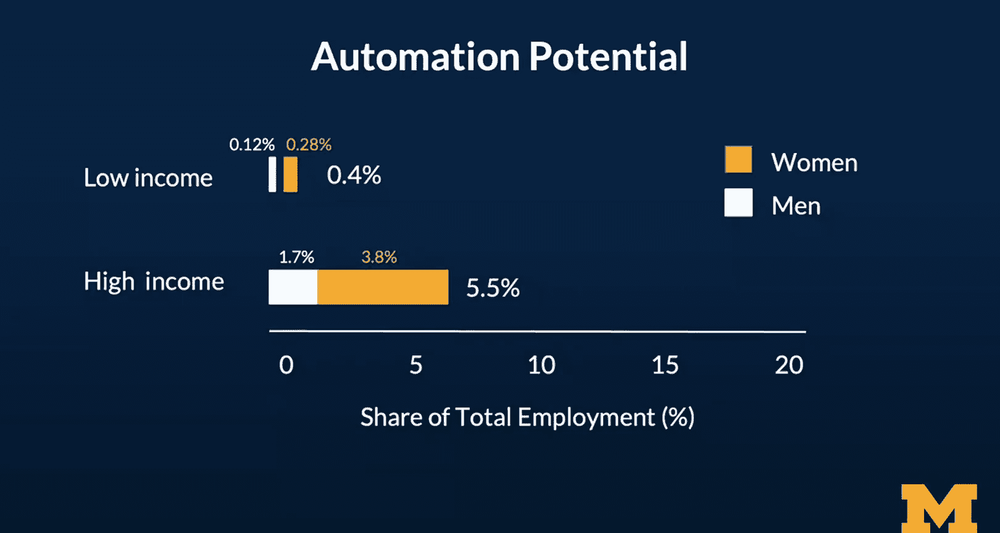
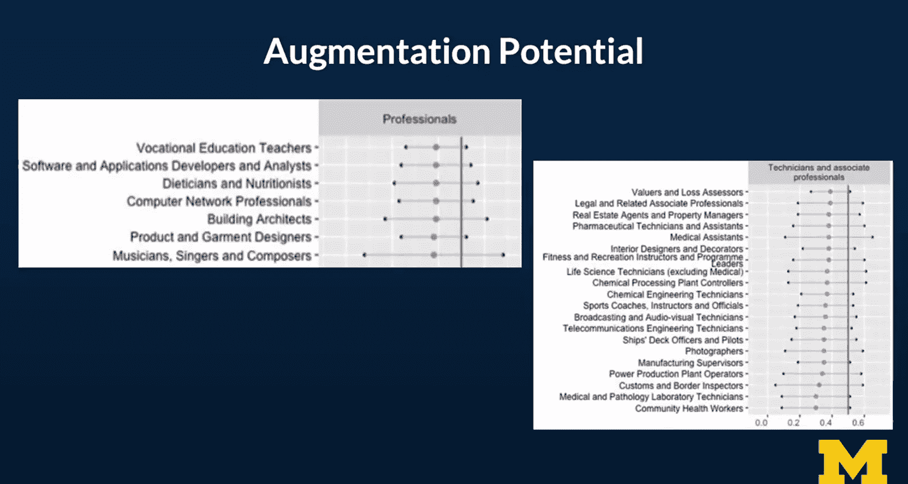
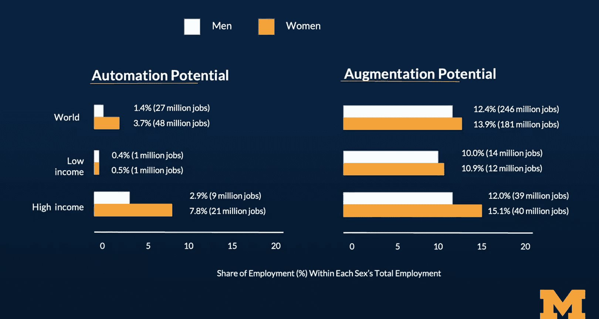
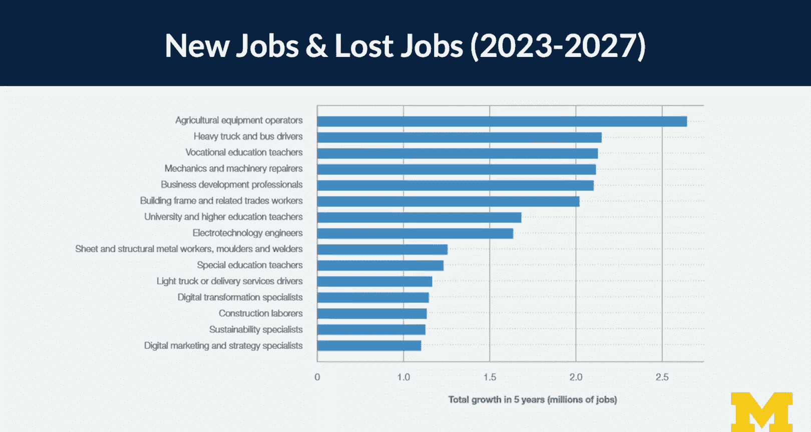
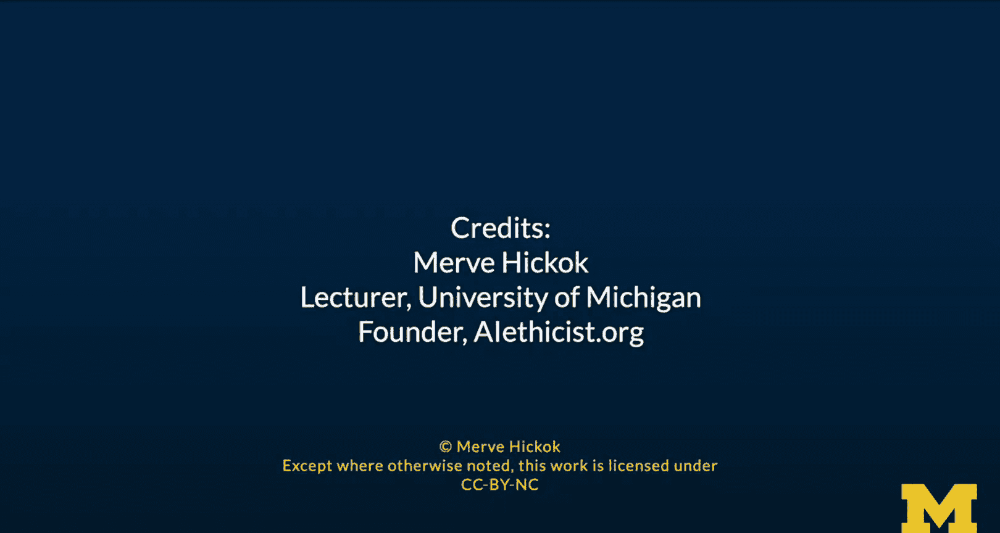

# 4：增强与重组替代战略

## 概述
在本节课中，我们将要学习如何评估生成式AI对工作岗位的影响。我们将了解到，分析AI的影响不应仅停留在职业名称层面，而应深入到具体任务层面。我们将探讨AI带来的两种主要影响：**任务自动化**（可能导致岗位被取代）和**任务增强**（帮助人类更好地工作），并分析这些影响在不同职业、性别和国家间的差异。

---

## 从职业到任务：分析AI影响的核心视角

当评估生成式AI对工作的影响时，在**任务层面**进行分析被认为更为有效。我们需要理解一项任务对生成式AI的**暴露程度**或**敏感度**，而不是仅仅关注某个特定的职业头衔。

一个人的工作可能涉及数十项任务，这些任务需要不同的技能组合。其中一些任务可能借助生成式AI更容易完成，而对另一些任务而言，这项技术在短期内可能并不相关。

在本系列课程的第一部分，我们详细讨论了生成式AI可以用于的不同类型的任务，无论是语言、音频、视频、图像还是编码任务。

---

## 国际劳工组织的分析

以下是国际劳工组织（ILO）一份报告的核心发现，该报告审查了数百种职业中的任务，并按职业类别识别了具有中高生成式AI暴露风险的任务。

*   根据分析，**文职支持、服务和销售类岗位**所包含的任务具有较高的暴露风险。
*   著名经济学家阿西莫格鲁和帕斯夸尔·雷斯特雷波认为，自动化导致的劳动力替代往往会造成**劳动力在国民收入中所占份额的普遍下降**。
*   然而，这种下降在一定程度上会被**新任务的创造**所抵消。
*   不过，由于劳动力市场的复杂性，这种重新配置可能缓慢且痛苦。这包括：
    *   掌握新任务所需技能的时间。
    *   寻找和获得一份新工作的时间。
    *   以及教育机构对劳动力市场变化做出反应通常所需的时间。

---

## 完全替代 vs. 任务重组

上一节我们讨论了任务层面的分析，本节中我们来看看AI对工作的具体影响形式。

**完全替代**指的是特定工作中的人力因素被完全取代。这意味着技术拥有充分的能力和容量来取代现有模式，并且组织可以全面部署它。

让我们暂时搁置技术能力问题，同时也搁置这样一个事实：在某些情况下，风险和商业考量可能仍然要求企业对生成式AI的输出进行人工监督。

仍然存在**可负担性、当地劳动力条件和社会决定因素**等要素，这些都会影响劳动力的替代。从这个意义上说，你可能很少看到一个职业头衔被完全取代。

相反，更常见的情况是，企业利用生成式AI执行某些任务，并将节省下来的时间重新分配到其他工作上。国际劳工组织的分析也表明，文职类岗位更容易受到生成式AI带来的**任务自动化和替代**的影响。

---

## 影响的性别差异

值得注意的是，生成式AI带来的任务自动化和替代，预计对**女性劳动者**的影响将显著大于男性。

这是由于女性在此类工作岗位中占比较高。无论国家收入水平如何，女性受到的影响预计几乎是男性的两倍以上。

---

## 任务的增强效应

与替代效应相反，**专业职业**或**技术人员、机器操作员**的任务则更多地暴露于生成式AI的**增强**效应之下。

这些职业有更多任务可以让工作者使用生成式AI来帮助完成任务，为其工作内容提供信息，或以更高效的方式为他们提供信息访问途径。

同样，具有高增强潜力的工作岗位比例在女性中也高于男性。

---

## 宏观层面的国家差异

在宏观层面，**高收入国家**预计将受到生成式AI自动化潜力的显著更大影响。

无论工作岗位位于低收入还是高收入国家，也无论其具有高自动化潜力还是高增强潜力，女性劳动力预计受到的影响都显著大于男性。

---

## 影响差异的重要性

这种差异非常重要，因为**性别鸿沟、工作机会获取以及性别工资差距**已经是影响几乎所有国家的严重问题。

---

## 劳动者的感知与不易被替代的工作

在劳动者的感知方面，**粉领工作者**（通常指从事护理、服务等行业的女性）对生成式AI使其工作变得多余或任务被完全自动化的担忧较少。

同样，那些需要**人际互动、细致判断、情商和危机管理**的工作，例如医疗保健、教育、航空、执法等领域，都被认为不太容易导致人力被取代。

---

## 技术变革与劳动力市场的长期动态

然而，正如技术可以增强或取代某些任务一样，它们也会**创造新的任务和新的工作岗位**。

尽管在某些劳动力市场中，过渡期可能充满压力，但从长远来看，新创造的工作岗位可能会抵消变化带来的影响。经济学家大卫·奥特发现，如今60%的劳动者所从事的工作在1940年时并不存在。

劳动力市场的变化受到多种因素影响，范围从环境原因到投资、人口增长、供应链效率等等。然而，随着新技术的出现，社会总会找到新的方式来利用它们，和/或要求权力和财富分配的变革。

因此，重要的问题在于：技术变革是缩小还是扩大了社会经济的不平等与鸿沟？以及对于广大劳动者而言，工作质量是得到了改善还是恶化？换句话说，当技术在特定领域接管任务时，它是否会迫使人类劳动者转向技能要求更低、薪酬更差的工作？

---

## 未来工作岗位的创造与替代

自AI和生成式AI技术部署以来，最常被问到的问题之一就是：**哪些工作岗位将被创造，哪些将被取代？**

这是一个没有确定答案的问题。然而，展望到2027年，图表中标记为蓝色的**大量工作岗位**预计将被创造，而一些标记为紫色的岗位将被取代。列表的顶部和底部显示了作为当前全球就业数据一部分的双向变化比例。

与当前就业规模相比，一些工作岗位预计将以更高的比例增长。AI及机器学习相关工作岗位目前雇佣的人数不如其他类别多，因此其比例增长预计会更大。

然而，在同一份报告中，世界经济论坛实际上预测**绝对数量的增长**将集中在职业工作和教育领域。这些工作岗位恰好也是那些可以被增强，但较难被生成式AI系统自动化的工作。

---

## 总结

本节课中，我们一起学习了评估生成式AI对就业影响的更细致方法——即从任务层面而非职业头衔层面进行分析。我们探讨了AI带来的两种主要影响：**任务自动化**（可能导致替代）和**任务增强**，并认识到这些影响在不同性别、职业类型和国家间存在显著差异。我们了解到，虽然技术变革会替代部分任务，但也会创造新的机会，而关键在于社会如何应对这些变化，以确保技术进步能够促进更公平、更高质量的就业环境。