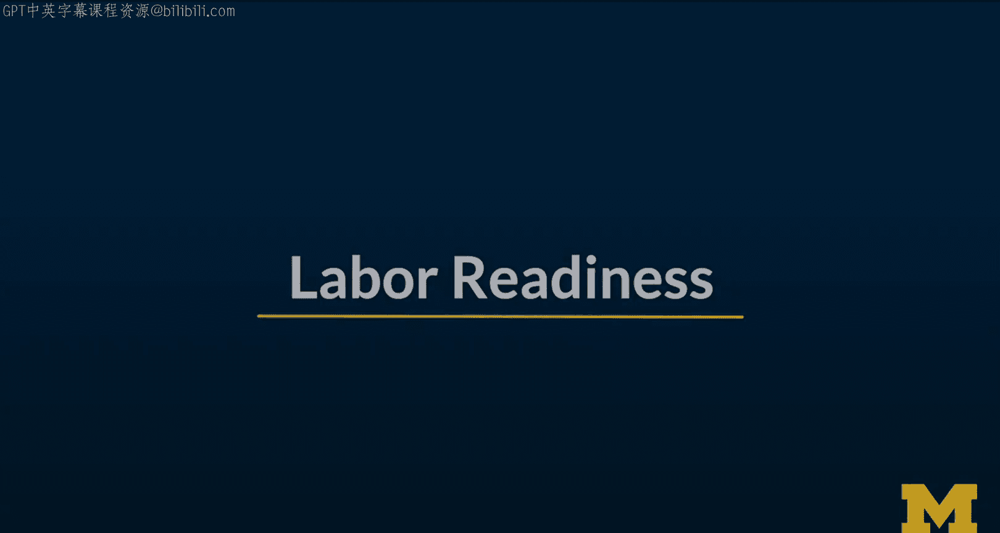
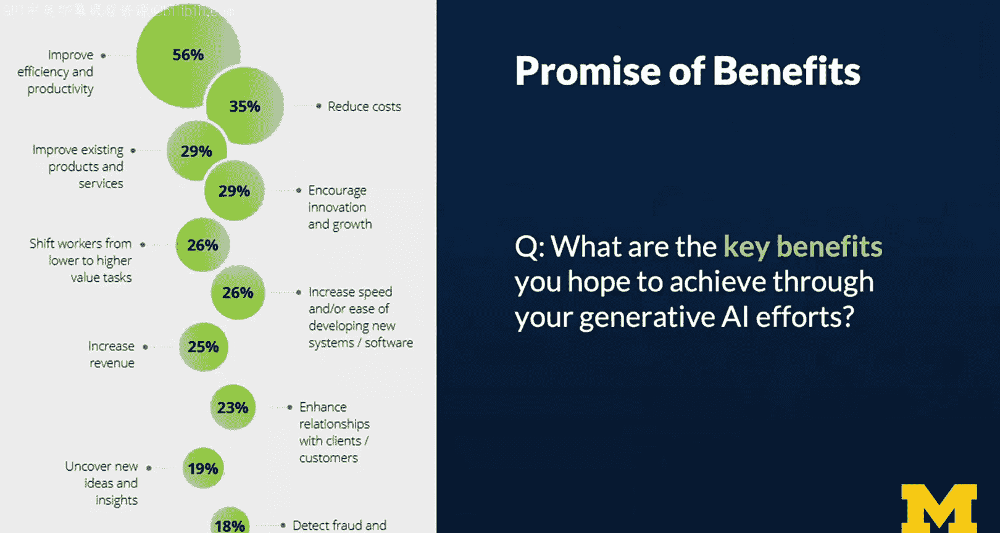
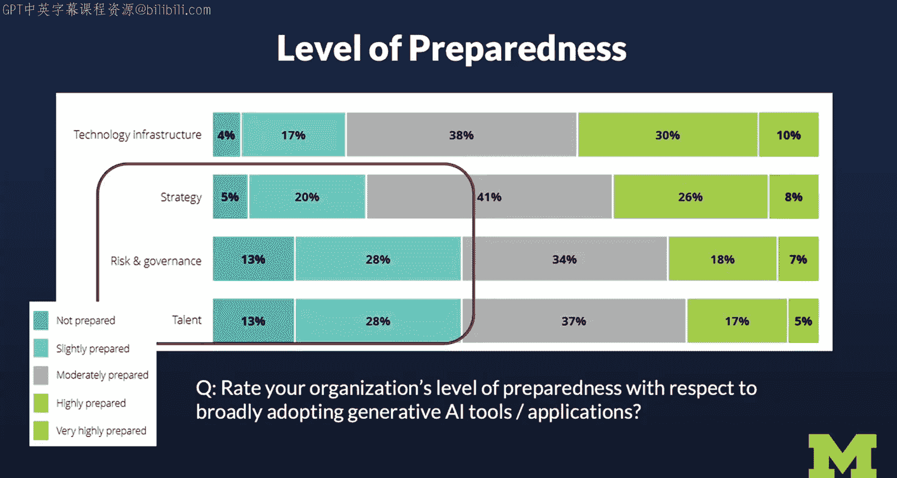
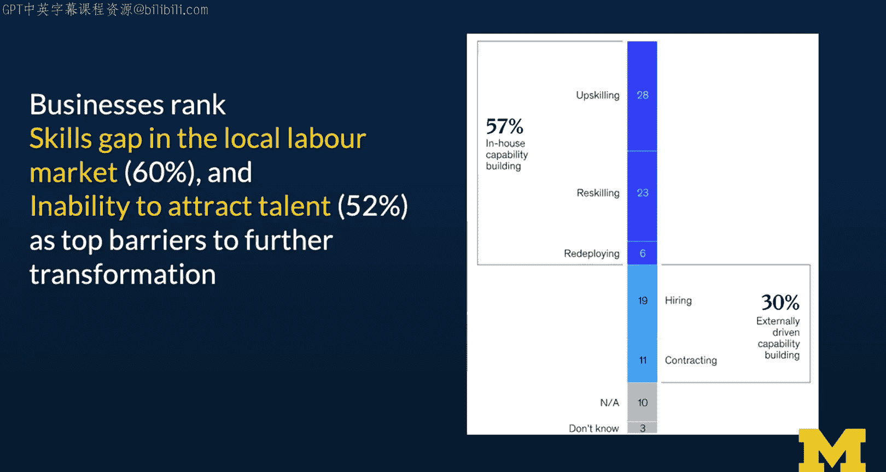
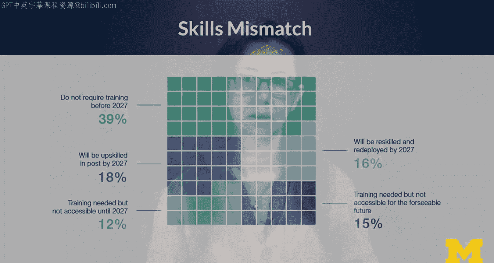
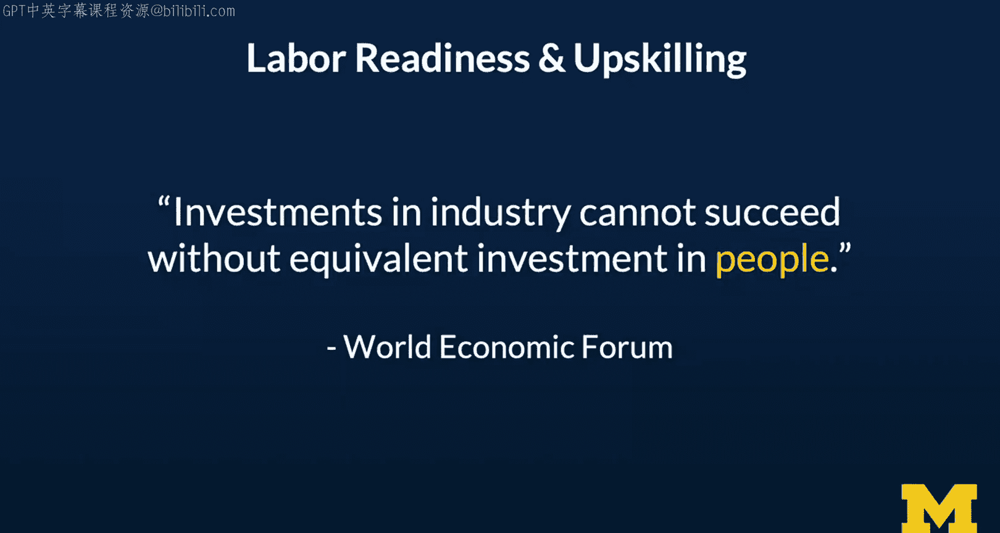
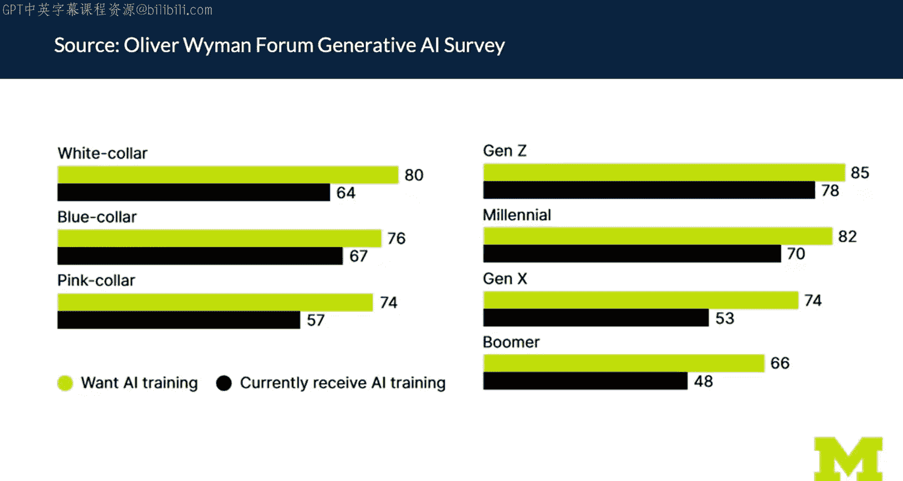
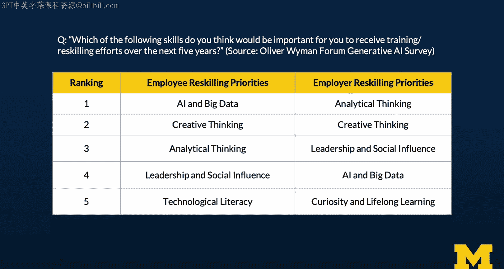
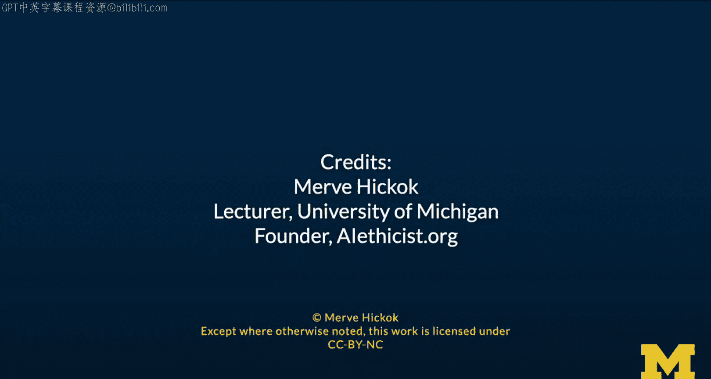

# 负责任生成式AI简介：5：劳动力准备度评估 👥

在本节课中，我们将要学习企业在部署生成式AI时面临的关键挑战之一：劳动力准备度。我们将探讨技能差距的现状、其对企业和社会的影响，以及缩小这一差距的必要措施。

## 企业期望与技能差距

上一节我们介绍了企业期望从生成式AI中获得的各种收益。本节中我们来看看实现这些目标的主要障碍——人力因素。

我们之前已经指出，企业期望从生成式AI中获得的收益，范围从**提高效率和生产力**到**降低总体成本**以及**加强与客户的关系**。

我们也曾指出，任何重大部署的主要推动力将是人的因素。对于任何考虑开发或部署生成式AI系统的企业而言，对人力资本的投资都是必要的。

然而，调查显示，员工无法满足本地劳动力市场的技能需求。😔

或者说，企业无法吸引到他们所需数量的相关人才。

## 技能不匹配的现状与影响

换句话说，现有的劳动力市场未能跟上技术变革以及这些技术所需技能的发展。😔

企业发现，在当前人才供应短缺的情况下，很难满足自身的人才需求。

这迫使雇主转向内部技能建设活动，以弥补技能和人才缺口。更大的问题是，这些变革能否及时到位，以减少转型期的阵痛和持续时间。😔

雇主预计，近一半的员工技能将在五年内受到冲击。😔

他们还预测，到2027年，十分之六的员工将需要接受培训。虽然其中一部分人可能通过技能重塑准备好应对不断变化的劳动力市场挑战，但预测也显示，超过四分之一的劳动力将无法获得所需的培训。😔

## 供需失衡与社会影响

这样的差距意味着劳动力的供给与企业的需求并不重叠。这也可能产生连锁的社会影响。劳动力市场的技能差距不会自行解决。

这意味着，如果没有投资，企业将继续为同一小部分人才库而竞争。😔

这对于拥有必要技能的少数工人来说可能是一个有吸引力的提议，因为这会推高他们的收入。然而，对于整个行业或社会而言，这既不具吸引力，也非优选。

例如，新冠疫情向我们展示了，许多国家在医疗保健和教育领域的劳动力方面所处的岌岌可危的境地。😔

世界经济论坛领导人关于AI和生成式AI影响的一个关键信息是：**对行业的投资若没有对人员的同等投资，就不可能成功**。😔

## 解决方案：投资于员工

与其试图吸引同一小部分拥有必要技能的工人，公共和私营组织需要投资于他们的员工，以扩大劳动力市场。

事实上，领先的AI公司在如何处理员工技能重塑和投资方面展现出显著优势。他们倾向于投资以扩大AI人才库，并在技术性和非技术性岗位上培养员工与AI相关的技能。

技能不匹配可以通过教育系统和雇主双方来缩小。虽然教育系统正在缓慢转型，但雇主可以对技能不匹配和需求做出更灵活的反应。😔

## 培训需求与优先事项的协调

调查显示，各行业对AI培训的兴趣相似，但在不同年龄层存在差异。初级员工似乎对AI培训表现出更高的需求。😔

他们可能对机会更感兴奋，同时也更担忧AI自动化带来的影响。

然而，技能重塑也需要共同努力。😔

尽管几乎所有人都认同劳动力准备度的必要性以及技能重塑的需求，😔但在员工优先考虑的事项与雇主认为最重要的技能重塑领域之间，可能存在一些不匹配。

这并不是说这些差异是不可调和的，而是为了表明，当组织在考虑教育计划时，需要进行更广泛和全面的讨论，以避免员工的不满和失望。

## 总结

本节课中我们一起学习了企业在生成式AI时代面临的劳动力准备度挑战。我们认识到，当前劳动力市场的技能供给与企业需求之间存在显著差距，这阻碍了AI技术的有效部署并可能引发社会问题。解决这一问题的核心在于，企业和公共部门必须协同投资于员工的技能重塑与提升，而不仅仅是争夺现有的一小部分人才。成功的AI部署不仅需要技术投资，更需要与之匹配的对“人”的投资。