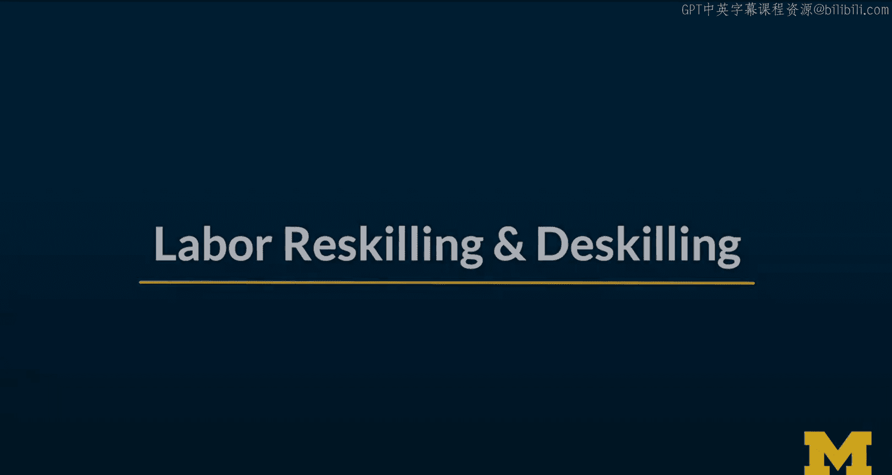
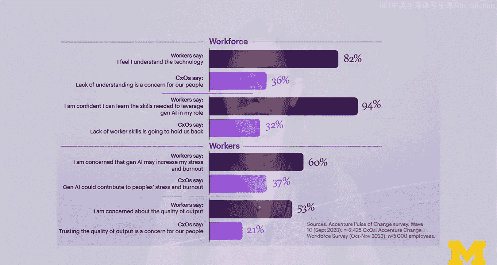
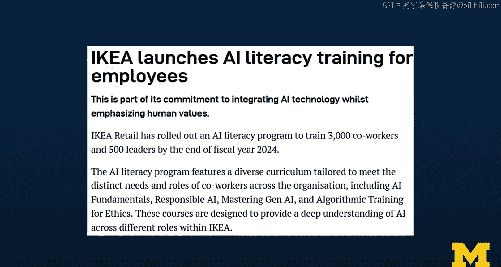
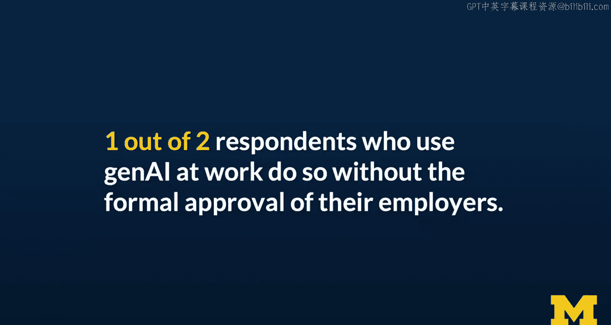
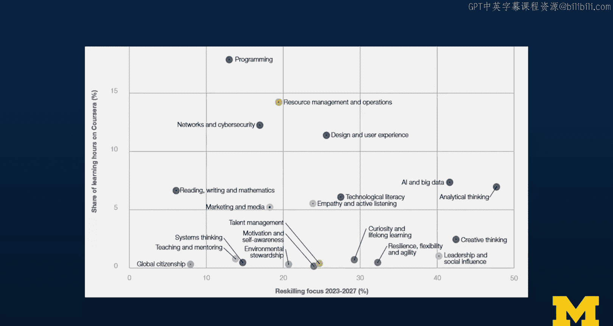
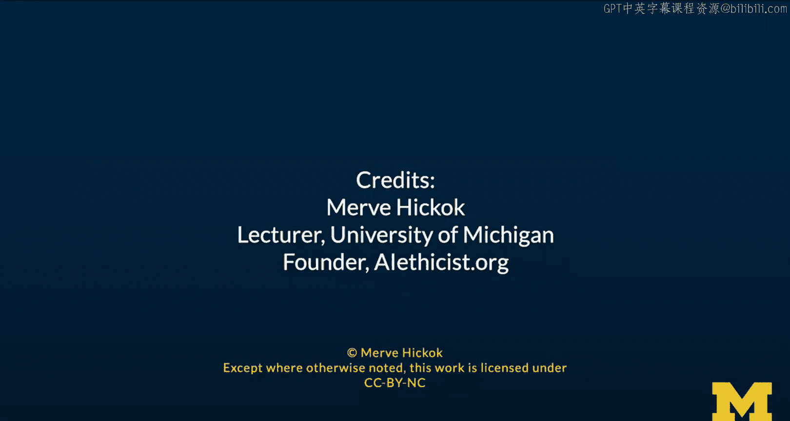

# 6：技能重塑与降维效应

在本节课中，我们将探讨生成式AI对工作技能的影响，分析雇主与员工在技能需求认知上的差异，并讨论如何通过负责任的协作与教育，实现技术与人类能力的互补与平衡。

---

## 雇主与员工的技能认知差异

多项调查显示，雇主对员工技能和态度的期望正趋于一致。雇主最看重的技能是**分析性与创造性思维**，其次是**通用技术素养**。

然而，当问题面向员工时，**AI与大数据技能**则被列为技能重塑需求的首位。

如果员工与管理层在战略和举措上的认知存在偏差，这种摩擦将侵蚀信任，并使得大规模技术应用变得更加困难。

---

## 理想的协作采纳模式

理想的场景是，在采纳生成式AI时实现员工与雇主的协作。这意味着，员工应有机会提出他们认为AI应用能产生最大影响的领域，并拥有表达其担忧的机制。

公共和私营组织需要确保AI采纳与整合的**收益与负担是公平的**，不会不成比例地落在特定员工群体身上。

负责任AI优先考虑**包容性增长**与**可持续发展**，将人类福祉、尊严和公平作为政策与投资决策的核心驱动力。

---

## 投资于教育与能力建设

虽然生成式AI可能对提升生产力有显著影响，但这不会自动实现。与企业长期成功息息相关的，是与员工共同确定最具影响力的组织用例，并投资于他们的**教育与能力建设**。

以下是实现这一目标的关键步骤：

*   **提供可及且持续的学习机会**：这为员工提供了促进自身职业发展、规划成长路径的手段。
*   **采用自下而上的方法**：企业不应采取自上而下的强制采纳方式，而应首先投入时间提升全员AI素养。
*   **识别高价值应用场景**：随后，再共同识别那些生成式AI能力能贡献最大的任务与业务流程。

一个投资于员工教育与能力建设的例子来自一家大型零售公司。该公司为其数千名员工推出了AI素养计划，旨在建立对AI、生成式AI工具以及负责任AI方法的基本理解。该计划的重点是提升和重塑员工技能，增强他们在公司内外的长期就业能力。完成培训后，这些员工被期望能以负责任的方式，提出新的AI应用用例。

---

## 组织政策与个人使用的鸿沟

调查一致显示，许多组织要么仍在决定是否采纳企业级AI，要么在制定AI组织政策方面滞后。

然而，员工已经在**个人层面**广泛使用生成式AI。一些调查指出，三分之二的员工在工作中使用生成式AI，而只有四分之一的受访者表示其所在组织有相关的AI政策。

其他全球调查（如来自Salesforce的）显示，员工强调工作中缺乏生成式AI培训和政策，并担忧生成式AI输出不准确、有偏见，以及会引入新的安全风险。

尽管如此，大多数员工目前正在使用或计划使用生成式AI。换句话说，对生成式AI的担忧并不一定会阻止员工在工作中使用它。事实上，一半在工作中使用过生成式AI的受访者承认，他们是在没有获得雇主正式批准的情况下使用的。

---

## 自下而上的采纳与自我投资

生成式AI的自下而上采纳，主要源于个人测试其自身活动和任务，即使组织可能没有采纳计划。

在组织层面的AI素养和技能计划被讨论和采纳的同时，**个体学习者也在进行自我投资**。尽管技能重塑和培训更多地被视为雇主的责任，但在线教育机会正日益成为免费技能提升的来源。

Coursera的调查显示，**分析性/伦理思维、创造性思维以及AI与大数据技能**是自主学习最关注的领域。

---

## 平衡技术与人：降维效应的风险

在讨论未来工作以及生成式AI对技能提升和重塑的影响时，我们也需要讨论随着时间推移可能出现的**技能降维**与**技术过度依赖**问题。

当人们过于重视生成式AI技能，而相对忽视人类在特定领域的专业知识或创造力时，会发生什么？考虑到生成式AI在可重复性、幻觉和对抗性攻击方面的固有风险，**人类的专业知识仍然是必要的**。

我们在之前的课程中详细讨论过，生成式AI模型可能提供不准确的结果，但模型却坚称其正确。我们也讨论了这些系统缺乏推理能力。我们仍然需要人类的创造力和领域知识来创建复杂的生成式AI提示词。我们仍然需要人类的知识和专长来理解生成输出的缺陷，并验证和核实这些产品的响应。

因此，我们如何找到正确的平衡点，利用技术来**补充和增强人类技能**，而非取代它们？

另一个对AI系统的担忧是**自动化偏见**。仅仅因为“人在回路中”，并不意味着风险会自动消失。始终存在一种风险，即员工自身变得过于依赖AI生成的结果，或者随着时间的推移，由于AI在其组织中的部署方式，员工变得**能力被削弱**，以至于不再关心或指出问题。

员工必须被赋予权力，能够表达他们的担忧，在必要时**覆盖系统**，并且能够轻松地提出新的AI想法和用例，只要这些应用是有益的。

---

本节课中，我们一起学习了雇主与员工在AI技能需求上的认知差异，探讨了通过协作、教育投资和负责任的部署来实现生成式AI成功整合的路径。我们认识到，虽然技术能极大提升效率，但人类的专业知识、批判性思维和创造力不可或缺。关键在于找到平衡，让AI成为增强人类能力的工具，同时通过持续学习和赋权，防范技能降维与过度依赖的风险，最终实现包容、可持续的发展。