# 7：数字鸿沟挑战

在本节课中，我们将探讨生成式人工智能（Generative AI）在普及和应用过程中面临的一个核心社会挑战——数字鸿沟。我们将分析这种不平等现象在不同维度上的表现，以及它如何影响技术红利的公平分配。

## 不平等的起点

我们知道，生成式AI将随着时间的推移，以不同的程度和规模影响劳动力市场和商业。

我们并非站在一个公平的起跑线上。无论是在全球范围内，还是在我们的社区内部，数字鸿沟已然存在。

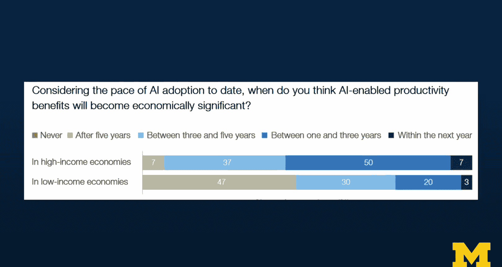

我们是否都能平等地从生成式AI中获益，并缩小差距？看待这个问题有不同的角度。

## 经济预测的视角

一种方式是回顾经济预测。例如，首席经济学家的展望报告。需要提前说明的是，预测未来非常困难，我们应当以审慎的态度看待任何预测。

尽管经济学家们对生成式AI在商业中应用的轨迹看法不一，但他们预计影响最大的改进将出现在非重工业领域。例如：IT与通信、金融和专业服务、医疗保健服务，其次是零售、制造、工程、能源和物流。

同一批受访者更一致地认为，生成式AI带来的生产效率提升在高收入国家将显著得多。73%的首席经济学家预计，生成式AI不会对低收入经济体的就业产生积极的净影响。

这些预测是由各国基础设施准备程度的差异所驱动的。这些差异体现在数字基础设施、人力资本与劳动力市场政策、创新能力以及法规监管等方面。因此，我们有必要深入探讨造成数字鸿沟差异的一些因素。

## 数字鸿沟的多维度审视

我们可以从不同维度审视数字鸿沟。例如，我们可以跨越地理区域比较国家之间的差异。或者，在同一国家内部，跨越性别、年龄、种族和社会经济条件进行比较。我们可以询问特定群体对新兴技术底层基础设施的访问程度，或者其数字素养水平如何。

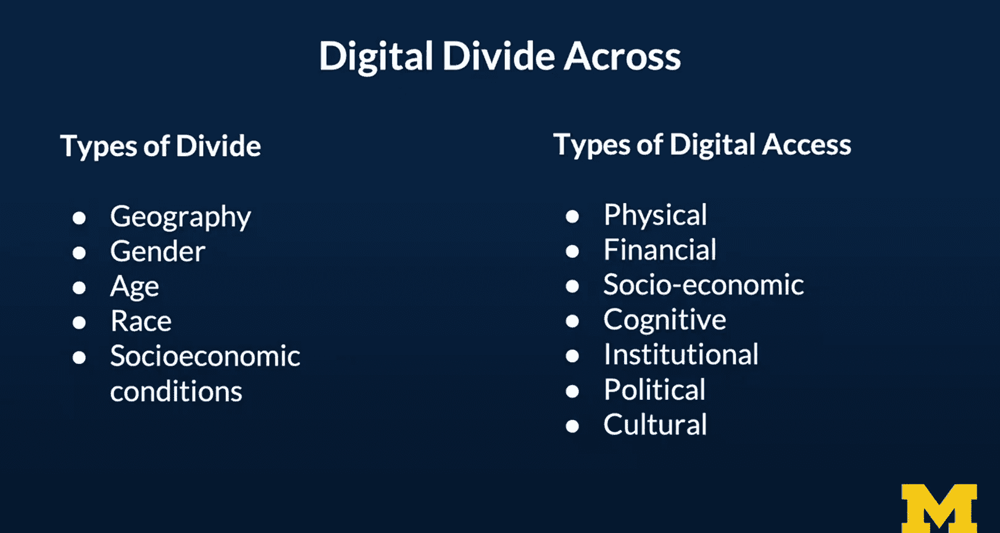

我们还可以审视不同类型的数字访问权限，例如：物理访问、经济承受能力、认知理解、制度支持以及文化政治环境。

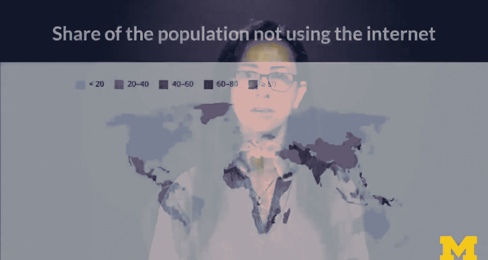

## 基础设施：首要前提

无论是个人还是组织层面，要从生成式AI中获益，首先需要能够访问基本的基础设施。换句话说，就是**宽带网络**。

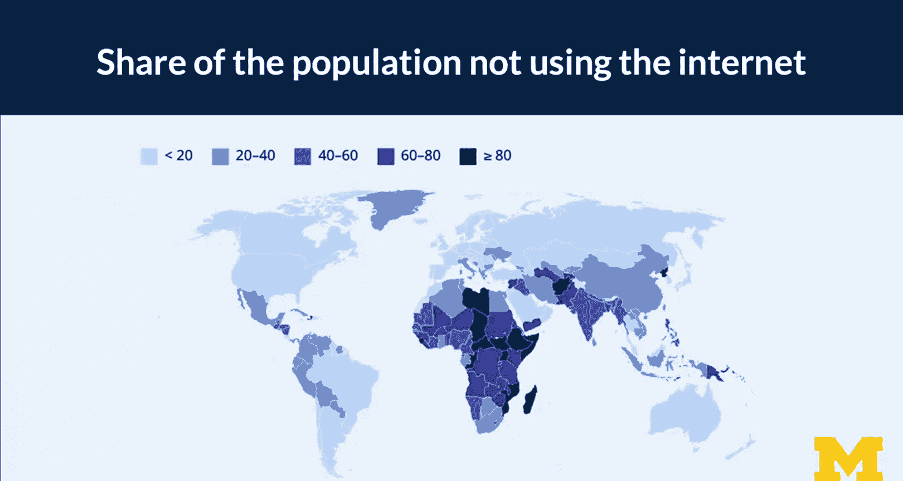

在全球范围内，非洲和南亚国家的人口互联网接入率最低。因此，这些地区采纳新兴技术承诺的可能性也更低。事实上，非洲的互联网普及率大约在40%左右，而欧洲则接近90%。

这种差距严重影响了组织将生成式AI系统整合到其业务中的能力，也限制了个体试验这些技术或获取技能培养机会的能力。

低收入国家薄弱的关键基础设施和低互联网普及率，也推高了宽带连接的费用。虽然高收入国家的一些人或组织可能对自己使用的数据量毫不在意，但在世界其他地区，这笔费用可能非常高昂。

个体可能无法以创造自主创业的方式使用这些新兴技术。

## 代际与性别差异

有人可能认为数字鸿沟会随着时间的推移和新一代的成长而缩小。全球劳动力调查指出，年轻人对就业转型具有更高的灵活性，而年长工人则可能在再就业时面临技能重塑、流动性和适应新技术等多重挑战。

然而，这种思路的前提是基本基础设施首先必须是可访问的。

在缩小未来代际数字鸿沟的能力方面，值得注意的是国际电信联盟和联合国儿童基金会的报告与警告：全球有21亿3至24岁的学龄儿童和青年在家中无法访问互联网。目前亟需投资来弥合这一鸿沟，它正阻碍儿童和年轻人获取在线数字学习资源。前联合国儿童基金会执行主任称此为“数字峡谷”，而非简单的“差距”。

在性别方面，全球近一半的女性人口（约43%）仍无法使用互联网，而男性的这一比例为38%。

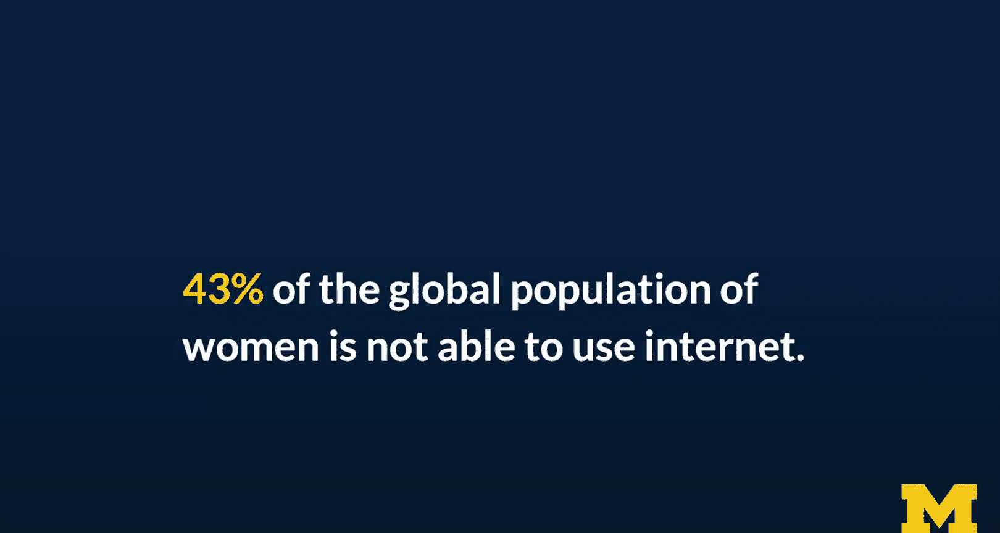

访问权限的差异意味着，如果没有结构性干预，这道峡谷将会加宽。

## AI行业内部的差距

你可能会问，在AI行业内部，特别是在劳动力构成方面，情况又如何？情况同样不容乐观。

虽然女性在可能被生成式AI取代的工作中占比较高，但她们在开发AI解决方案的职位中代表性不足。全球范围内，女性仅占AI人才的30%。在机器学习相关工作中，这一比例显著下降到10%至15%，而在不同国家的AI研究出版物作者中，女性比例甚至更低。

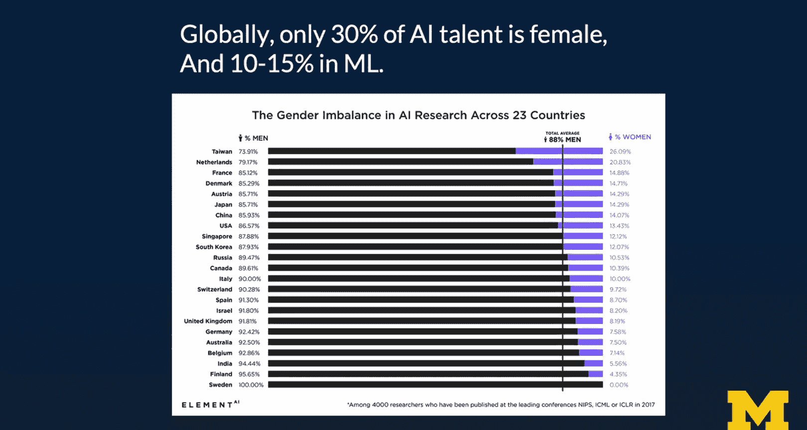

我们需要AI产品反映其潜在用户的多样性，以便这些产品能为每个人提供更好的性能。

性别差距也带来更广泛的商业和社会影响。AI和生成式AI影响所有行业，然而，在这些行业中创造的解决方案、知识工作、雇佣实践，可能会因劳动力中如此巨大的性别差异而严重扭曲。

例如，我们在医疗、教育、关键基础设施等领域所设想、优先考虑、投资和部署的解决方案，可能会看起来截然不同。

当从种族或民族代表性的角度剖析数据时，情况甚至更糟。开发AI的少数族裔员工平均比例低至25%，而一些公司从事AI解决方案工作的少数族裔员工数为零。

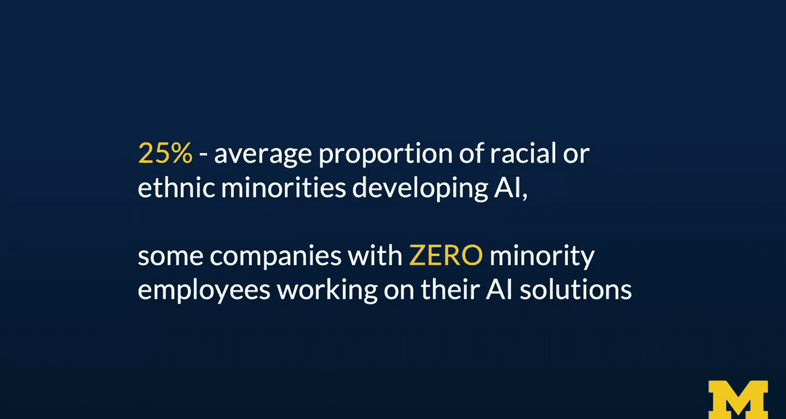

尽管基于新冠疫情前强制披露的数据，调查报道中心对硅谷公司员工构成的分析显示，领先AI公司的人员代表性情况依然令人震惊。

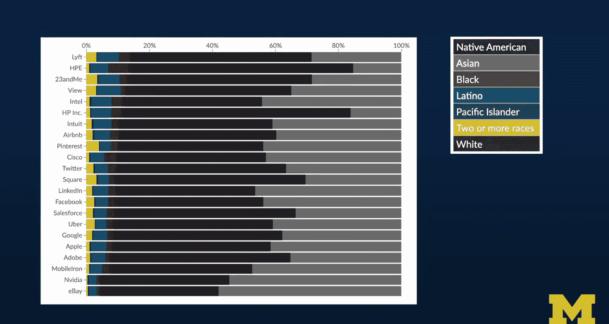

或者说，是谁没有被代表。预测还显示，如果当前的结构性问题和长期存在的财富生成与分配模式得不到纠正，生成式AI可能会显著加剧种族财富差距。

例如，在美国，预测显示到2045年，生成式AI创造的财富在种族间的差异分配，可能使美国家庭中黑人与白人之间的财富差距每年扩大430亿美元。

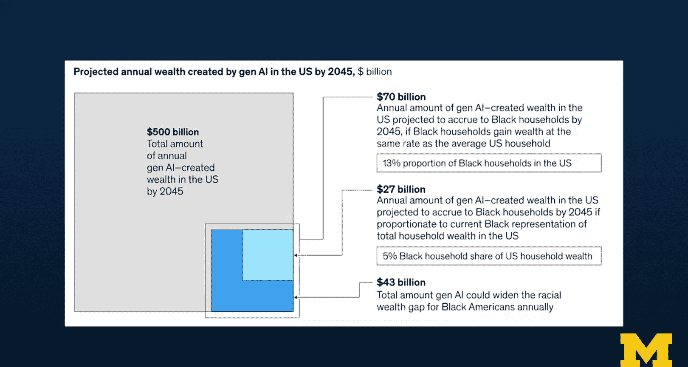

这种预测可以在存在现有社会经济不平等的不同人口群体或国家中进行模拟。

社会不平等导致对这些技术的访问机会更少或更低，进而导致获取财富的机会减少，加剧不平等，这可能形成一个难以打破的恶性循环。

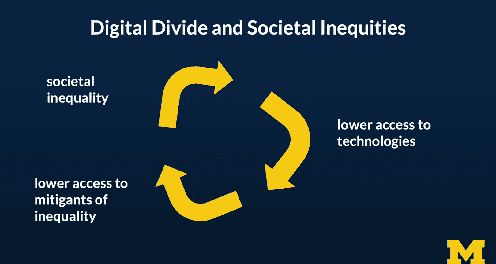

## 总结与未来展望

生成式AI有可能让工作变得更好。然而，如果没有必要的投资，不平等的参与和收益可能导致累积性的劣势。

作为总结，我想回到我开始这个模块时提到的观点：鉴于这项技术成为主流的时间尚短，评估生成式AI及其对工作和职场的影响是出了名的困难。

没有任何单一因素将决定这项技术的影响，而是一整套因素共同作用。这些因素包括：工作任务面临自动化或增强的可能性、我们社会中现有的鸿沟、政府政策、组织投资和技能重塑的速度、我们如何整体上评价劳动价值等等。

同样，行业决策、政府政策与要求、版权裁决、开源运动、公共数据和计算基础设施，以及再分配政策，都将决定生成式AI在经济中被采纳的速度和广度，无论地域如何。

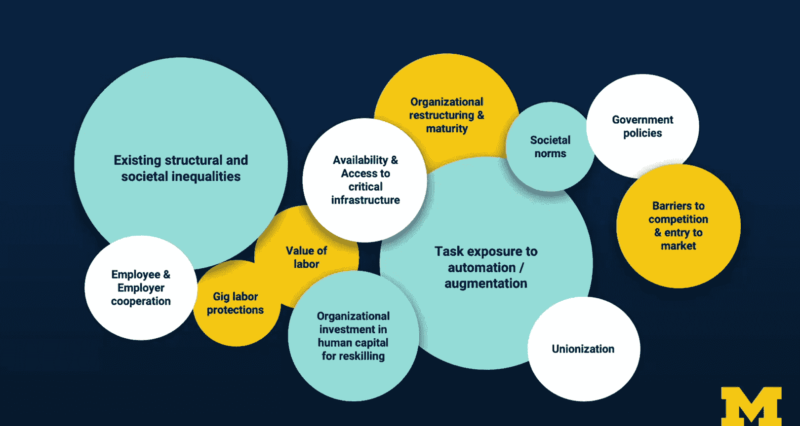

为了制定更好的企业和政府政策，对增强和自动化两种场景进行不同的分析和模拟非常重要。

然而，同样重要的是提醒我们自己，工作的未来并非预先注定，也不必是一个注定失败的场景。生成式AI和数字技术的进步蕴含着我们可以实现的希望。

工作的未来取决于每个社会所珍视的价值。我们如何投资于人、人的尊严和基本权利，工作的未来应当由人类有意识的决策来塑造。

---

本节课中，我们一起学习了生成式AI发展中的数字鸿沟挑战。我们探讨了这种不平等在地理、基础设施、代际、性别和种族等多个维度的表现，并认识到如果不加以干预，技术红利的不平等分配可能加剧现有的社会差距。最后，我们明确了未来的工作形态并非由技术单方面决定，而是可以通过有意识的政策、投资和价值选择来共同塑造。