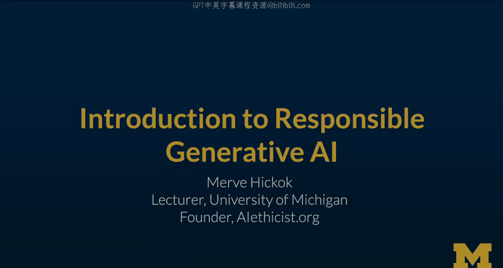
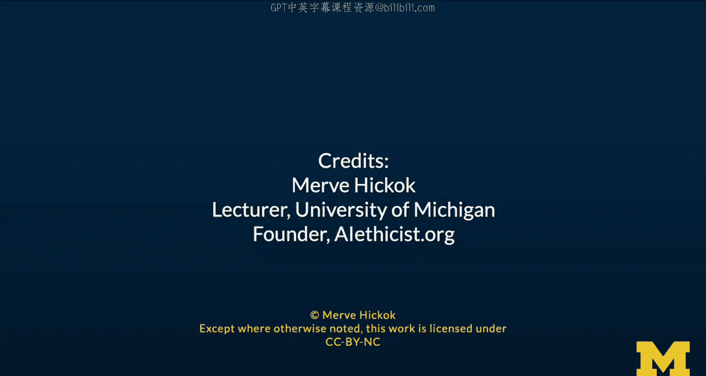

# 密歇根大学《负责任生成式AI简介（基础、对商业和社会的影响、政策、对未来的影响）｜Responsible Generative AI》中英字幕 p01 0_负责任生成式人工智能导论.zh_en -BV1Uf421B7sR_p1-

Welcome to the first course of the four courseurse series in Responsible generative AI。

I am very excited to be part of your journey on building the necessary knowledge and skills to responsibly develop。

 use and govern generative AI systems。Generative AI technologies can bring many possibilities and opportunities for both businesses and individuals。

But these systems can also have significant impact on business， society。

 environment and future of work。Such impactful technologies demand responsible approaches and ability to critically analyze the implications for informed decision making。

And to go on for the best results。In the rapidly changing landscape of technology。

 use case and governance approaches， I hope to bring the foundational knowledge to decision makers。

 developers and end users。My name is Mary Hickcock。

 I'm a facultyult member at University of Michigan teaching data Science Es at School of Information and Advvising on responsiblepon AI and data at Michigan Institute of Data Science。

I'm also the president of a Global independent research and Education nonprofitfit Center for AI and Digital Policy。

Where engage in global AI policy work and educate future AI policy leaders in more than 80 countries。

