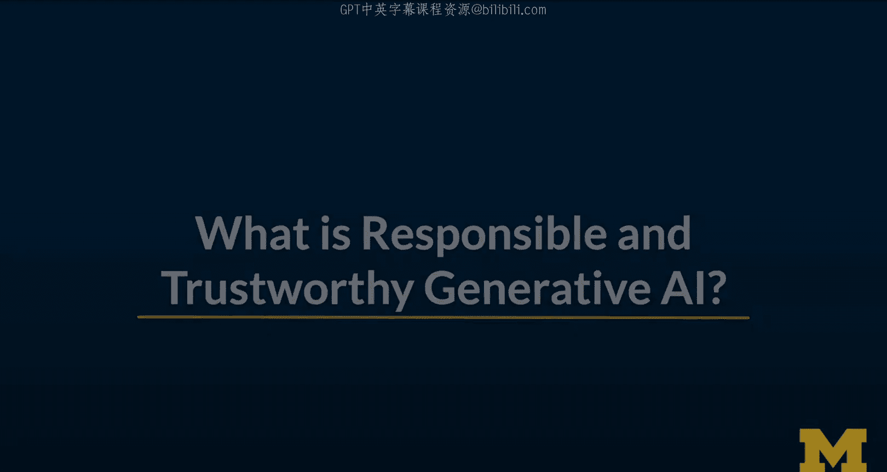
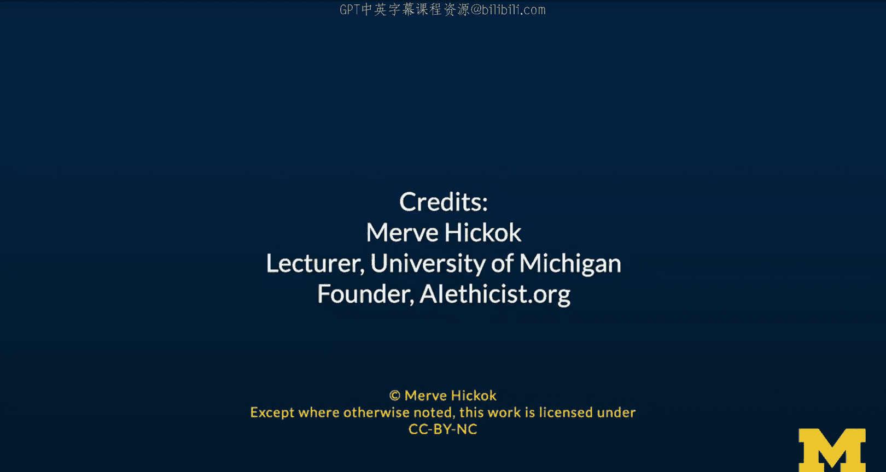

# 密歇根大学《负责任生成式AI简介（基础、对商业和社会的影响、政策、对未来的影响）｜Responsible Generative AI》中英字幕 p02 1_何为负责任可信生成式AI.zh_en -BV1Uf421B7sR_p2-

In 2022， millions of people were introduced to generative AI products。

Which promised to transform industries for the better。

And provide innovative tools to mainstream users。Previously， AI systems were mainly predictive AI。

 focusing on analysis of data sets to complete tasks such as classification， recognition， prediction。

 recommendation， etc。Generative AI systems， on the other hand。

 analyze underlying patterns and data and allow users to create new content based on text， image。

 audio， video code。Or a combination of these modalities。

The content that you can create is pretty much limitless。

And many new use cases are being introduced every week。

The adoption of generative AI was boosted by the fact that you only need natural language to use it。

 However， the development， deployment and use of AI also brings a lot of new challenges and questions to the table while amplifying existing risks。

 So how do we， as individuals， businesses， communities benefit from this emerging technology。😔。

We need all hands in。It is exciting times， and we probably do not know right now many of the applications that will emerge from generative AI over time。

We need collaboration between a variety of stakeholders。And we need to promote human dignity。

 contribute to positive societal transformation。And protect the environment in the process。

This is very responsible and trustworthy AI and generative AI comes into the picture。

 we all have a voice， and as AI developers， users， investors， scientists， policymakers。

 civil society， we all have a responsibility。Responsible AI means ensuring justified trust for AI technologies。

Trust increases the adoption rates。Use cases and investment in research。

Generative AI can be transformational for the better。

 but we need to understand better the possibilities， limitations and align our focus accordingly。

Some may choose to focus on short term economic gains and exploit data， labor and natural resources。

Which would eventually do this technology。With significant impact on our societies and businesses。Or。

We can develop and deploy systems with multiple stakeholders and communities in mind。

Critically analyze the benefits and implications of these technologies。

We can work on guardrails to fight against bias， polarization and malicious uses。

We can proactively prepare for positive societal， labor or educational transformations。

Invest in enhancing accessibility， as well as equitable access。Incentanivize work on common goods。

Prioritize ethical and social progress。Increase data and AI literacy。

And ensure fair distribution of economic benefits。Responsible AI is not just one thing。

 It is what you decide to prioritize and implement。

