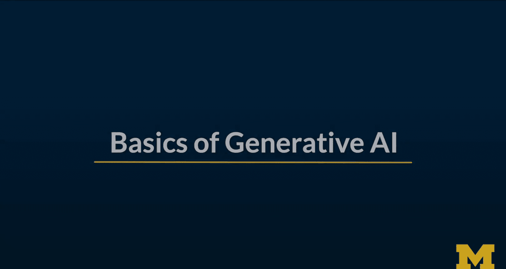
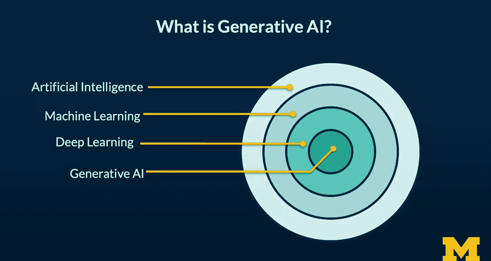
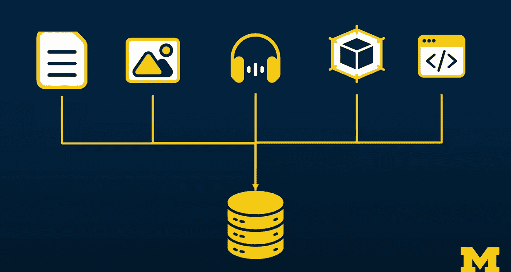
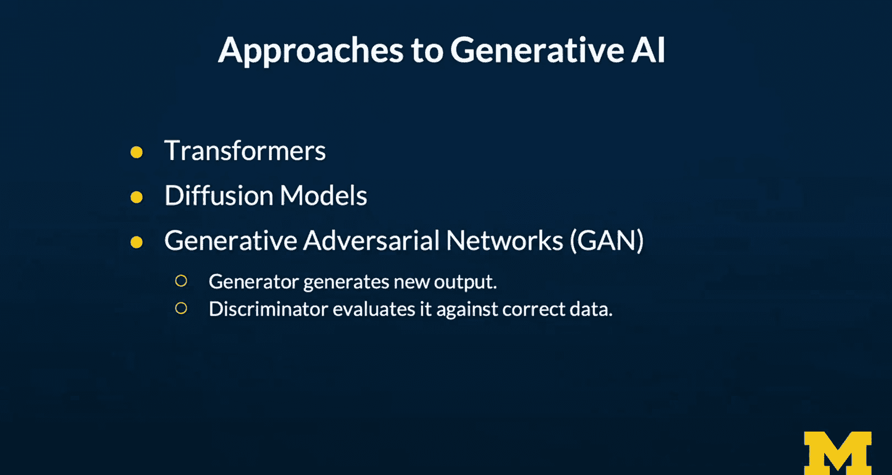
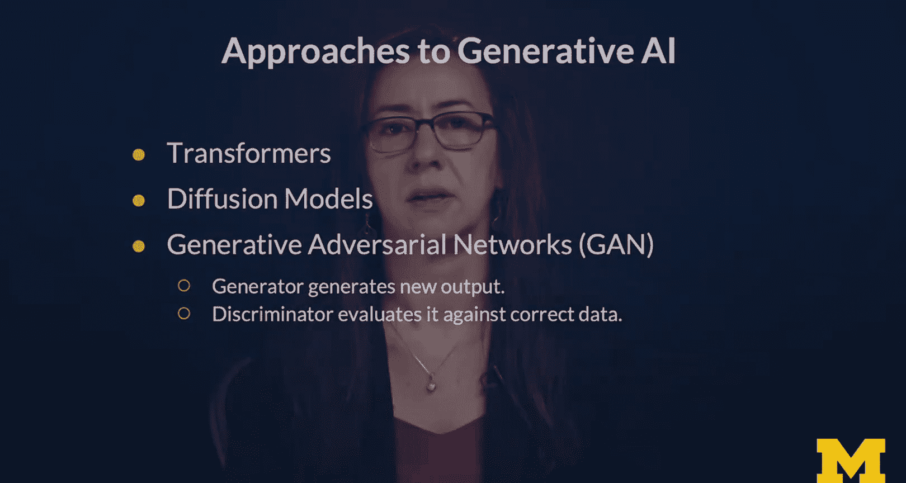
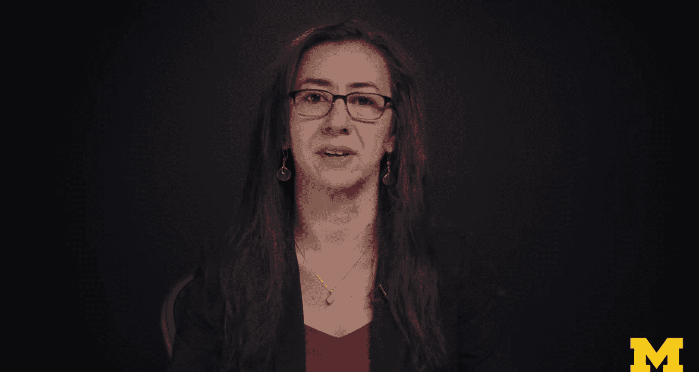
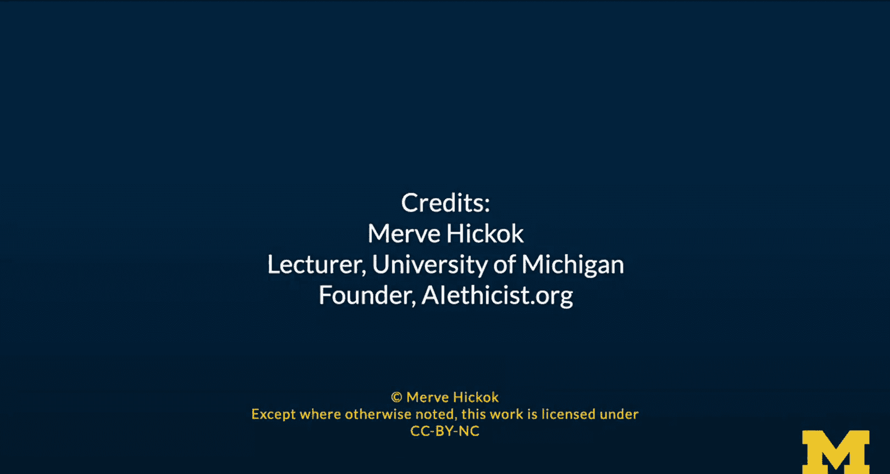

# 密歇根大学《负责任生成式AI简介（基础、对商业和社会的影响、政策、对未来的影响）｜Responsible Generative AI》中英字幕 p03 2_生成式AI基础原理.zh_en -BV1Uf421B7sR_p3-

Artificial intelligence or even large language models are not new。They go back to decades。In fact。

 the first chatbot was developed by Joseph Weisenbaum in 1966。However。

 generous AI systems have captured the interest and attention of many since they have been made available to mainstream users in 2022。

The ability to interact with these systems with our technical knowledge and simply by using language meant that more people across the society were able to use different products。

But what is generous AI？You can think of AI as both the scientific field and as algorithmic systems。

Then machine learning， deep learning and generative AI as respective subsets of each other。

AI systems can be simple rule based algorithms， such as if done scenarios。

They can be algorithmic models， they will opt to perform specific tasks。

Or they can be very complex systems where it becomes very hard to explain or interpret why a certain input produces an output。

AI systems are already deployed in many domains in our lives， from recruitment to insurance。

 financial and credit decisions。Home valuations， healthcare diagnosis， matter forecast。

 manufacturing or critical infrastructure management。

 More complex methods are machine learning and deep learning systems。😔。

Machine learning refers algorithmic models where the system learns from the data it uses。

Rather than explicit programming。Ml algorithms continuously detect patterns。

And relationships and adjust their logic to produce their outcomes。

Deep learning systems use neural networks to assess and represent data connections。

The deep and deep learning refers to the multiple layers of neural networks。

 where the data passes through and establishes connections。

These neural networks can be taught as interconnected nodes， organized in layers。

Deep learning models extract connections between features and pass that information to the next layer and next until the text is complete。

What makes deep learning interesting is it can learn from both labeled and unlabeled data。

For example， it can use data sets where images have tags or explanations。In this case。

 the algorithm uses supervised learning。But these systems can also learn from data sets。

 even when the data is not labeled and come as raw content。 this is unsupervised learning。

Geneneative AI systems are trained on very large dataset sets or corpus of data。

Data sets composed of text， audio， video images， or even software code are used to train generative AI models。

Unsupervised learning techniques are used to train the model。In other words。

 the models are provided with unlabeled data， and they discover patterns and connections without explicit coding from the humans。

A generative AI model learns from the existing relations and patterns between words in its dataset set。

Users can ask the system to create a response or content by using natural language such as English。

In response to the user request called prompts， the system generates outputs in text， audio。

 video or code。You do not need technical knowledge to engage with the system。

The natural language interaction makes the system very easy to use for tasks where factual information or accuracy are not main concerns。

However， you still need domain or technical knowledge to double check the accuracy of the outcome。

Especially if you're planning to take action on the output provided。For almost a decade now。

 deep learning models have been used to generate more and more realistic images and audio。

These earlier systems used variational auto encoders or Vs。

With more recent developments， the most popular approach to the generative AI systems are transformers。

 diffusion models and generative adversarial networks， organs。

Transformers as used in large language systems， are used to predict the sequential output。Next。

 token in the output thread。Cans are made up of two models， a generator and a discriminator。

The first model generates a new output， the other one evaluates against correct or real data。

The spec and forth between the two continues until the generated versus the reel cannot be distinguished from each other。

Ks are used to generate realistic videos or audios or T fakes。

But they can also be used to create a synthetic table， or data。Diffusion models， on the other hand。

 generate images by an iterative process of forward and back。

Where the model is trained by forwarding and converting image into data noise。In other words。

 the data structure is systematically dismantled。Then the model sends the data noise to unstructured data。

Back to restore its structure and create the image。 While computationally more intensive。

 this process gives the developers more control over the outcomes。

