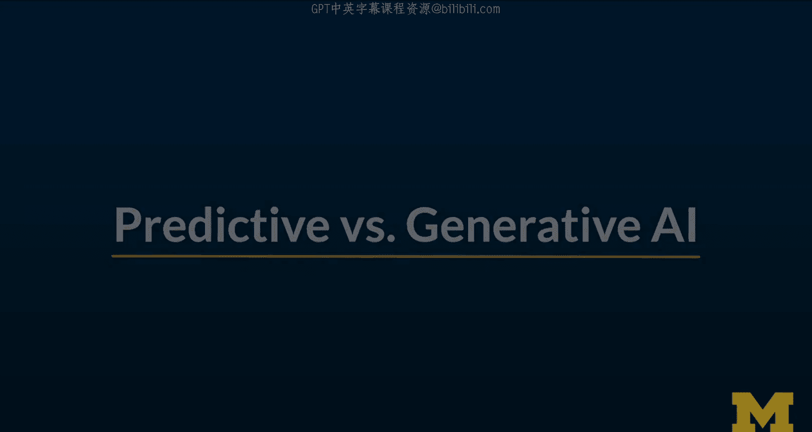
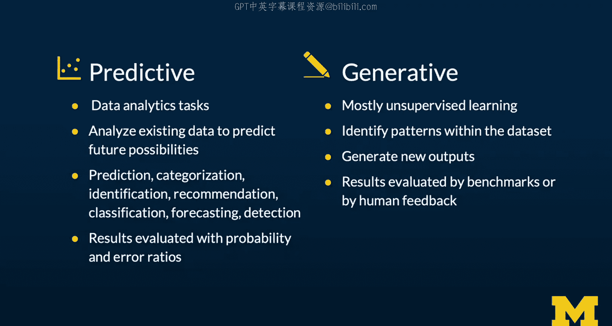
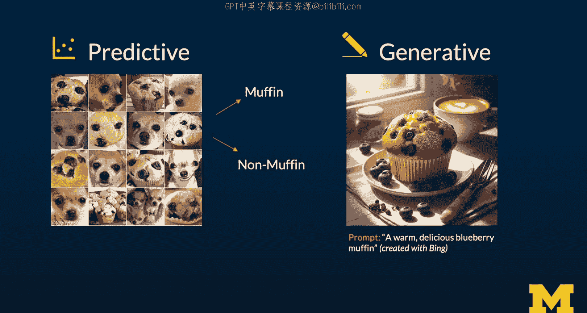

# 密歇根大学《负责任生成式AI简介（基础、对商业和社会的影响、政策、对未来的影响）｜Responsible Generative AI》中英字幕 p04 3_预测型与生成式AI对比.zh_en -BV1Uf421B7sR_p4-

Predictive systems are embedded in many applications we currently use knowingly or unknowingly。

These AI systems allow us to conduct data analytics tasks。

 such as looking at past occurrences of an event and then predicting the likelihood of it happening again。

Predictive systems can be used to identify objects in an image or video。

Recommend what kind of news or social media posts you should see next。

Detect unusual activity with your credit card， etc ce。

Generative A systems， on the other hands， identify patterns in their training dataset set to create new outputs。

In other words， the use cases between these systems are significantly different。

They are trained by massiveive dataset sets without the need to label pieces of that data。

For example， if you wanted to identify an image of a dolphin in a picture。

You would want to use a predictive system。You would train the system with many pictures of dolphins。

 many of them with text tags until the system was identifying the image correctly。😔。

But if you wanted to draw a picture of a dolphin swimming in front of a sailboat。

 you would want to use generative eye systems。

The results of predictive models can be evaluated by using a host of Per metrics。If， for example。

 you provide the system with several images of muveins and other items。

And ask which ones are muffin or not。 You can verify the results， and have an accuracy rate。

Evalation of outputs of generative AI systems is more complex。With generative AI systems。

 you may prompt the system to create a picture of a warm， delicious blueer muffin。

It is a lot harder to evaluate if what the system has created is delicious looking。

Or to assess the extra elements the system added in the picture。 In this case， the fork。

 the coffee or the freshberrries。

How one person may evaluate the performance and results made different from others。😔。

The quality of the image and whether that satisfies what you had in mind or subjective decisions。

 If you were using a language model， the performance can be evaluated across tasks。

Maybe you can evaluate it identifying false outputs against the Grandro。

Or laws of physics or chemistry， or et。Or more subjectively。

 by assessing the quality of the responses and whether it satisfies the task。

Currently， there are a number of language benchmarks that these systems are evaluated against。

These can be thought of as standardized frameworks where the model is tested against standard language tasks。

 such as paraphrasing or predicting the sentiment of a sentence。 Additionally。

 gene eye systems have a level of randomness when generating an image or next word in a sentence。

The results may change every time， even if you use the same prompt。Therefore。

 the results are less reproducible than predictive systems and harder to evaluate。

