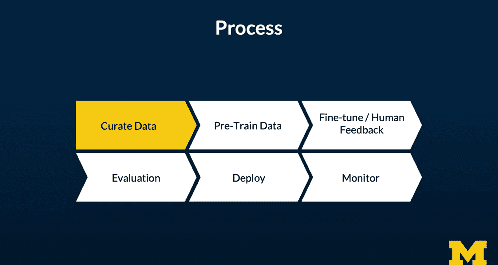
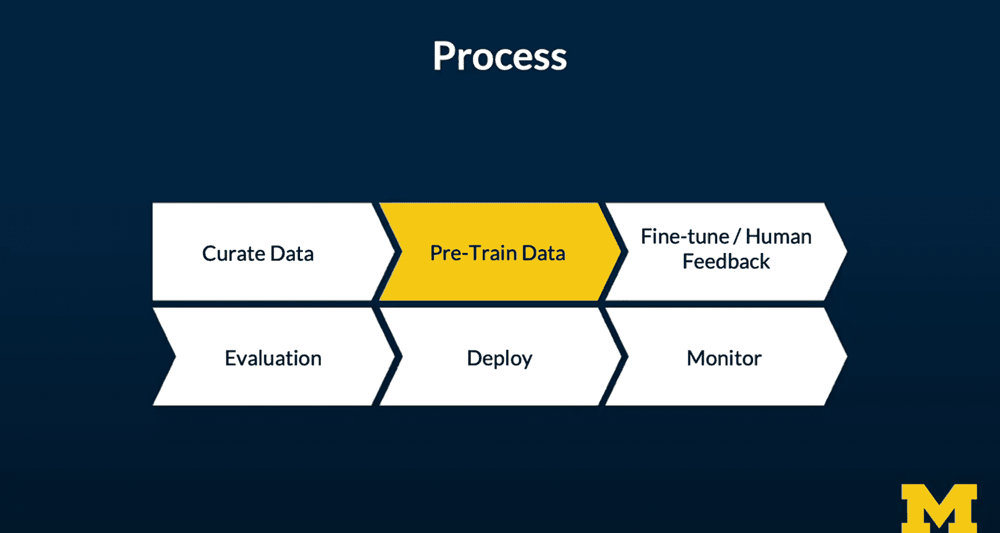
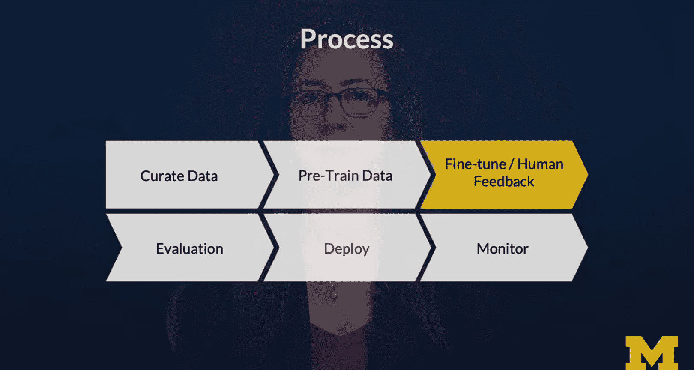
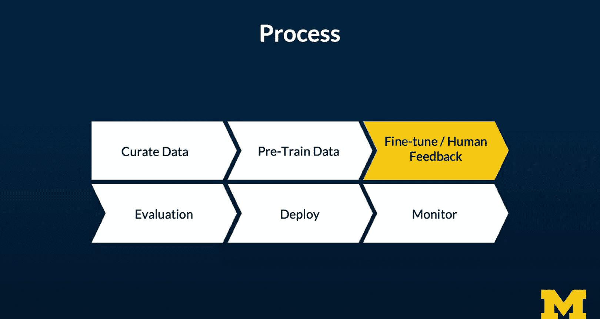
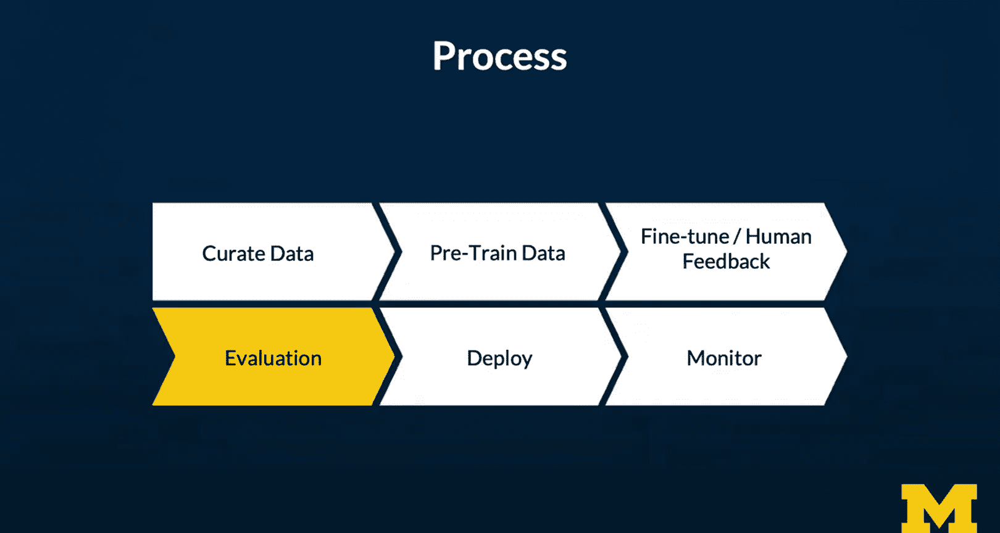
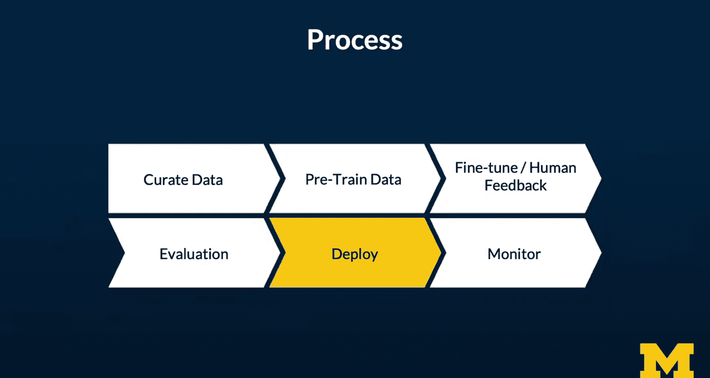
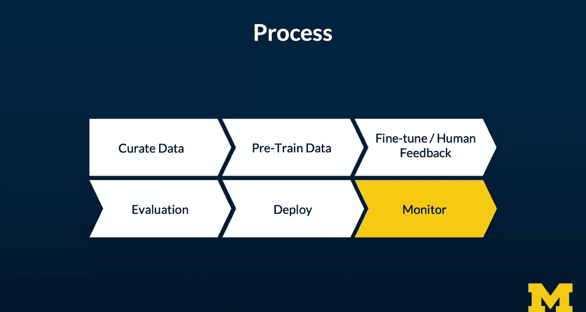

# 密歇根大学《负责任生成式AI简介（基础、对商业和社会的影响、政策、对未来的影响）｜Responsible Generative AI》中英字幕 p05 4_生成式AI生命周期.zh_en -BV1Uf421B7sR_p5-

Yeah。These general models are made up of billions or trillions of parameters。

With currently available approaches， the general purpose generative AI systems require significant amounts of computing infrastructure and resources to train。

As mentioned before， to train generate our systems， massive amounts of data is required。

Current training data sets represent a good portion of the Internet。

These are collected by scraping millions of websites and their contents。Including discussion forums。

 social media。As well as scraping of large sources such as Wikipedia， patent applications。

 newspapers， books， movies， YouTube videos， personal blogs。

And using combination of commercial and proprietor dataset sets curated for the purpose of training。

The scraping of such large amounts of internet content means the training dataset sets contain significant amounts of copyrighted material。

 public information。As well as data collected from behind payrolls or paid content。

Once collected， the dataset set is compressed for efficiency purposes。In other words。

 the model encodes a simpler version or representation of the training data。

Ideally， the dataset sets should be processed to remove illegal， dangerous or toxic elements。

As well as private information。Quality checks should be conducted。

 and data prominence and changes to the corpus should be documented。Then with model training。

 the neural network learns the relationships and patterns between words in a dataset cell。

Once the model learns these billion of relationships， it can generate outputs when prompted。

During the training process， the model establishes connections between the data points。

And analyzes the strength and weight of these connections for its task。

These learned variables are called parameters， and they include the knowledge essential to turn inputs into outputs。

However， the system may still need further improvement and optimization。

You might also want to reduce some of the toxic or dangerous responses。

 This is where fine tuning comes into the picture where the system is asked templates of questions。

And when the responses are compared， corrected， and tuned。

 human feedback is used to improve the system's responses。

Performance evaluations are conducted again before the system is deployed。

These metrics may differ depending on whether the system is general purpose or a specific task based one。

Or it might differ by domain in which the system may be used。😔。

Responsible deployment requires both the developers and the deploys to ensure the system is safe。

 secure and trustworthy。😔。

The ex anter。In other words， the pre deploymentloyment。

 impact and risk assessments should have been completed at this stage。

 Forcing harms and risks should be mitigated。And the necessary feedback and response mechanisms should be in place for those unforeseen risks。

It is true that we may not be able to know or foresee every single problem ahead of a deployment。

However， this does not remove the responsibility for taking all possible precautions for the known and established issues with AI systems in general。

Once deployed， any AI system requires ongoing monitoring for performance changes， new use cases。

And for the possibility of adversarial attacks。

These are not static systems。Their performance may change due to new data。

 interactions with users or even due to malicious actors。

