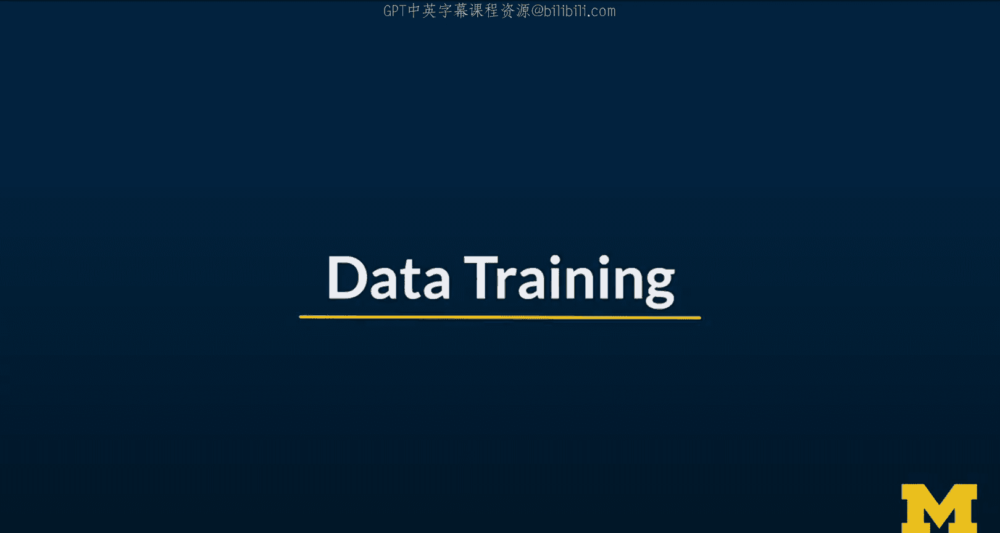
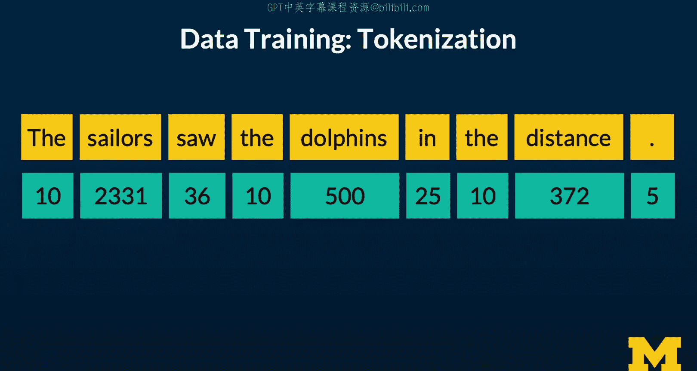
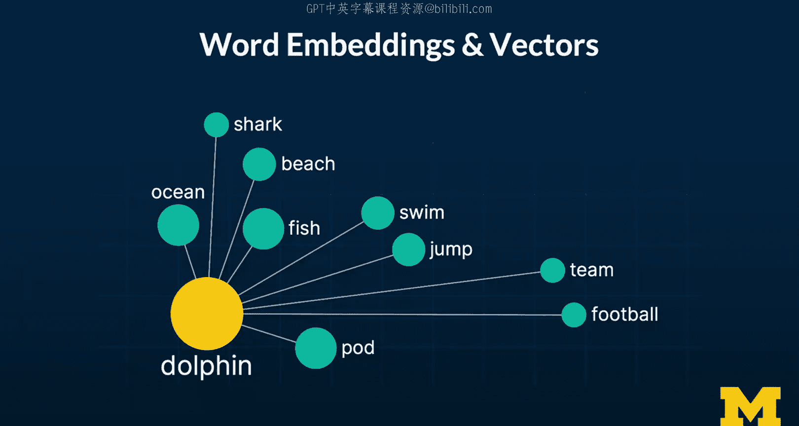
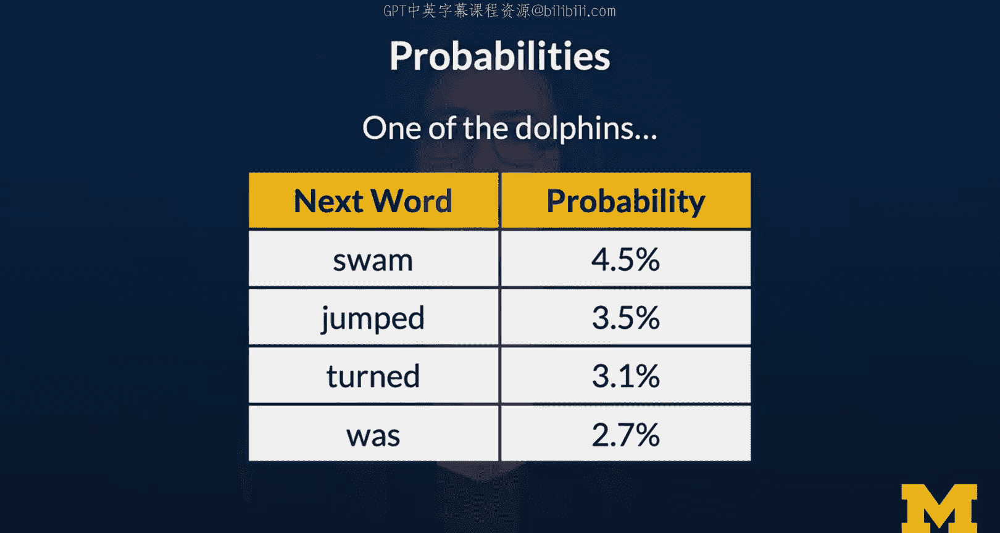
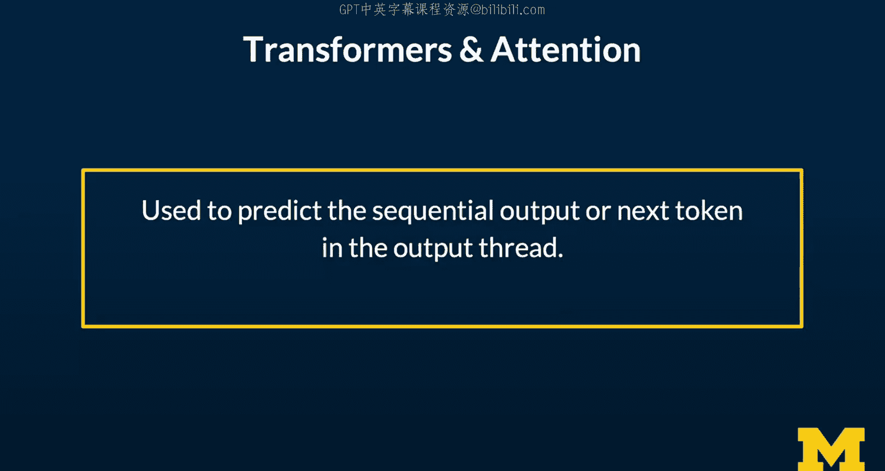
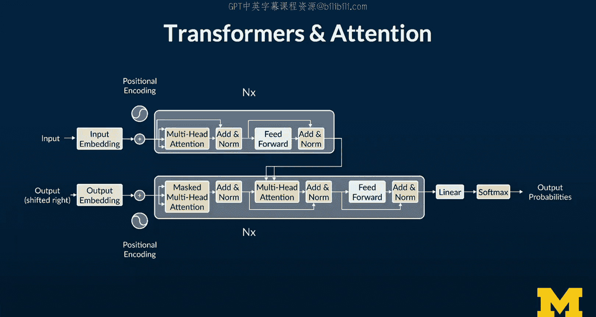
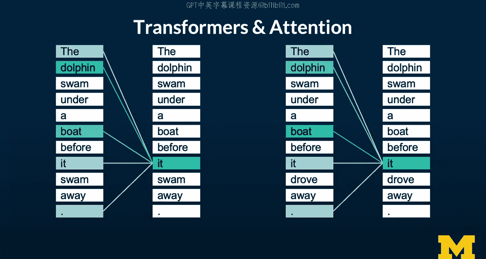
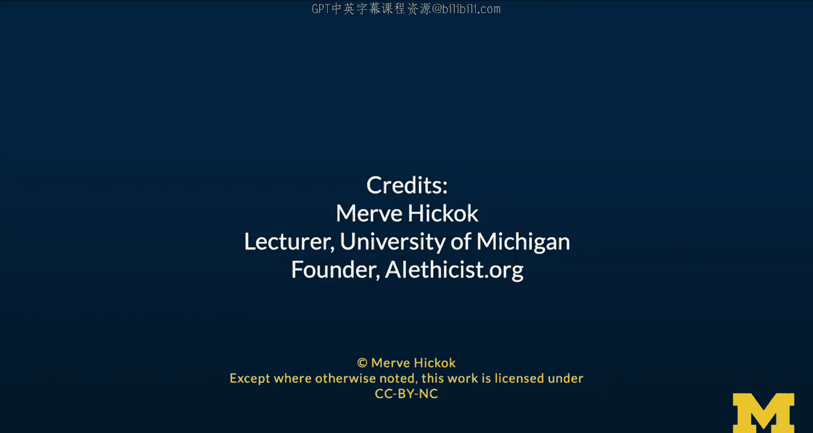

# 密歇根大学《负责任生成式AI简介（基础、对商业和社会的影响、政策、对未来的影响）｜Responsible Generative AI》中英字幕 p06 5_数据训练阶段.zh_en -BV1Uf421B7sR_p6-

。Trading of generatorr AI model requires several steps。

A model doesn't understand the language in the form that we humans use it。To train the system。

 language needs to be traded in a formulaaic way。In other words。

 all the information in the dataset set is to be converted into a mathematical representation。

This is called tokenization。Tokens are what make the language systems work。

 They are the building blocks。

Let's say the model had this sentence in its training dataset set。

Tokenization process would first split up every word and punctuation into individual tokens。

And then assign an numerical I D to each token。

Although in this particular example， tokens match words。

You can also tokenize on letters or combination of characters， etc。Now。

 imagine the model doing this for every single word in its training dataset set。After tokenization。

 reacts come into picture。Vctors showed the numerical representations of the relationships between tokens。

The model reviews its data set to see what words are the most frequently associated with each word。

When we plot these relationships， we can see the word embeddings。In other words。

 they learned representation for words。Which are similar or associated。

Ebedding is the plotted vector representation。Now that the tokens and the vectors are assignedsigned。

The relationships and how strong they are become clearer。For example。

 the word dolphin may have a stronger association with the word ocean or fish or shark within the language dataset set。

Now， let's switch to what the system does when we prompt it。 When a user gives the system a request。

 the prompt sentence or the sequence is also broken into tokens。😔。

Then the model finds the embeddings， which corresponds to these tokens。

Processed through the layers of neural networks。Now。

 the model has an idea of possible tokens to use as a response。

And probabilities for each of these tokens。For example。

 if he prompted the system to write about a dolphin， the system may complete the sentence。

 one of the dolphins。With the words， sm。Jumped， turned， rather than textant。

It is important to remember that large language models are all about statistical relationships and representations。

A single word， in this case， dolph。Has a vector representation。

All the other words in the sequence have a vector representation。

And then the final outcome or the predicted word， or the token has a vector。In other words。

 the system applies vector calculations constantly to generate a response to the user。

As mentioned， calculations to predict the next word in the sequence depends on the existing relationships and the strength of the relationships within the dataset set。

In other words， the quality of your training dataset set determines the quality of the responses you will receive。

When the system is predicting the next token。The probability of each next token is ranked。

The system may be tuned to always pick the top choice。

Sometimes this may lead to repetitive cycles， and outcomes are useless。

You can adjust a formulation of generated outcomes。

Where the model can be made to pick lower rankward。

Or pick up the words randomly from the probability list and still keep some cohesiveness。

Randomness here means that if we were to use the same prompt multiple times。

 we are likely to get different responses every time。 One of the technological breakthroughs。

 which allow for more cohesive responses in large language models is called transformers。😔。

You might remember from the beginning of the course that transformers are one of the most popular approaches to generate AI systems。

Transformers have contributed significantly to the recent developments in generative AI。

Simly put。Instead of processing input sequentially。

Transformers can process several sequences in parallel to each other。

This allows training of the model to be quicker and larger。

What makes generative AI systems and transformer method very interesting。

Is a concept called attention。Instead of only focusing on the very last word or the token。

 the model can look at a longer range and analyze the input sequence of tokens。

It pays more attention to certain tokens or words， which are crucial in keeping in line with the context。

 the pronouns， word noun relationships， etc cea。 The attention headers help to improve the model's prediction for the next tokens。

In other words， the model takes a prompt。En codes a mathematical representation of the prompt。

It runs the embedding and probability calculations。 separately。

 the most important parts of the previous sequence are analyzed for attention headers。

Then both the probability calculations and attention are combined to create a new representation。

 This mathematical representation is then decoded to convert it back to natural language。

For example。If the word dolphin in the previous example was used in the context of interacting with the animal in the ocean。

The attention headers would make that connection。And not suggest expert predictions。

 which would relate to Miami dolphins， for example。

A professional American football team based in Miami。

Such ability to analyze longer range of words and keep their relationships intact is one of the reasons the outputs of the generative AI systems tend to sound like the system understands the context。

The output sounds coherent。Because the model uses patterns existing in human language。

However， the system doesn't have an understanding of context or consequences。

It only has the former knowledge of the relationships between words。

You may also notice that if your prompt is beyond a certain length threshold。

 the responses may be less consistent and less coherent。

