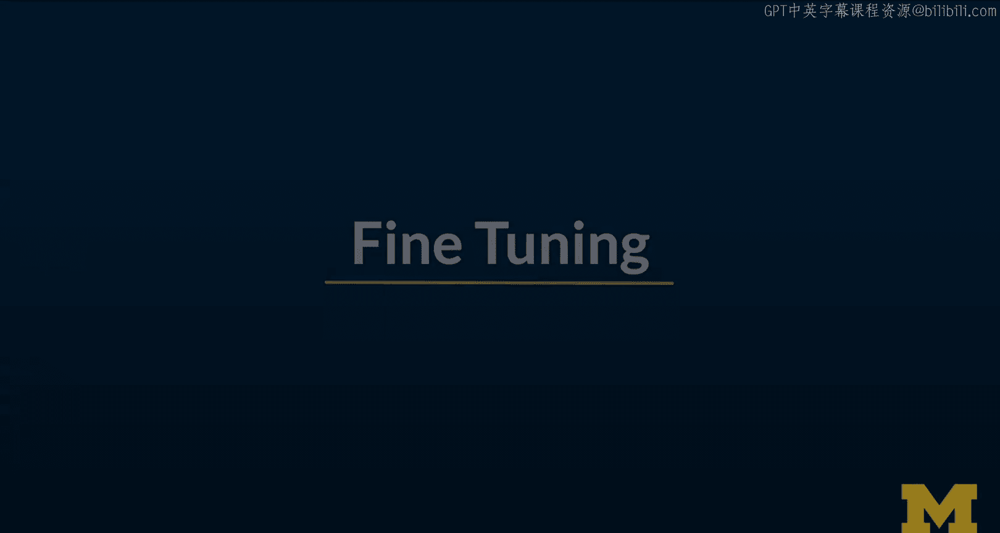
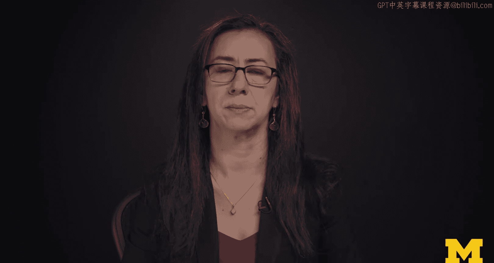
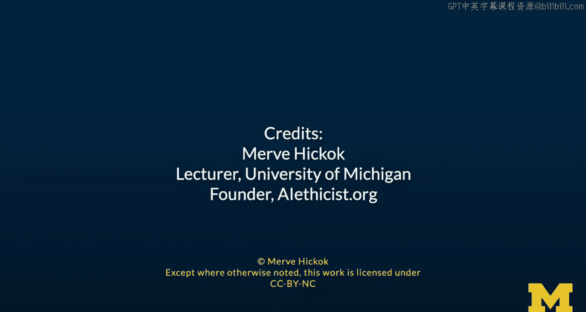

# 密歇根大学《负责任生成式AI简介（基础、对商业和社会的影响、政策、对未来的影响）｜Responsible Generative AI》中英字幕 p07 6_微调技术.zh_en -BV1Uf421B7sR_p7-

As mentioned before， once the unsupervised training for the model is over。

 you may still want to improve or adjust the responses for response quality。

Some consider tuning as more of an optional element in the life cycle。 However。

 for responsible development and for good governance purposes。

Or to improve the system's performance in a particular domain。It should be paid Ser attention。

Tunening can be thought of as a step to align the outputs with certain rules。

 Find Tning involves more quality data and human involvement。In this stage。

 the system' outputs are improved through question and answer between the humanss and the model。

The model is asked a series of questions， and the answers are compared against expected results or the grant route。

 Then the system is tuned further。

This work may involve significant human labor。 Another way to align the system is called reinforcement learning from human feedback。

In this approach， humans engage with the system by providing demonstration or samples of preferred responses。

Or compare different system outputs and rate the results。After human rating。

 another neural network tries to predict these human ratings。😔，And reinforces this on the model。

This becomes an iterative process。

