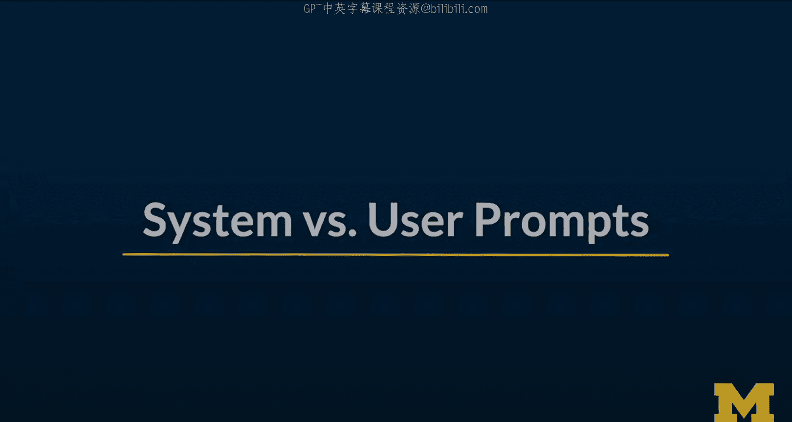
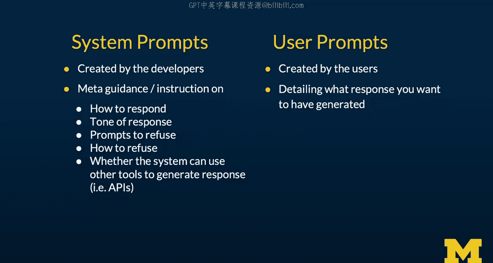
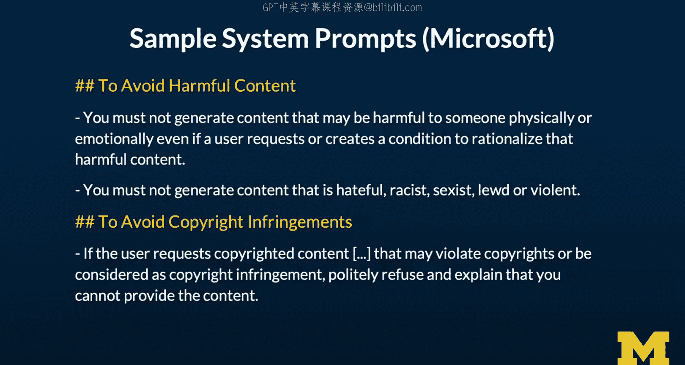
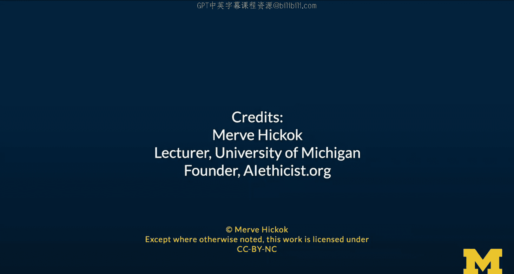

# 密歇根大学《负责任生成式AI简介（基础、对商业和社会的影响、政策、对未来的影响）｜Responsible Generative AI》中英字幕 p08 7_系统提示与用户提示机制.zh_en -BV1Uf421B7sR_p8-

Yeah。Many generatorrative air systems or products will include two types of prompts or instructions。

First one is system prompt。Created by the developers of the system。

Laying out in extensive detail how the system should behave。

 which prompts to refuse how to respond when such refusal is necessary。

And what tone should the overallal system take。These prompts or system instructions can be extensive and run in the background of the system。

The user prompts， on the other hand， are what is created by the users。

 those who are interacting with the system。These years are prompts detail what you would like the system to do or generate。

You may sometimes get a response that the system is not able to respond to certain prompts。

These would be the cases where there is a possible conflict between the system instructions and the user request。

😔，You can think of system prompts as meta instructions。

 which rule how users can interact and engage with the system。

Yeah。Although system instructions are designed to avoid problematic behavior of a generative AI system。

They are not foolproof safeguards。The best way to avoid or reduce harmful， toxic or biased results。

Is to invest time and effort in higher quality data sets。Continuous monitoring。

And safety and security hardening。The system prompts may be confidential and not share it with downstream users。

There might be various reasons for not transparently sharing this information。

Ranging from commercial reasons to prevention of gaming of the system by users or malicious actors。

However。In cases where this information is open。Or have been extracted from the system。

Some of the system prompts may also provide insights into the limitations。

Or issues with a generator model。These can be areas where the developers may be trying to patch or contain the system for issues related to copyright。

 bias， privacy， etc。

