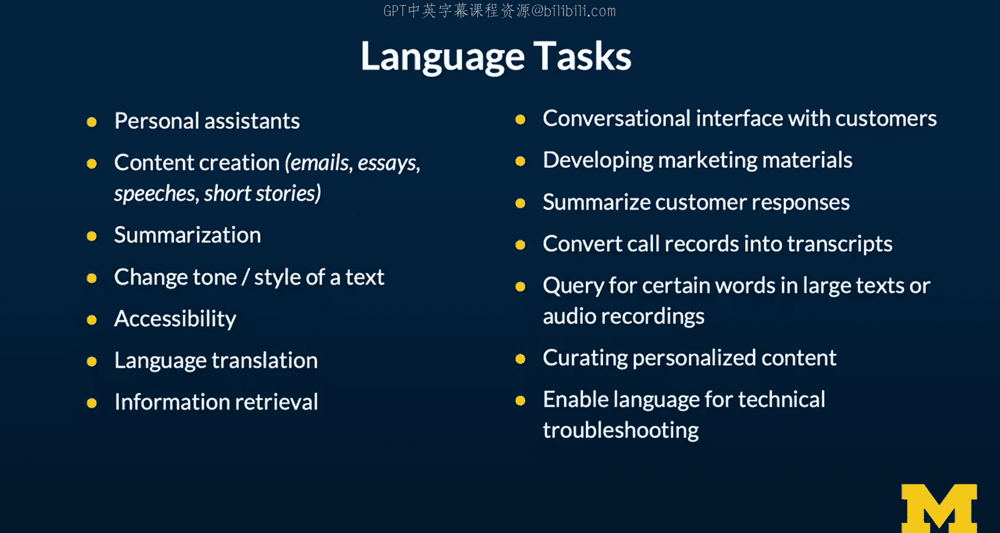
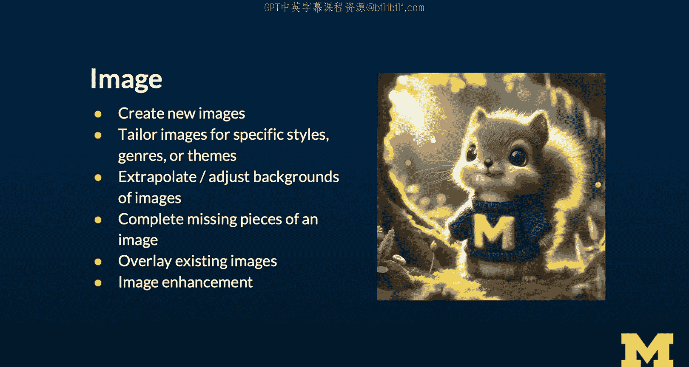
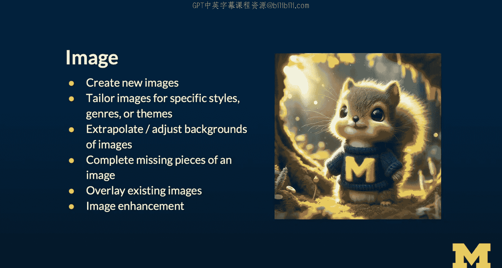
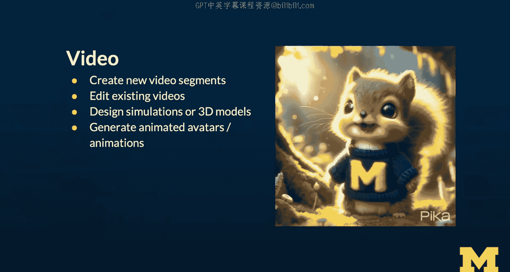
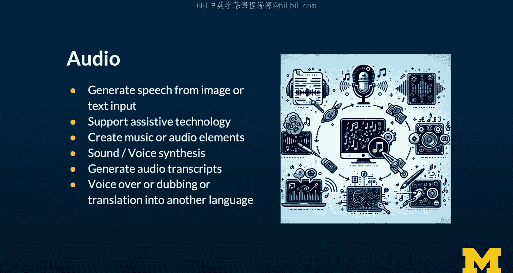
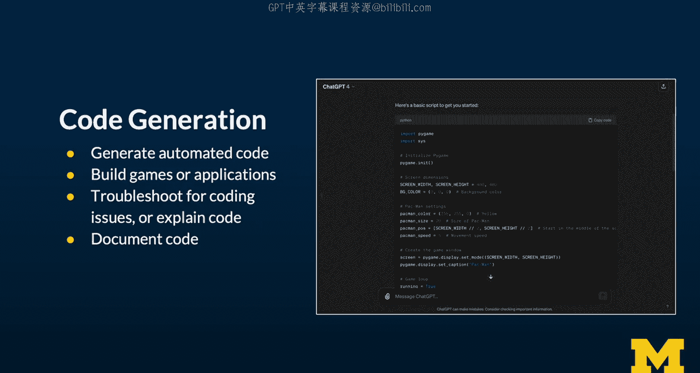
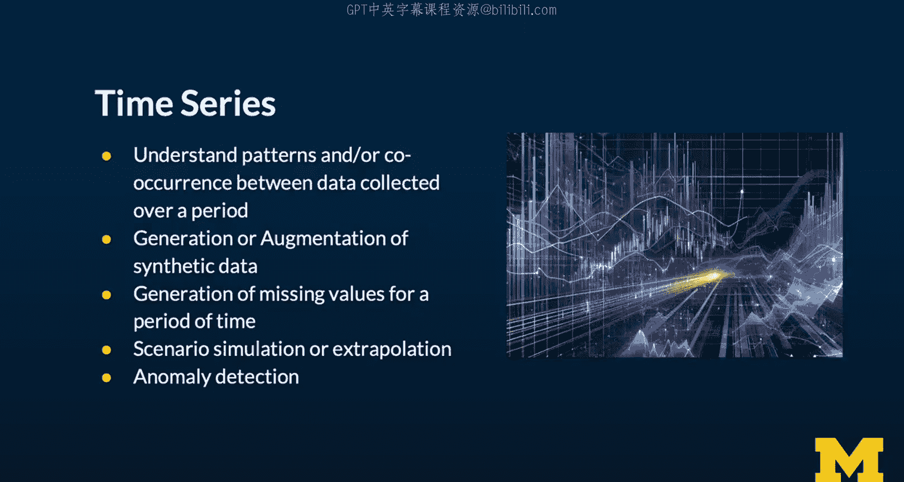
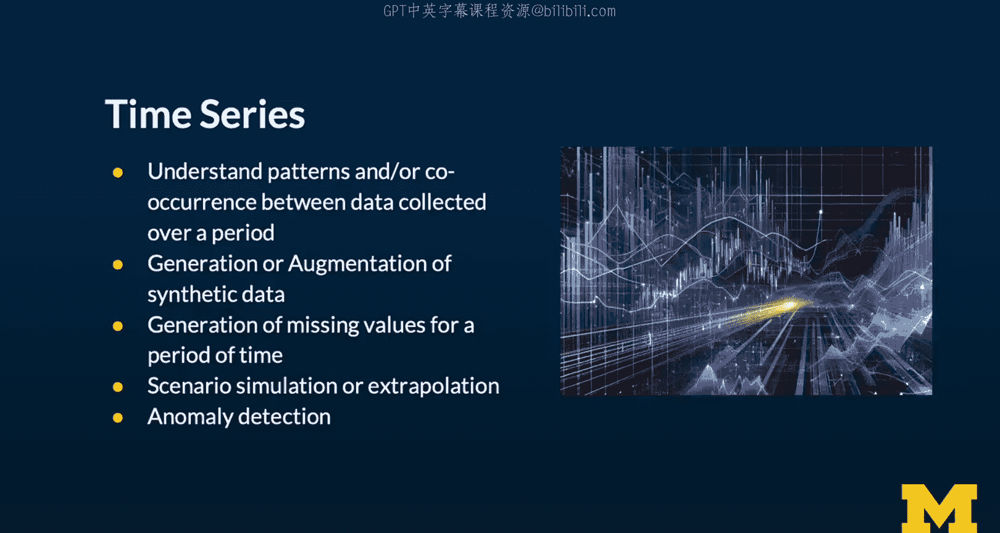
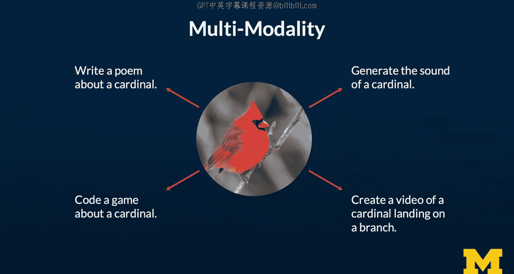
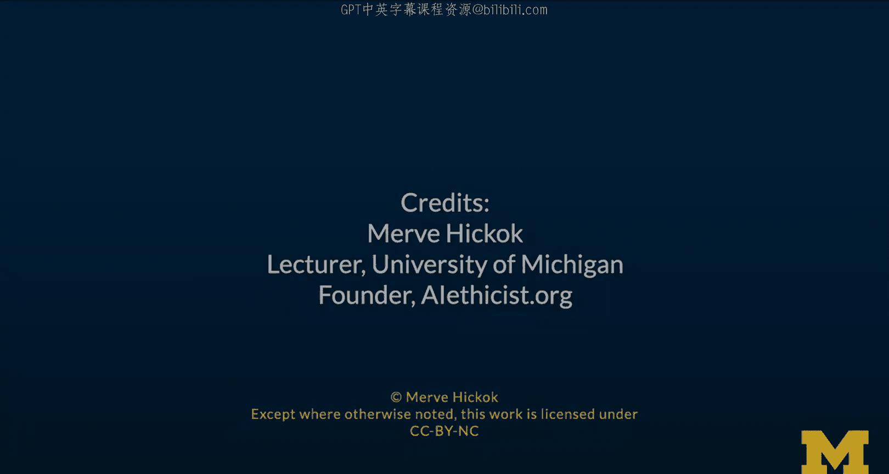

# 密歇根大学《负责任生成式AI简介（基础、对商业和社会的影响、政策、对未来的影响）｜Responsible Generative AI》中英字幕 p09 8_应用场景分析.zh_en -BV1Uf421B7sR_p9-

Now let's look at some of the use cases and emerging possibilities。

Generative AI systems have emerging use cases across many industries。For some of these industries。

 the impact may be transformative。Is our understanding of generative AI systems。

 possibilities and limitations mature。We will have more creative applications。

This is not to suggest that generative AI should be applied to every possible business。

Understanding how these systems work， their impact on business and society。

As well as the possible risks and limitations， it will be crucial for where we want to use the systems in terms of language tasks。

 we see both personal and business cases。

For personal use， generative AI can be used as a personal assistant。For example。

 users can ask the system to summarize long text or even audio conversations。

Change the style or tone of an existing text。Or even generate text such as emails， essays。

 speeches in a certain style。Genative AI can be used to search a collection of documents。

And pull out the elements when particular words are used。Instead of writing long formulas or queries。

 you can use language to autocomp tasks within spreadsheets。

We see examples of generative AI used for creation of creative content。Such as marketing materials。

 short stories or essays。These systems can be Kstarters to create new content。

Or provide the first draft of long narratives， such as blog posts or social media updates。

 or even brainstorm ideas。

However， it is important to remember that the generated content can be inaccurate。😔。

Based or based on copyrightated material。We will cover this risk， shortly。In business。

 some of the possible use cases are using conversational systems to automate responses for customer queries。

This is different from previous generation of chatbos， which were more rule based systems。

In other words， the system was programmed to answer in a specific fee for limited query types。😔。

Other use cases are summarizing comments or certain themes from customer reviews。

Turning call records into transcripts。Users can also create queries or search scripts to access information easier and quicker。

 rather than searching within large texts or audio recordings。Similar to language tasks。

 geneative via systems can be used for creative purposes in image related tasks。

The simplest use case is when a user generates new images by simply prompting the system with what they would like to see in an image。

This can be as simple as creating a coloring book。Or as complex as creating consistent characters in cartoon series。

Illustrated storytelling。Or creating scifi imagery etc。

Similar to language， these images can be tailored for specific styles， genres or themes。

In other use cases or possibilities， the system can use a given image and extrapolate or adjust the background of that image。

Complete the missing or fractured pieces of an existing image。

Overlay objects from different sources to create a new image。

Or even enhanced existing image for different photographic qualities。

 In addition to creating still images or drawings， generative AI systems are also used for creating new video segments。

Animated avatars and animations。Or even generate simulations of 3D models of product or design ideas。

The importance of using generative eye responsibly and understanding the capacity of these models becomes very important in the video context。

 While the majority of the videos are expected to be for fun or legitimate business purposes。

We are already experiencing very realistic defect videos used to create thisin and so distrust for blackmail individuals。

We will cover the impact of this information on defects in the following course， however。

Remembering that there are always both positive and negative users to these technologies can already start us in the right direction。

Generative AI systems can be used to create speech from image or text input to generate music or audio elements。

 synthesize sound or voice， or build sound effects。These systems convert text into audio transcripts。

 for example， to use in audiobooks。They are also used for assistive purposes， and can， for example。

 convert an image to an audio description by explaining the details of an image to a user。

The models can also be trained to mimic the voice and style of a person from a recording。

 which can be used for voice over or dubbing or translation into another language。

While this might be used for creative purposes， the capability also opens up possibility to create audio deep fakes or potential fraud scams。

Yeah。Just like the language tasks， code generation with the systems is based on the codes included in the systems dataset set。

 In other words， the system's outputs will be only as good as the quality of the code in its dataset set。

Coding can be used to build games， complete tasks or create websites。

And it can be as simple as prompting the system with instructions or drawings of what you would like to code。

 You could， for example， use Gen Ai to first create a game to align。

 Then the game character person is， then their animated avatars。

 and the code could then be generated to turn these ideas into an actual game。

 The system can be prompted to create software code in a particular programming language。

Or use to explain and troubleshoot coding issues。

Or even help with documentation of coding。You can prompt the model with error code you're getting in the code and ask it to explain the issue and suggest corrections。

While using GenAI for coding can be a great way to kickstart your project。

It does not remove the need for domain and coding expertise required to double check the code or the need to secure your model from adversarial actors。

 The issue at text health nations can repeat itself hereto。😔，The system may generate inaccurate code。

Or include malicious code learned from its training dataset set。Just like defect fakes。

 malicious actors can more easily create adversarial codes with these systems， too。

 a less known and discussed application of generative AI is time serious analysis。

This approach may be considered as a research question， for the moment。

It uses timest data or measurements collected over a period。

It is used to understand the behavior or trend of the system。

One challenge with using time series is the temporal or time dependency between the features。

As well as the possibility of other factors contributing to changes。

 consider continuous data such as render patterns。Energy consumption， stock market， network activity。

 sale figures。

Traffic or logistics data。Just like word embeddings， which show words that tend to appear together。

Time series dataset sets can be analyzed to understand the patterns between the features。

Such as co occurrences， seasonal or periodical changes。

Researchers are also working on whether Gs can be used to create synthetic data from existing time series。

In other words， creating sequential data。Or the possibility of extrapolation where data might be missing for a certain period of time。

😔，If time analysis works as expected， it can also be used for scenario simulation of patterns and interventions。

😔，Or detect anomalies or deviations from the pattern。

Some generate a systems are trained on a single type of input， such as only image or only text。

Therefore， their outputs are limited to a single input type。

More complex multimodal geneative AI systems， on the other hand。

A trained with input from a variety of types such as text， image or code。

The models analyze the associations between text and other types of data。

Such as the corresponding image or audio。And it can generate outputs in different formats， too。

For example， you can prompt the system with an image and then ask the system to provide further information about the object。

Or upload a hand thrown template of a website and ask the system to create that website for you。

Or you can use text prompts to create videos。Now， using divisionffion transform approach。

The limitation is when the instructions are too complex or when the response requires spatial or logical reasoning。

