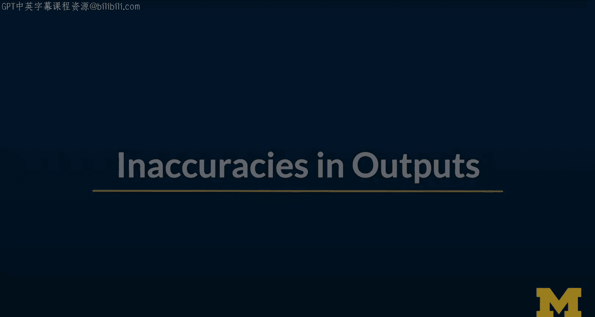
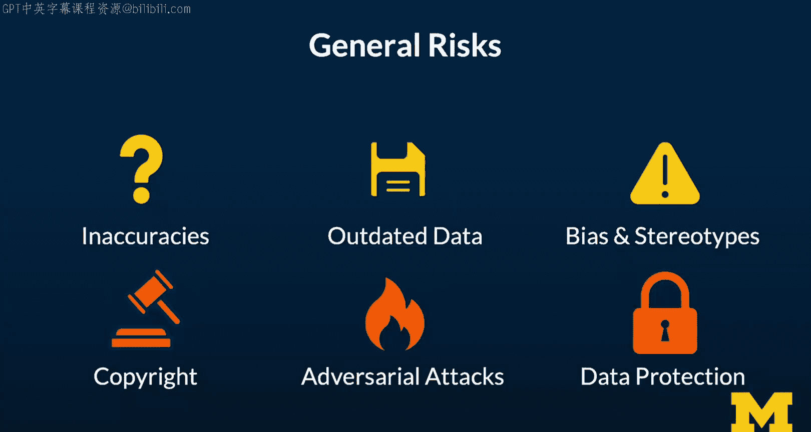
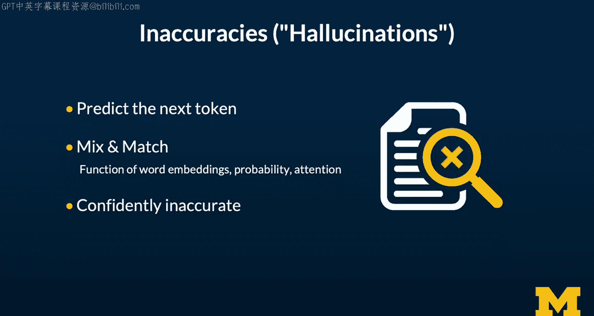
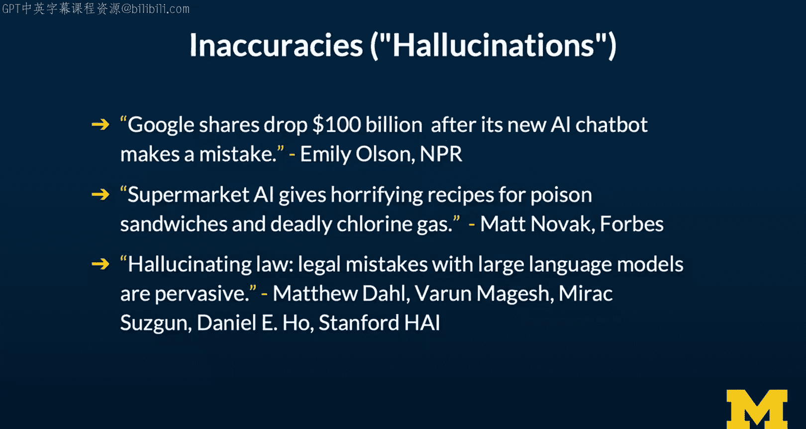
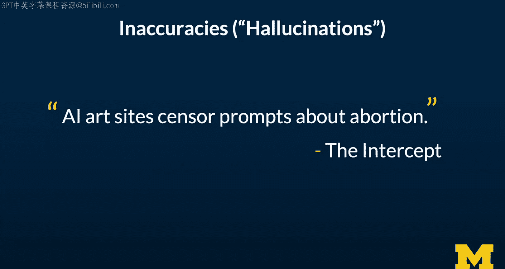
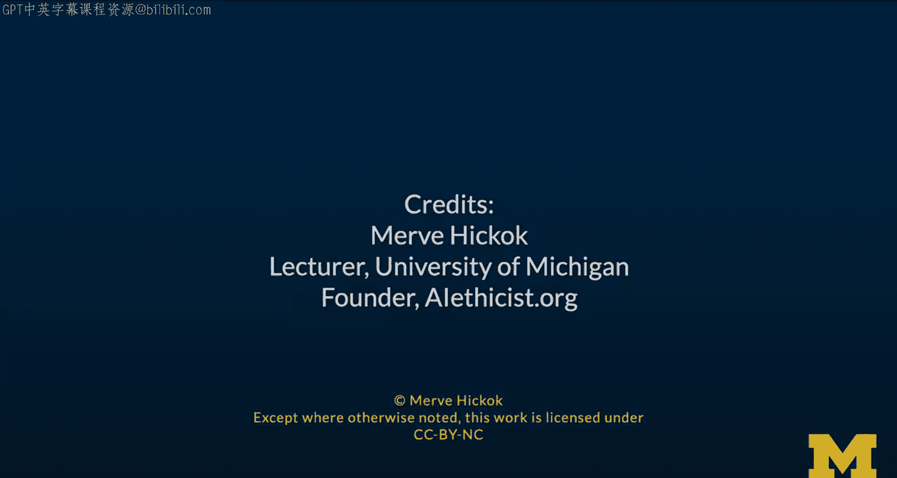

# 密歇根大学《负责任生成式AI简介（基础、对商业和社会的影响、政策、对未来的影响）｜Responsible Generative AI》中英字幕 p10 9_输出结果不准确性问题.zh_en -BV1Uf421B7sR_p10-

Developing and training geneative AI models from scratch is resource intensive work in terms of talent。

 money， computing power， data and effort。Currently。

 only a handful of companies are able to develop and train base models。

Many downstream users or businesses build their own models on top of these large base models。

However， whether you're building the model from scratch。😔，Or building a connected or dependent model。

 There are certain risks you should be aware of。In the following section。

 we will cover some of the general risks related to the foundational elements of these systems。

At the simplest level， large language models picked an next word in a sequence。

What the model is essentially doing is just asking over and over again。Given the text so far。

 what should the next word be。The responses are based on statistics and reflect the most frequent word connections。

😔。

Because the model is based on statistics rather than logical reasoning。

These systems can produce inaccurate results。

And with high confidence， too。They can reflect what is in their dataset set。

But cannot be that logic or an independent understanding of the world。

This means they may have incoherent or wrong responses to prompts involving nuanced contextual knowledge。

 idioms， special explanations or causal reasoning。😔，Furthermore。

 the quality of the training dataset set， whether it is representative， recent， sufficient。

Can also impact the model's ability to make better generations。When used for creative tasks。

 such mix and match function can be helpful and even preferred。

It is considered as a feature rather than a bug by some developers。 However。

 for any use case where the accuracy， factualness or precision of output is important。😔。

Decision makers should think twice about using generative A systems。

 although generative AI systems are great in creating coherent sounding outputs。

These models do not have the technical means to complete complex tasks。

Where nuanced understanding of issues is necessary， such as financial or legal analysis。

The providers of these models warns against this inaccuracies in their terms and conditions。

Depending on the use case， these inaccuracies could cause significant harms or failures for both the individuals receiving the prompt。

 as well as the businesses whose system is producing such outcomes。

Liableed issues can emerge for businesses。 For example。

 a recent study by Stanford researchers show that when language models are prompted for specific legal queries。

Their inaccuracy rates range from 69 to 88%。These models do not correct errors。

 even when prompted further。😔，And tend to reinforce incorrect legal assumptions and beliefss。

This may be a relief for some paralegals and lawyers concerned about their job security。 However。

 imagine a person who doesn't have the financial means to hire a lawyer。

And decides to use a language model for legal questions。

To write their plea or even understand the legal process。

 the same study also warns about tendency of language models towards our confidence。

Irrespective of their actual accuracy。Similar warnings can be made for any task that may involve a user taking a real life action as per the responses of the generative A systems。

Such as making financial investments， medical inquiries。And even planning your next vacation。

But even when you least expect it or with personal use of generative AI systems。

 there are still serious considerations we need to keep in mind。😔，Ideally。

 if there is a benefit from these emerging technologies。

 we would want them to benefit everyone equally and equitably。However， in some cases。

 the generated outcomes may be inappropriate for the context， sometimes even artright offensive。

In many cases， it is the decisions about training data sources。

And the decisions about the design which go into the model， which result in pious or toxic results。

 Some AI products are designed to avoid certain issues by way of system prompts or meta instructions。

However， such restrictions on certain content may also account as censorship。

 The target issue may be culture， or context dependent。

Or it might be a politically divided issue in an attempt to create safeguards against a certain content。

 The system may be trained to avoid certain words or language and prompts。However。

 this may result in users not being able to generate outputs to express themselves freely。

Create content for their products， align with their identity。

Although it is possible to use different prompting techniques and make the system generate the sensor。

 text or image。The extra step or burden。Or possibly viin in terms of use are still problematic。

 using prompt refusals as the only mechanism to fight against toxic content or inaccuracies。

May result in a false sense of assurance for the developers and deploys of the system。

