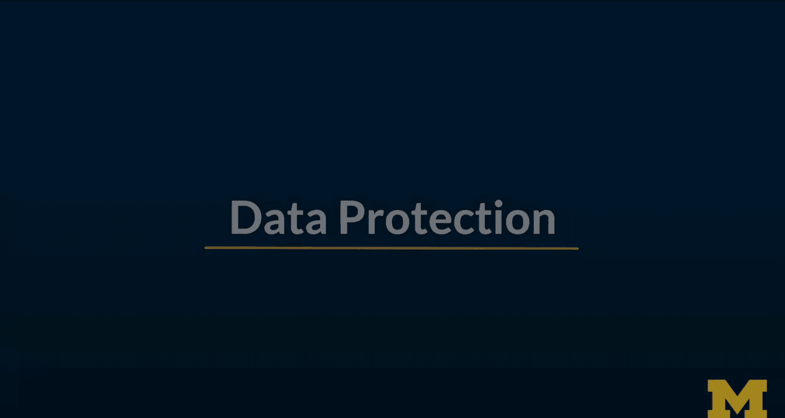
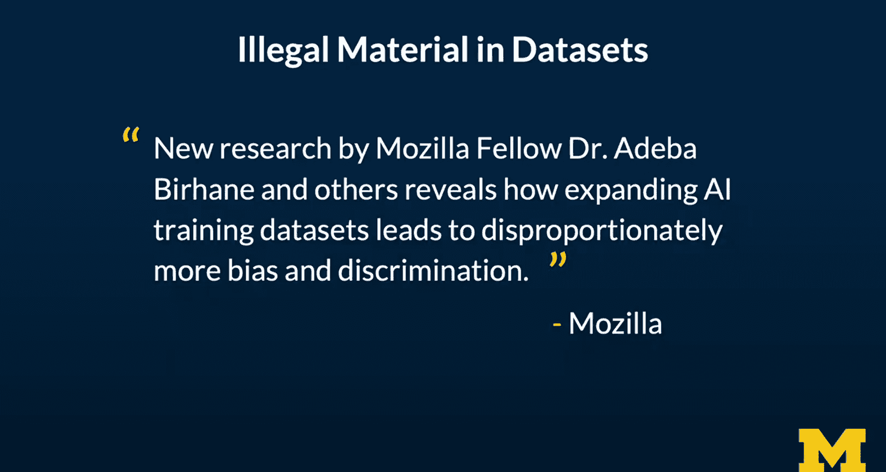
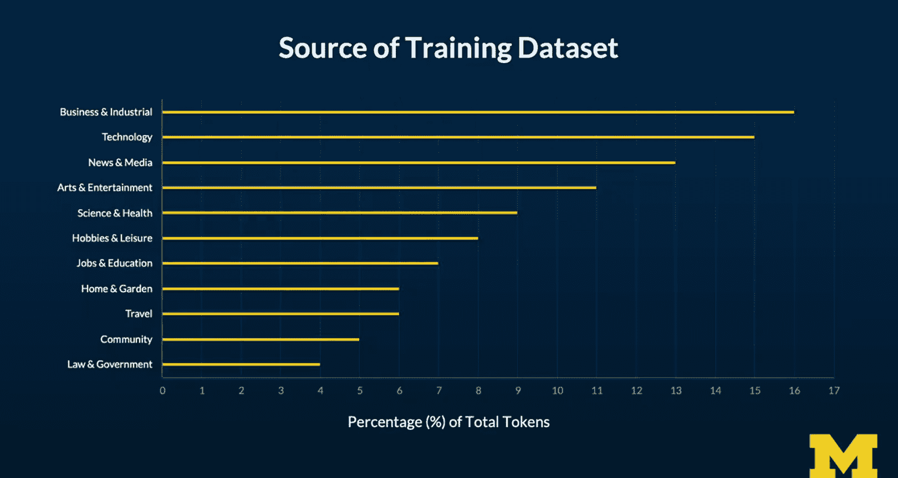
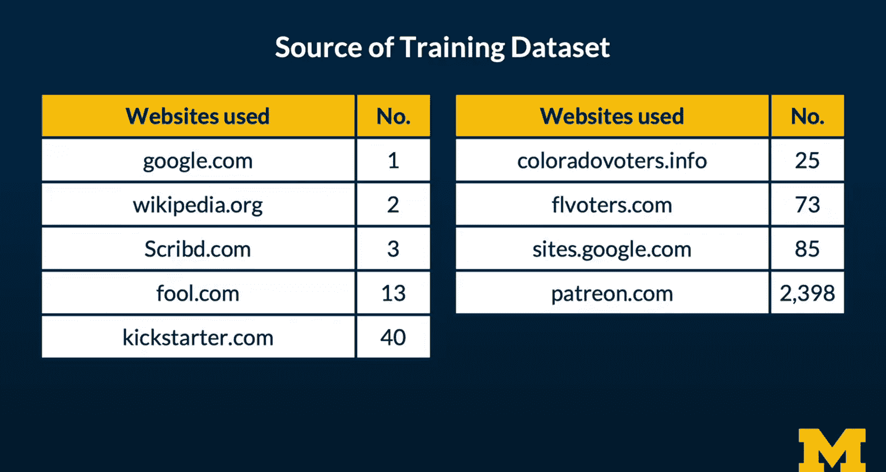
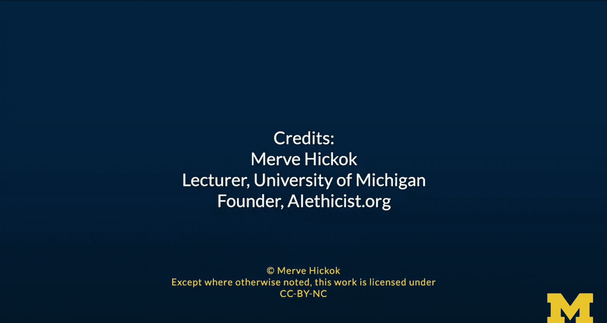

# 密歇根大学《负责任生成式AI简介（基础、对商业和社会的影响、政策、对未来的影响）｜Responsible Generative AI》中英字幕 p11 10_数据保护策略.zh_en -BV1Uf421B7sR_p11-

On large chunks of internet is scrapd， the data sets may also include illegal or offensive imagery from the web。

 such as violence， hate symbols， pornography and more researchers analyzing samples that detect hateful content。

Also found that while generative multimods are scaled up with larger and larger data sets。

 the hateful content， the negative stereotypes and other harmful representations can appear at a significantly higher rate in larger dataset sets。

 just because the training dataset set or even a product is widely used does not mean that it is free of toxic。

 illegal or private data。😔。

Unfortunately， many of the generative AI systems available as products or open source。

Do not have associated data quality or proence documentation。😔。

This means we do not know the extent of public versus private information in the training dataset set。

Free versus copyrighted material。The extent of bias in representation and toxicity when using these models for personal or business purposes。

Geneerrated output should be treated with caution regarding its prominence。

 accuracy and related risks， not being able to analyze the dataset set and the models also means that we are working in the dark about the capabilities and behaviour of these models。

As an example， reporters in Washington Post have analyzed Google C 4 data。

 This is a dataset which is widely used for training purposes。

And reflecting contents of 15 million websites， the dataset set is reported to be used for several large language models。

 too。 you will notice that some of the sites used can be more neutral and credible sources of information。

 such as patent database， Wikipedia， et cetera。😔。

However， data sources also include websites which have information such as water and address registries。

Or scrap websites where individuals or even companies provide exclusive content for a fee or subscription behind a payable。

A certain subset of the dataset shows propaganda sites and discussion forums engaging only in certain political or world res。

Quality of the training dataset set makes significant difference in the outcomes generated by AI。

We have more information about this dataset in the example。However。

 this is not the case with many generative AI systems where vendors do not share the details on the prominence or the quality of the data。

