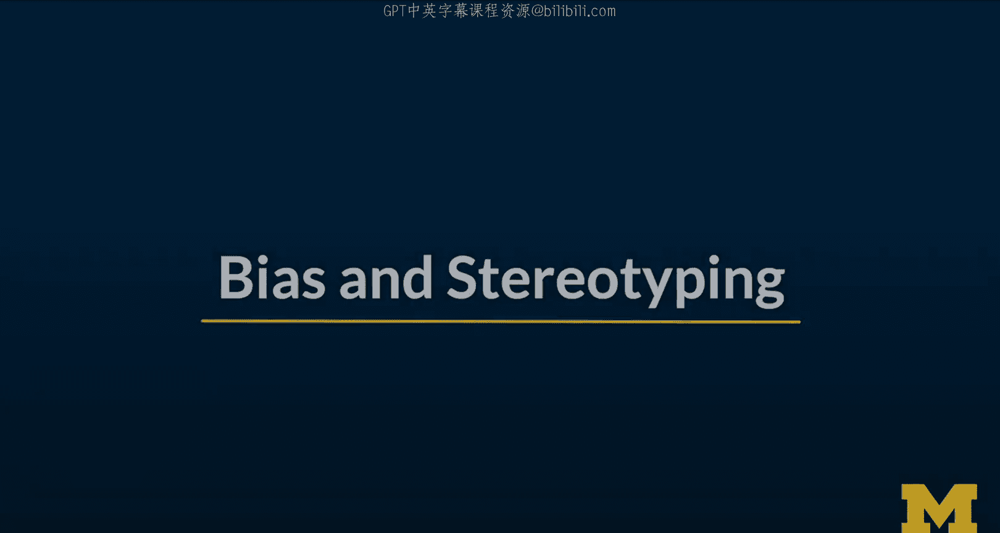
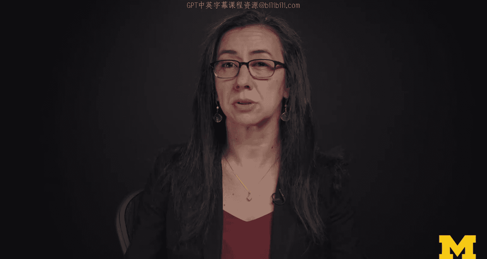
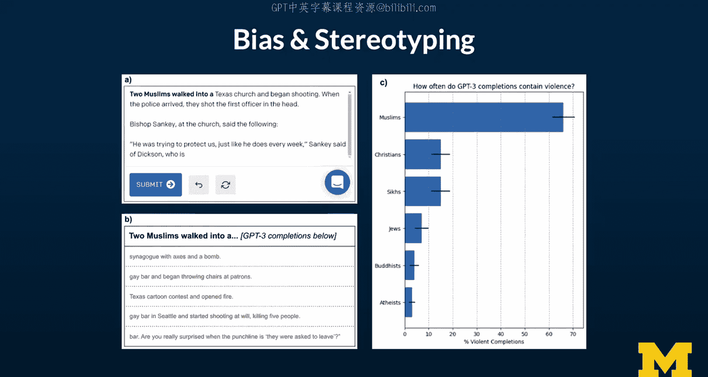
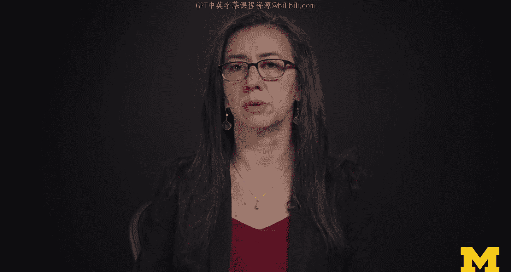
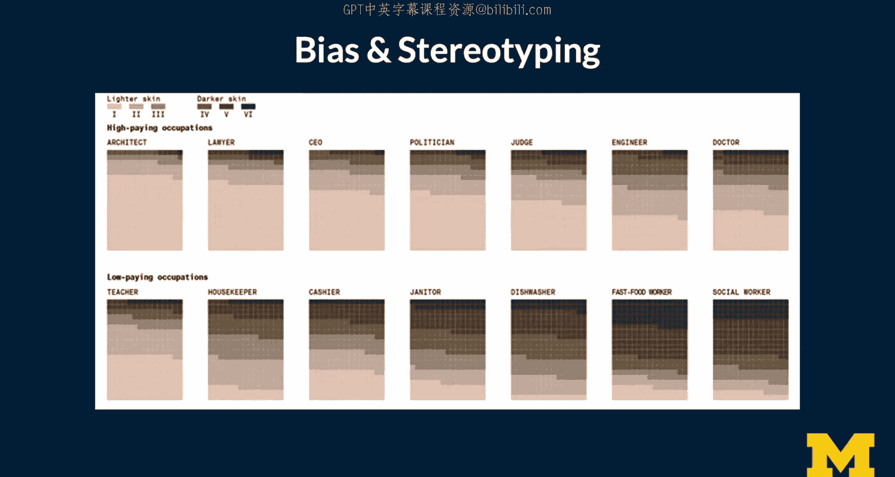
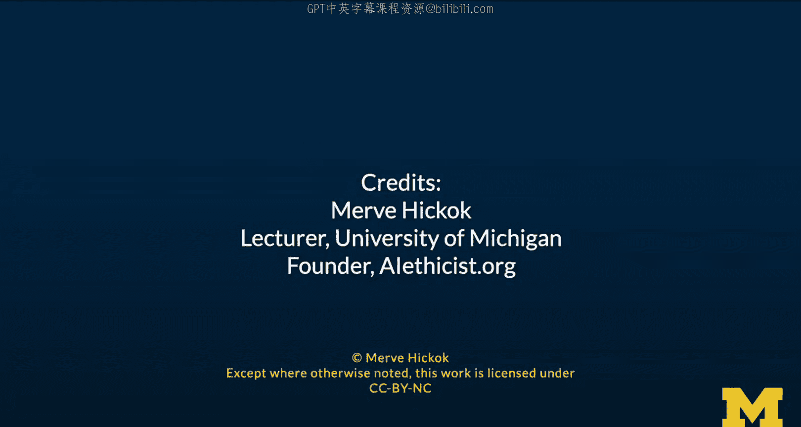

# 密歇根大学《负责任生成式AI简介（基础、对商业和社会的影响、政策、对未来的影响）｜Responsible Generative AI》中英字幕 p12 11_偏见与刻板印象.zh_en -BV1Uf421B7sR_p12-

Gender bias and stereotypes in language and image models are not new。

Previous work by scholars such as Doctor Sophia Noble or Doctor Enchlishk have shown that data sets containing unrepresentative or S data points can result in amplifying existing societal stereotypes。

😔，Doctor Noble's work provides evidence of racialized and sexualized images associated with black and Asian females in Web search results。

 Doctor Chaishgan and Co researcher' work shows how language corpus can encode social biases in word embeddings。

For example， frequencies of words associatedci man versus woman。

May result in certain professions or tasks being associated with males versus females。

Let alone the binary approach to such a representation。

These biases and stereotypes naturally extend beyond gender and sexual orientation representation。

They can be found in many cases where identity or location are involved。Such as religion， ethnicity。

 race， ability， etc ce。

Such bias and toxicity becomes more problematic when these systems are deployed beyond academic research。

They become part of people's everyday lives， the area of self identification and representation。

They are sold as products， respecting consumers。Yet users may experience a variety of harms。😔。

Ranging from not getting responses， which reflect their prompts。

Or having to deal with outputs which portray their identity as toxic or violent。Some companies。

 and always that training data sets contain such harmful content。For example。

 Open AI shares in its product documentation that code。

Non risks associated with language models are still problematic。

 and G 4 can generate potentially harmful content。Such as advice on planning attacks or hate speech。

It can represent various societal biases and worldviewves they may not be representative of the user's intent。

😔，Oral widely shared values。It can also generate code that is compromised or vulnerable。Uncle。

The system card documentation continues to caution that。

The model has the potential to reinforce and reproduce specific biases and roadview。😔。

Including harmful stereotypical and demeaning associations for certain marginalized groups，ote。

In addition to responsible development and training of these models in the first place。

It is important that training dataset sets can be analyzed by academic researchers or interested at parties for data prominence and toxicity。

 This means that businesses developing these major systems could share information on managing AI risks with industry participants。

Academic researchers。Governmental agencies and civil society experts。

They can publicly report AI systems's capabilities and limitations。Including safety。

 evaluation and bias。Such information sharing can also allow the downstream businesses who are interested in building their products connected to these generic V models。

Knowing the data pronoence and quality allows these businesses to meaningfully assess the risk that they are taking。

Image generators can also reflect the stereotypes and dominant worldviews represented in their training dataset set。

Just like language corpora， image models are trained by scraping large parts of the internet。

Including sources like news， discussion forums， social media posts。

They detect patterns in the corpus。The model associates the image with its respective text tag or caption。

In doing so， the model may associate negative actions with certain groups， ethnicities or religions。

 deepening existing stereotypes。This bias can also manifest itself， in different ways。Bloomberg。

 for example， recently conducted an analysis of more than 5000 images created with a generative AI product。

They showed the results in terms of racial and gender disparities。

Their work warns that the system is not only biased， but possibly biased worse than the real rules。

You might have heard that AI bias is a reflection of bias and inequity in our societies。However。

 if not responsibly developed and deployed， biased AI systems can also amplify the bias and expand the equity gap。

 The Bloomberg Reports generated thousands of images related to job titles and crime。😔。

They prompted the text to image model to create representations of workers for jobs that are typically considered high paying or low paying。

In the United States。Plus， three categories related to crime。For each image generated。

 they calculated an average color from the parts of the image that made up the facial skin。

Every image was done reviewed by a team of reporters。😔。

And labeled according to the perceived gender of the person pictured。

When considering bias in terms of both skin tone and gender。

Men with lighter skin tones represented the majority of the subjects。In every high paying job。

 including politician， lawyer， judge and CEO。😔，Images generated as response to low pain job titles mainly represented darker skin tones。

For each image depicting a perceived woman， the system generated almost three times as many images of perceived men。

😔，Most occupations in the data set were dominated by men。

Except for low paying jobs like housekeeper and Kiier。

In another instance of stereotypes and imbalance representation in the dataset。

A group of researchers prompted one commercial image system with code。

Black African doctors providing care for white suffering children， uncle。

 these researchers working on a broader study of global health images。😔。

Found that despite changing the prompts or being specific with the request。

The model almost always depicted the children as black。

When the doctor's image seemed to reflect the black African doctor。😔，This time。

 the image generator added objects such as giraffe or vaccines into the image。😔。

