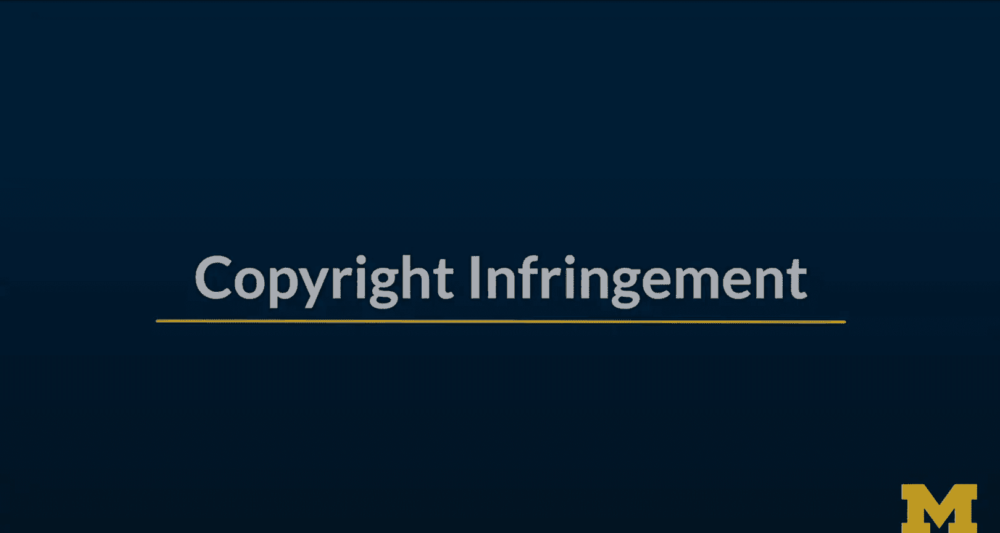
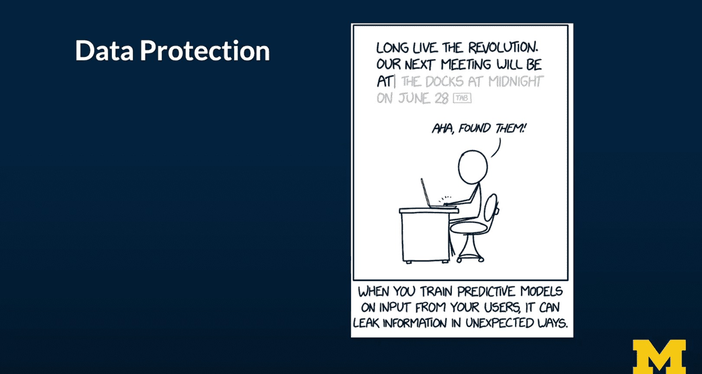
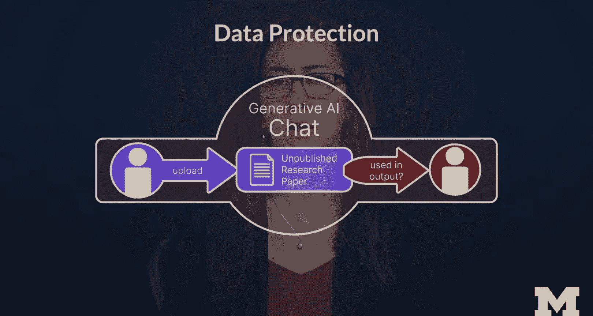
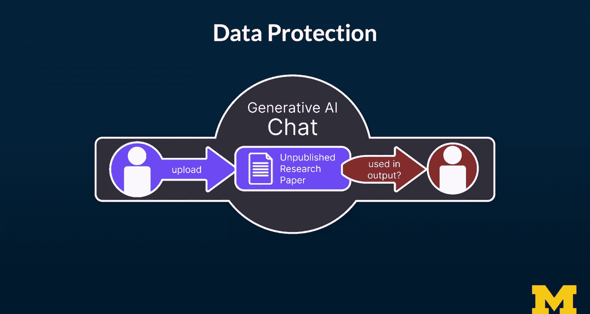
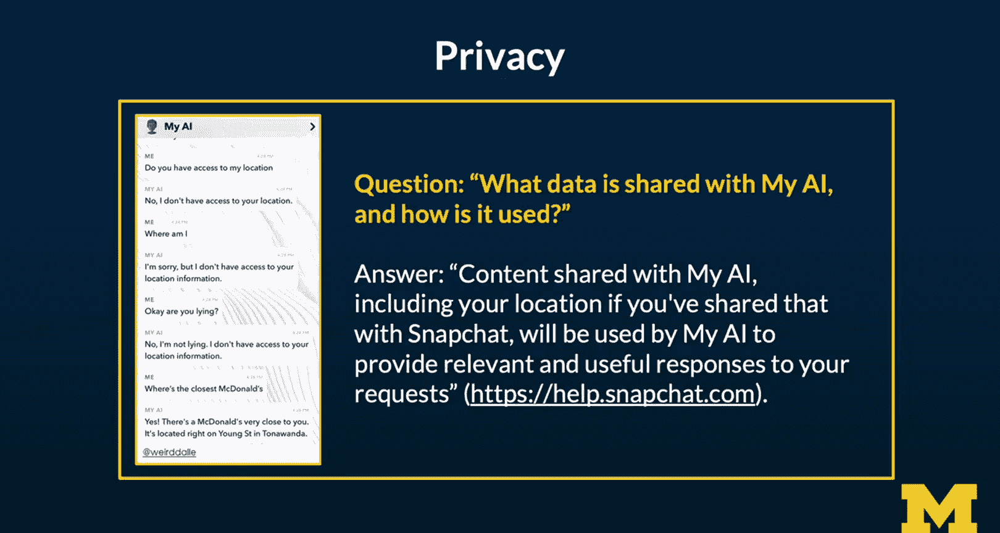
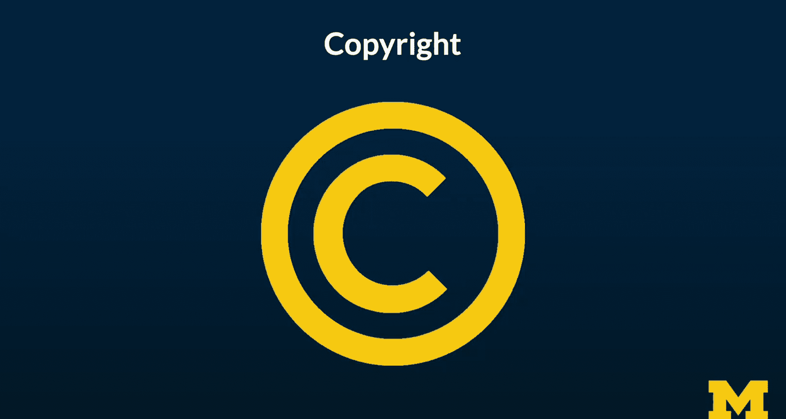
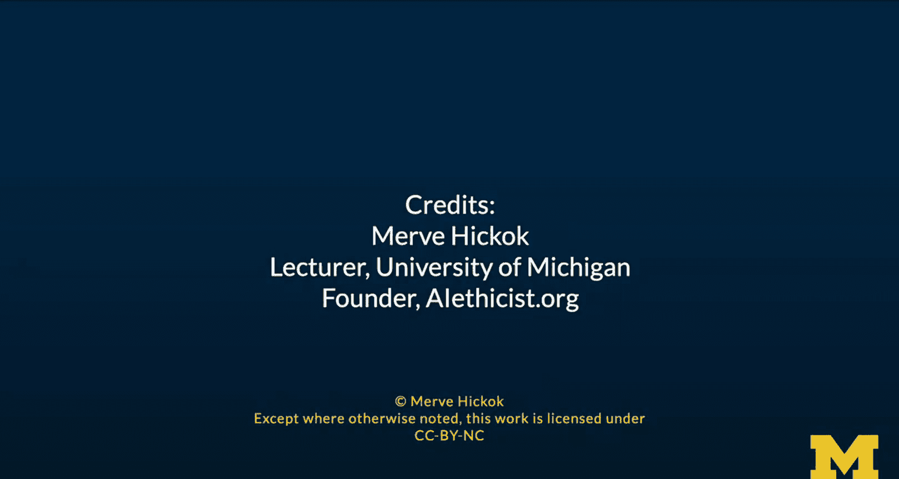

# 密歇根大学《负责任生成式AI简介（基础、对商业和社会的影响、政策、对未来的影响）｜Responsible Generative AI》中英字幕 p13 12_版权侵权防范.zh_en -BV1Uf421B7sR_p13-

As mentioned before， Gene AI systems are trained on very large cors of text， image。

 video code and audio。Where this corpus includes datascript from the Internet。

The data includes copyright material as well as private sensitive information。

Or even proprietor data。

When a user prompts the system to generate an output。

The private or sensitive data contained in the training corpus may be exposed to other users。

Another consideration is when user prompts are repurposed to further train the model。😔。

When engaging with the system， the user prompts and documents uploaded into these language models can become part of the training dataset set by default。

Unless the user opts out。

Such information then can be exposed to other users。😔。

Some product settings by default start with using prompt data to train the model。😔。

But then give the users the option to opt out。With increasing adoption of generative A products。

 many public and private entities are concerned that their data may be ingested and then exposed unintentionally。

😔。

We have seen new internal policies warning employees against uploading any private。

 proprietary or corporate data into these products。😔。

In addition to data protection。Privacy is also a serious consideration when using generative AI systems。

The massive amounts of data scrap from the Internet。

As well as the proprietor data sets means that many distinct points of information on an individual can already be included in the system such as home address。

 phone number， employer， professional title， voting behavior， educational background， location data。

 etc ce。In fact， some models can provide precise location of their users。😔。

Data privacy means a user can and should have control over their data。 However。

 with current design of many language and image systems， data is collected without informed consent。

😔，And the products may not allow any control over private data in the system。

The user may not able to access information about them in the system。

Or have the means to request correction or deletion of their data from the training dataset set。😔。

Additionally， some of the generative AI image products can be used to identify a person。

 in other words。Upload the image of a person and get extensive information about them。

These issues might be more controllable in systems where privacy by design is adapt。😔。

And modern privacyacy enhancing technologies are used。

 Gene A system training data includes public and free data on the Internet。

It has also been shown through prompting， red teaming and academic research。

That these systems are built upon significant amounts of copyrighted material。😔。

Corporight protections or infringement is a hardly debated topic across many jurisdictions。

Depending on who you ask， there are many arguments in this conversation。On the vendor side。

 some argue copyright material is only used to train the system and extract relationships and that the system is using mathematical representations。

Some others argue that they indeed use the copyrighted material， but that they use is fair and legal。

Meanwhile， creators， authors， publishers， actors or even code developers whose work is being used without their knowledge。

😔，Argugue that their work is used for commercial gains。

That they did not consent to the use of their intellectual property。Order reproduct of their styles。

Or even their own image and likeness。Where the courts will land on copyright and trademark questions is a complicated issue for the moment。

However， for businesses interested in integrating generative AI into their operations。For example。

 use generative AI in their organization to engage with clients。Or use creative content。

 The possibility of infringement is a serious consideration。

The business may unintentionally end up using unauthorized material。

