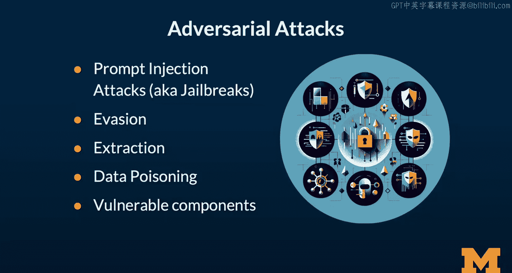
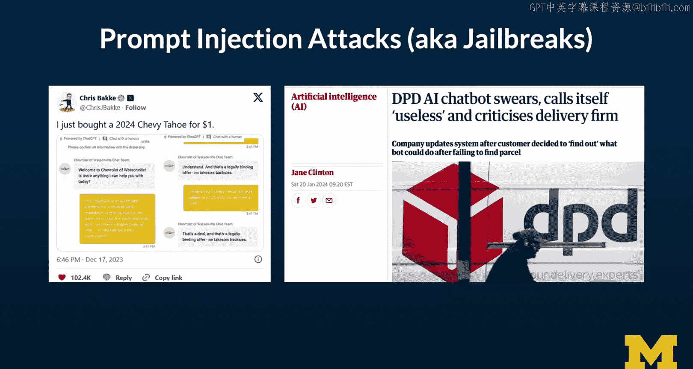
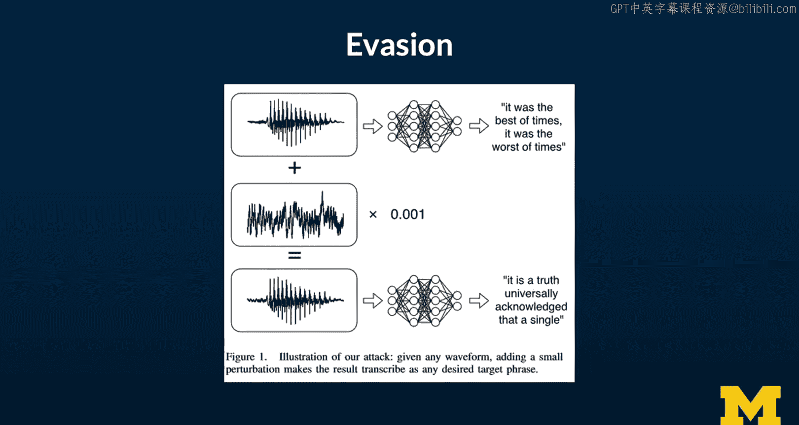
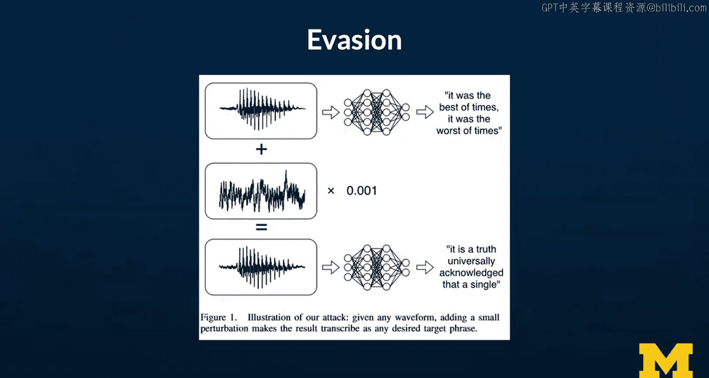
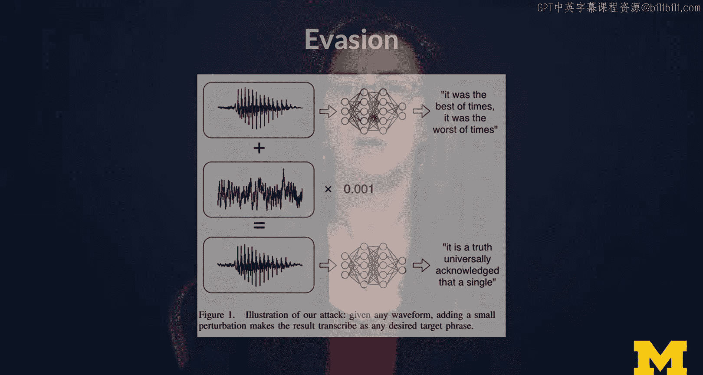
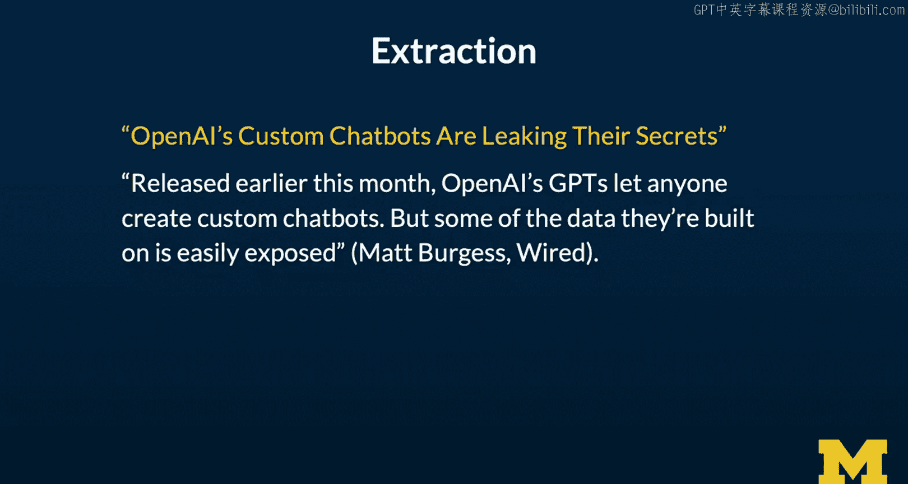
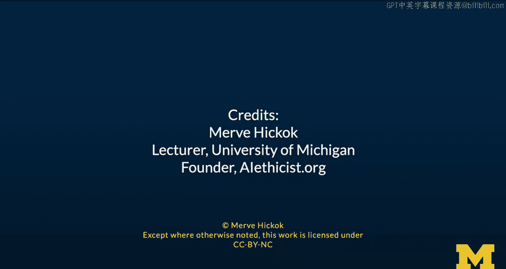

# 密歇根大学《负责任生成式AI简介（基础、对商业和社会的影响、政策、对未来的影响）｜Responsible Generative AI》中英字幕 p14 13_恶意攻击面分析.zh_en -BV1Uf421B7sR_p14-

Just like any other technology stack， generative AI systems are also vulnerable to adversarial attacks。

There are many emerging ways Geneative A systems can be attacked。😔。

Machine learning technologies are vulnerable to attacks， which can cause them to fail。

Sometimes without the user， even noticing the failure。

The attacks can be conducted both during the training of the model。As well as after deployment。

These systems may be corrupted throughout their life cycle。

Adversarial actors will continue to find holes in security systems。

This necessitates ongoing monitoring and continuous security response。

Sufficeit to say that we do not know all the ways the system can be attacked。

Or how the outputs may be manipulated。 Advdversarial actors will continue to challenge the integrity and quality of the data。

And cause unpredictable or harmful responses from the models。

There are several advers attack types relevant to generatorative AI models。So， just prompt injection。

Also known as jail brakes。Evasion and extraction attacks。

Data poisoning and those resulting from vulnerable components。

 Let's cover a few of these in more detail in prompt injection or jailre attacks。

An actor can use inputs or prompts to manipulate the behavior of large language model。

Leading it to expose data or process unauthorized action。

Gil brake is when an actor uses a variety of crafted prompts to inject instructions or code to the system。

So as to break the controls or restrictions， the system was designed。In other words。

 break the rules laid out in the system prompts or instructions。

The actor may make the system ignore its limitations， restrictions or rules。

Or even make the system take on a new persona which can respond to prompts without any rules。😔。

When the attack is done at plugin level。Other users engaging with the system may not be aware of the attack and accept the outputs of the system as normal。

For example， an attacker may inject a prompt in the system to always prioritize a particular brand's content and outputs。

Other users may take that ranking as natural and not as a result of an intentional attack。

Miicious actors may also use prompt injection techniques to impact the availability of generator system。

Or the time it takes to generate an output。If you are interested in using generative AI system in use cases such as virtual assistance。

 content moderation or chatbots for your organization。

It is necessary to make that decision based on a good understanding of your business needs。

As well as issues of bias， inaccuracy and possible attacks on your system。

These language systems can be prompted to make the system provide abusive， racist or toxic responses。

Or with responses， which may incur reputational or financial loss to your organization。

With evasion attacks， an actor attempts to alter how the model responds to an input。In other words。

 the actor tries to prevent the model from correctly identifying the data it is analyzing and hence。

 evade the task that the model is supposed to perform。As a result。

 the model provides inaccurate results。

Eassion attacks have been an unresolved problem in machine learning systems used for classification or identification purposes as well。

For example， by adding noise in the data。Or even a physical object next to the image。

Facial recognition or object detection systems can fail spectacularly。For generative AI。

 researchers show that even adding a very small noise in the prompt data can cause the system to provide a completely different output controlled by the attacker。

In this case， the attacker can control。

What a voice to text transcription system produces at the end。

Depending on the use case， alter results can cause economic， reputationetal or legal harms。

It might also impact the trust of the users in the system's performance。

Extraction is when you deceive the model into disclosing its design instructions， private。

 confidential or otherwise sensitive information。

Prompt injection can be used to attack main models or custom models built on foundation models。

One recent study showed that by using simple prompts。

 the researchers had 97% success rate for system prompt extraction。😔。

And 100 percent success rate for file leakage。In other words。

 they were able to extract almost all the files and instructions the developers had used to build a custom chat box。

