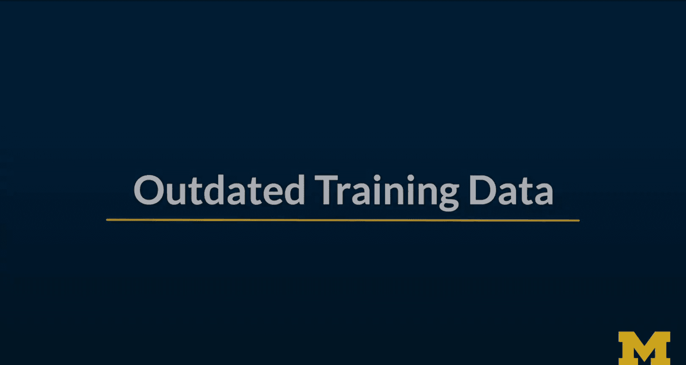
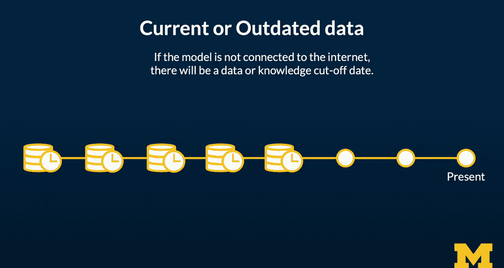
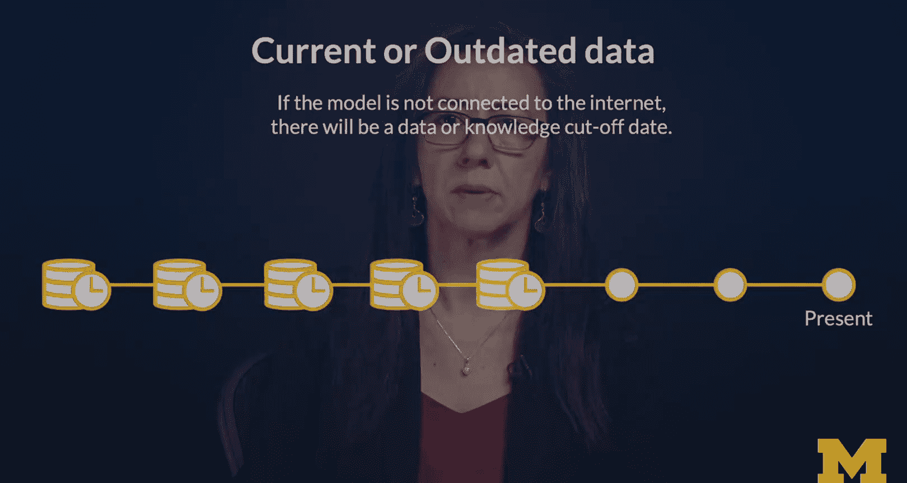
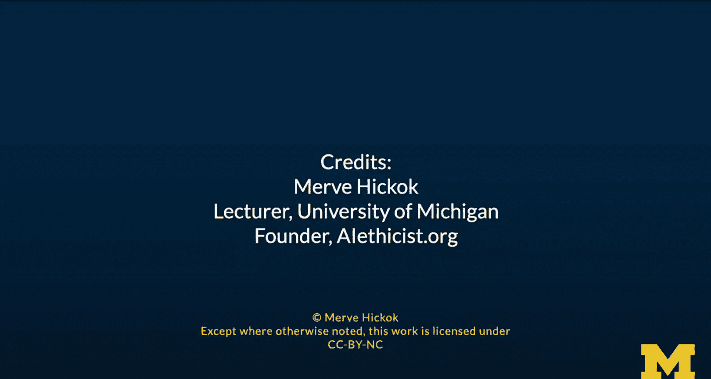

# 密歇根大学《负责任生成式AI简介（基础、对商业和社会的影响、政策、对未来的影响）｜Responsible Generative AI》中英字幕 p15 14_训练数据时效性问题.zh_en -BV1Uf421B7sR_p15-

For businesses considering to connect foundation models via APIs。

Or fine tuning a general system with business specific data。Instructions or expert knowledge。

 And securing this information is extremely important。As mentioned before。

 it takes significant resources to pretrain a geneative AI system。

And conduct regular training on the general models。

If the model is not connected to the internet， in other words， able to retrieve current data。

There will be a data or no cutoff date。In other words。

 the training data only contains data upon to a certain date and does not include information created beyond that date。

Depending on the use case， this knowledge cut off may or may not be a serious issue。

Some businesses may decide to integrate or connect the model to realtime data sources and APIs。

Some models or generateative AI products are connected to the web or even search engine browsers。

Such connection removes the issue of artd data， but may introduce new considerations on managing the quality of data。

