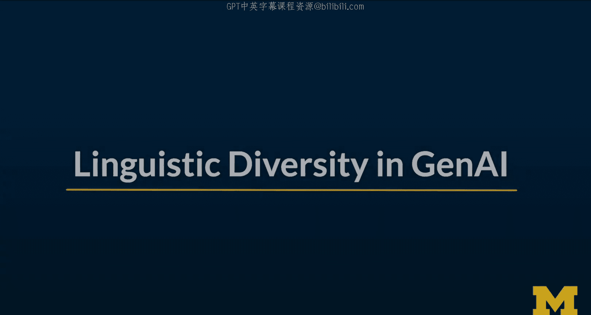
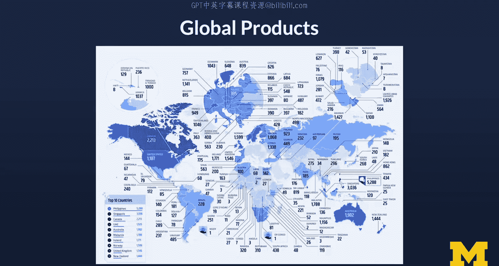
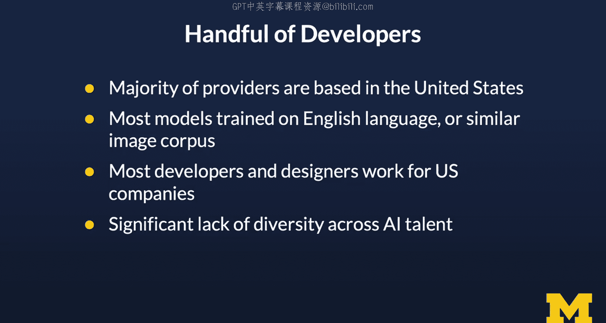
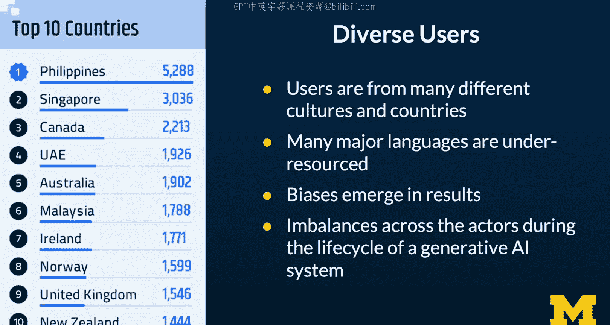
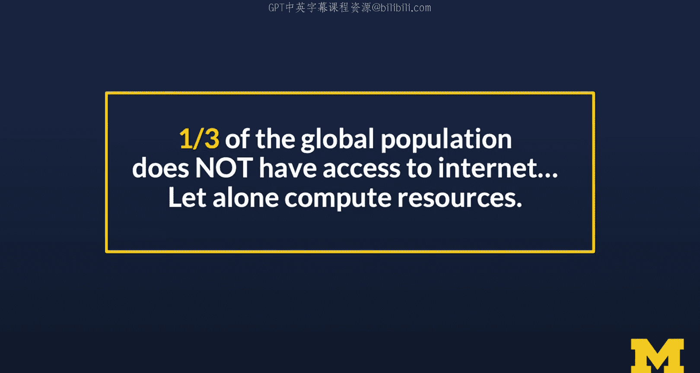
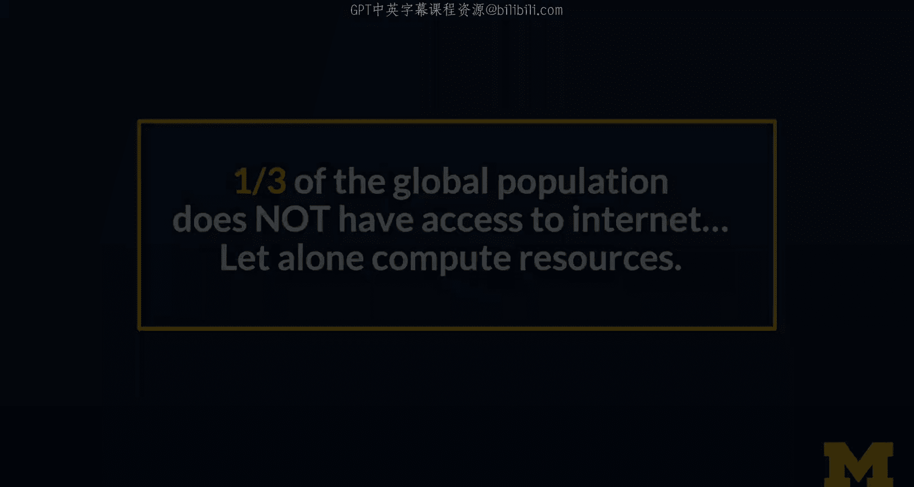
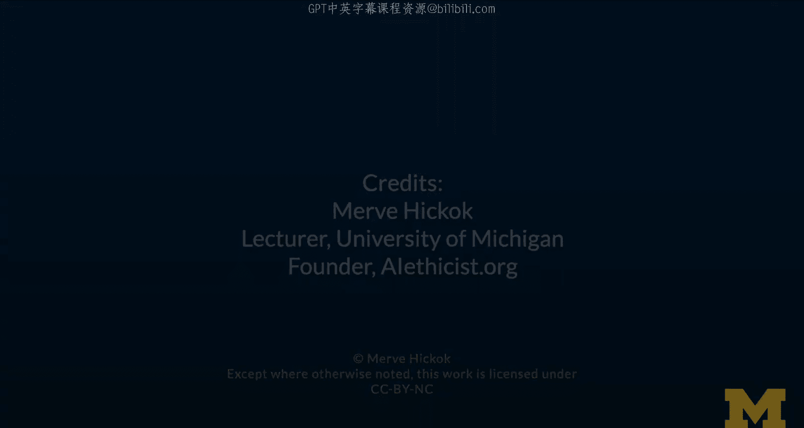

# 密歇根大学《负责任生成式AI简介（基础、对商业和社会的影响、政策、对未来的影响）｜Responsible Generative AI》中英字幕 p16 0_生成式AI语言多样性.zh_en -BV1Uf421B7sR_p16-

Generative AI tools have become one of the quickest adopted products in the history。

 These products generate excitement about the possibilities。

 While the questions about exact benefits and most impactful use cases remains to be answered over time。

It is hard to get an exact number of users globally to get a good idea of prevalence to start with。

 we do not have much disclosure from vendors about user numbers， but more importantly。

 there are also personal generative AI models now built upon open source models。

As well as systems built by corporations across different industries。However。

 there are some proxy analysis which already shows us the global nature of curiosity about these products。

One research shows number of searches for geneative products per 100000 of the country's population。

Well， the numbers on this chart are hard to read and naturally change all the time。

It is really the image itself， which I wanted to share。

 Geneative AI systems attract attention and experimentation globally。

Despite this global interest though， only a handful of companies concentrated in the United States and China actually have control over major generative AI models。

These handful of companies determine the product， design， development and priorities。

 Majority of these providers are based on the United States。

 Most models are trained on English language and similar image corpus。

 Most developers and designers work for US companies。😔。

And within these companies and across the industry。

 there is significant lack of diversity in AI talent in terms of backgrounds and experiences。😔。

While the generative AI companies and the teams within these companies are rather homogeneous。

 the user base reflects many cultural differences。 In fact。

 the previous charts which show the normalized number of searches for this product identifies the top 10 countries。

These countries reflect the significant diversity across the user base。

 The experiences and the benefits users gain from their engagement may differ。

The native languages of many of the users are rarely reflected in these products。

The text corpus used in these models are not necessarily content originating from these countries。

 but rather what the Internet text reflect about these cultures。

Whether this information is scraped from online news sources， discussion forums， social media， etc。

Naturally， this can result in cultural biases and stereotypes in the results。

There are more than 7000 languages spoken in the world today。

 showing the linguistic heritage and diversity。However。

 some languages enjoy a larger majority of representation。In fact。

 only a couple of dozen of these languages account for more than half of the world's population across these languages。

 English has an oversized representation。😔，The historical， political and social reasons aside。

 despite a smaller number of native speakers， total speakers of English language are significantly higher。

 However， even when English leads the number for most speakers， that statistics can be misleading。😔。

First， English still represents less than 20 per cent of the world。 Second。

 not everyone speaks the same English。There are vernacular differences between English speaking countries or even between groups within the same country。

Language corpus， which does not take into account these differences。

 may also result in models with lower performance across dialects， sls or lexicon。

 with an English itself。Prioritizing American standard English can even reduce the richness of the single language。

 Another way of looking at representation is how the global languages are represented in the digital realm。

Research analysis of how languages are resourced。 In other words。

 how much research and research is available provide us with a clear picture of imbalances。

Languages and high resource categories such as English， Spanish， German， Japanese， French， Mandarin。

 Russian， Dutch， Turkish， Hindu， etc cea。Make up the largest amount of labeled and unlabeled text data。

Availability of data has a direct impact on these types and quality of language systems which can be built upon them。

The number of languages certainly does not correspond to data resources。

Even with the highest resource languages， English， again， is overrepresented。

 While number of speakers of English language make up less than 20% of world's population。

 The amount of online content in English makes up more than 50% cent of the total。😔。

While some LM support additional languages for translation or transcription purposes。

 and while China has Mandarin based applications。The world continues to lack for language models。

 for speakers of many other languages。😔，The small research or community efforts to build texted assets for other languages is not comparable with the daily production of content in English or Mandarin。

Another example is the makeup of common Cr corpus 2。

 which is one of the main language dataset sets to pretrain LLMs。

The ratio each language represents in a data set。Shows the overwhelming influence of certain high resource languages。

This represents more than 75% of the overall data set。

With English making up 45 per cent of the total just by itself。

 these comparisons obviously do not suggest that every community needs its data to be used and mass。

Or that they need to invest in large language models。

 The choice belongs to the community of speakers。The numbers are also not a reflection of the value or the heritage of a particular language。

And just as importantly， the scale of available digital text does not mean all human knowledge and experiences is captured。

While generative eye systems are restricted within their dataset sets。

Our societies operate on many other layers of non digital knowledge， such as our oral histories。

 cultural traditions or experiences。As individuals。

 we make informed decisions based on our relationships， past interactions， our socioeconomic。

 political， cultural upbringing。As organizations， as much as many of the work may now be digital。

 we still depend heavily on institutional histories。And on that note of。

 what about non digital knowledge。We should also remember that one third of the world's population does not have access to Internet at all。

 let alone to generative AI products or complete resources。

