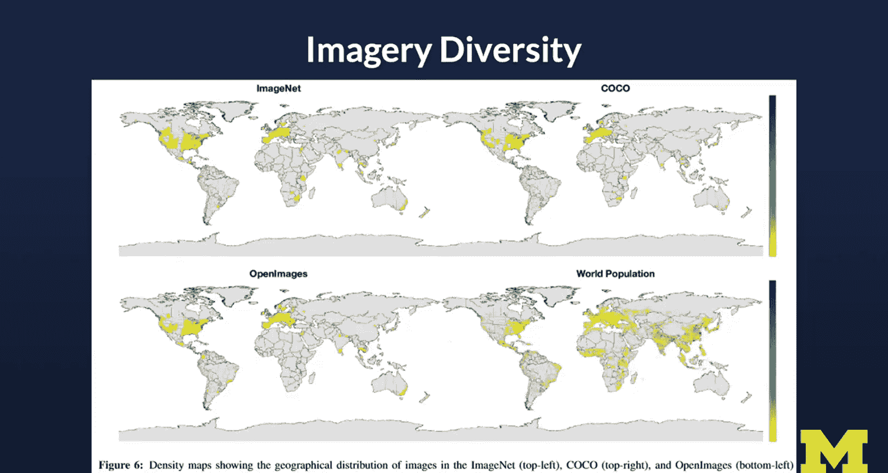
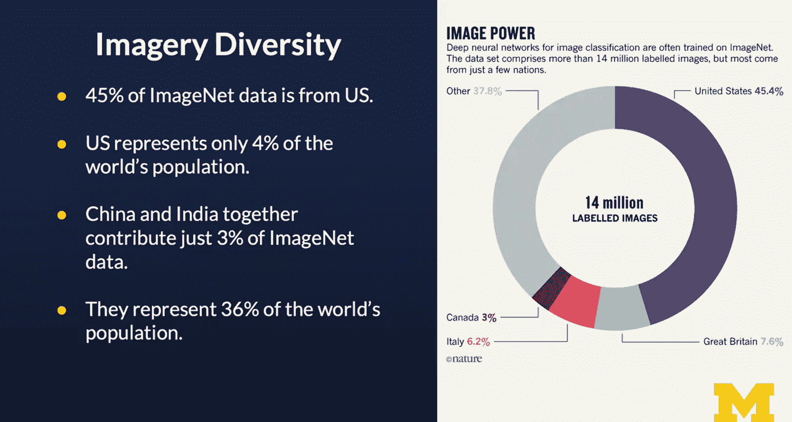
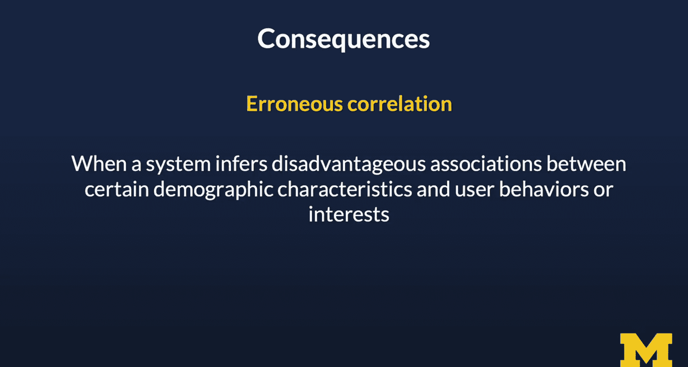
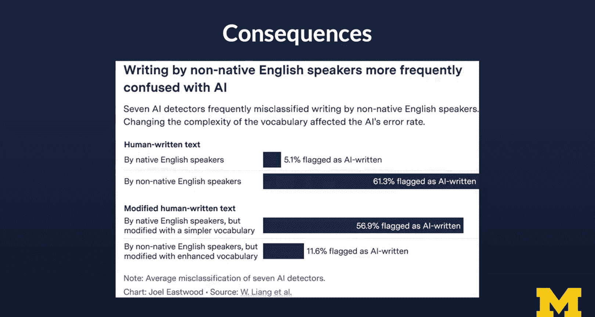
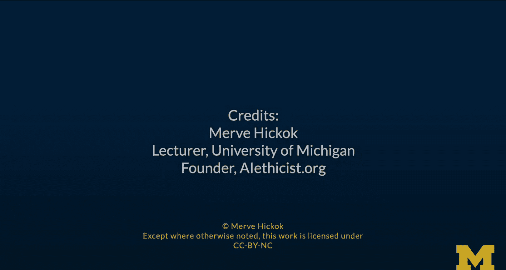

# 密歇根大学《负责任生成式AI简介（基础、对商业和社会的影响、政策、对未来的影响）｜Responsible Generative AI》中英字幕 p17 1_生成式AI图像多样性.zh_en -BV1Uf421B7sR_p17-

As exciting products as they are， generative AI systems represent a small portion of our diversity。

The digital representation of different cultures is not only a matter in language data but also of images。

In other words， images used to train generative AI systems also reflect a smaller portion of global heritage。

 over and underrepresentation for image dataset sets is not an new issue。

But one that is amplified by generative AI systems。

Data sets used for image recognition and classification purposes were already suffering from overreation of images from the United States and European countries。

Whereas other regions were sparsely represented in these training dataset sets。

 when models are trained on images from underrepresented regions。

 the performance of the model is expected to drop significantly。

The issues will be amplified by how many times an object is represented in the data set and how it is labeled。

Each country and culture will vary， for example， in the household objects used。Clothing。

 transportation items， food items。 just to name a few。However。

 those cultures represented as the majority in the dataset sets will be taken as the standard。

Take this example of wedding dress image prompts， for example。

 when the system is prompted simply for a beautiful wedding dress。

It will result in an image that is most represented in the dataset set。

Which will be established as a norm or the standard。 However， if， for example。

 you are a Japanese or Indian user。You will have to prompt the system more specifically to get the results which you might have considered as your own culture's norm or standard。

Such issues with representation can also result in generalization problems。

Where a model may return images with higher quality。Or more creative images for certain regions。

And perform verse for images of objects from underrepresented cultures。On the flip side of the coin。

 generative eye models may simply reflect the cliche or stereotypical representations in objects too。

Real life is more complicated， complex and diverse。But that is not a nuance。 the models can capture。

In an attempt to counter the representation issues in the dataset。Developers may hardco instructions。

System prompts or meta instructions may require the system to overwrite data distribution。

And force it to produce results， which looked diverse。

These instructions do not solve the underlying issues of data set quality or lack of contextual understanding。

They can be considered as patch fixes， at best。They may work for some instances。

 but they can also spectacularly fail or provide historically inaccurate results。

These issues of representation， amplification of certain cultures or perspectives and power imbalances are not without consequences。

Depending on the intended user or consumer base， there can be significant impact。

The results may reinforce certain roadviews， cultures and languages or others。

 forcing homogenization products may produce more hallucinations or skewed outcomes for certain groups of users or languages。

Products may fail frequently or not work at all In some instances。

 Some users may not be able to detect or manage harmful or toxic content with the lack of transparency or support mechanisms。

😔，Or the system may associate user behavior data points。

With certain demographics， erroneously。When AI systems fail， it's not just the software error。

These systems impact individuals rights， access to resources， benefits and opportunities。Therefore。

 when we develop and deploy the systems。We have a responsibility towards those on the receiving end。

 as well。😔，Let's look at an example。With the launch of generative AI models。

 concerns skyrocketed about students using AI to complete assignments。

Many educational institutions change their policies。

 assignment instructions and or control mechanisms。

Even the major generative AI companies highlight that there is currently no reliable way to detect synthetic content。

However， this doesn't stop a number of fes coming to the scene。

 which claims that their products can reliably detect synthetic content in assignments。😔。

In several instances， these systems erroneously flag international students assignments as AI generated。

These systems tend to flag the writing as AI generated。

If the sentences are simpler or the next word is more predictable。

Which may be more prevalent in the writing by non native English speakers。

After the news of these incidents。The Markup journalists analyzes seven of these AI detector tools。

The results showed significant bias against non nativeative English speakers。😔。

Some companies shut down this AI detection feature in their software。However。

 there are also many smaller vendors which continue their claims。

 despite significant risk and harm to those who may be erroneously flagged。😔。

