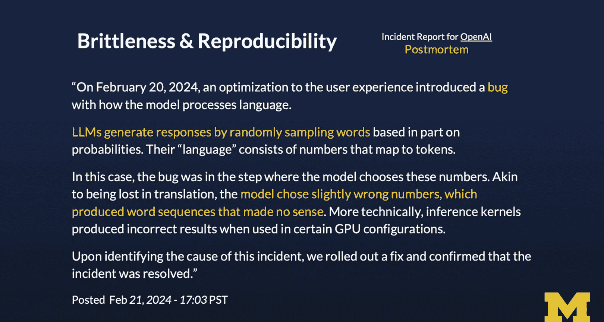
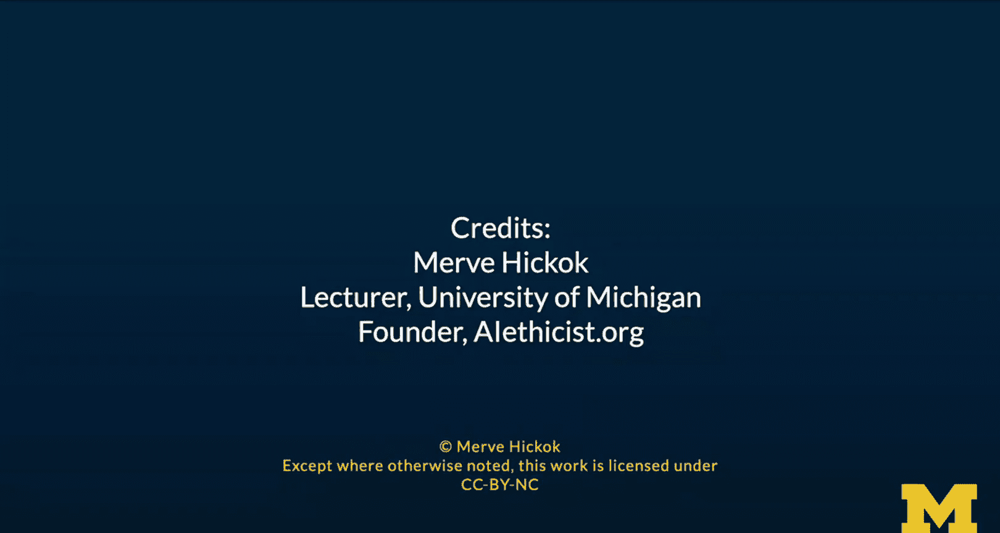

# 密歇根大学《负责任生成式AI简介（基础、对商业和社会的影响、政策、对未来的影响）｜Responsible Generative AI》中英字幕 p19 3_现有披露机制局限性.zh_en -BV1Uf421B7sR_p19-

Clear disclosures about the capabilities and limitations of Geneative AI systems。

Are not only missing in product design， but also from public statements of some of the tech executives。

Responsible practice necesstates assessment of possible risk and harms。

And contribution towards safeguards。Exaggerating product capabilities or future evolution of the technology。

 when there is very limited understanding of these with the mainstream users can create more confusion than benefit。

Responsible app practices requires us to help users understand these technologies better。

 Wed improved knowledge and transparent practices。We can lead to more informed adoption of these products。

Instead of frustration and anger。Transparency to underlying models lack of reasoning capabilities。

Or understanding of situational context or consequences can save users time and energy。

Product disclosures can go beyond the leglies。Or an assumption that the users have an existing robust understanding of AI technologies。

Similarly， the disclosures are expected to align with the actual user interface。

And user experience design of the system， for example。A default warning on user interface。

 noting these systems like accuracy can go long way。

Instead of simply mentioning these limitations in policy documents。

Consumers may better understand the possible transfer of liability。

And that they should not believe in systems accuracy， factuality or completeness。

Statements from tech executives may suggest generator I soon to replace shipment。However。

 the bttleness of the products provide us with a window an opportunity to have deeper discussions。😔。

For example， when one product started producing totally incoherent responses and mass。

 the following incident report and postmortem sent a clear message that a bug can significantly impact the performance of the system。

And reproducibility of the results。

