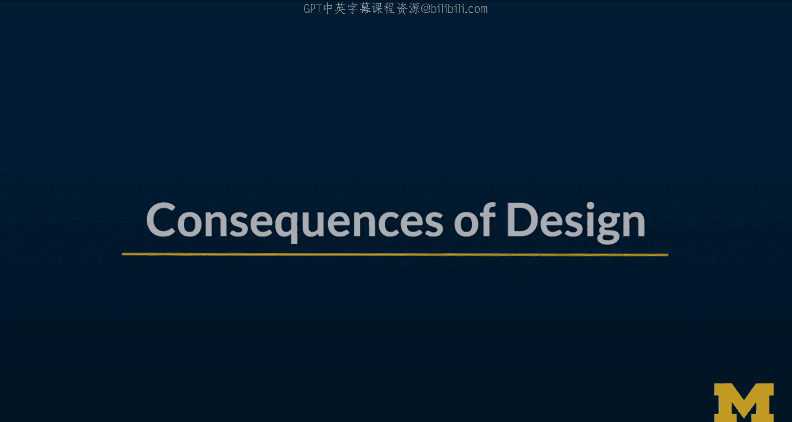
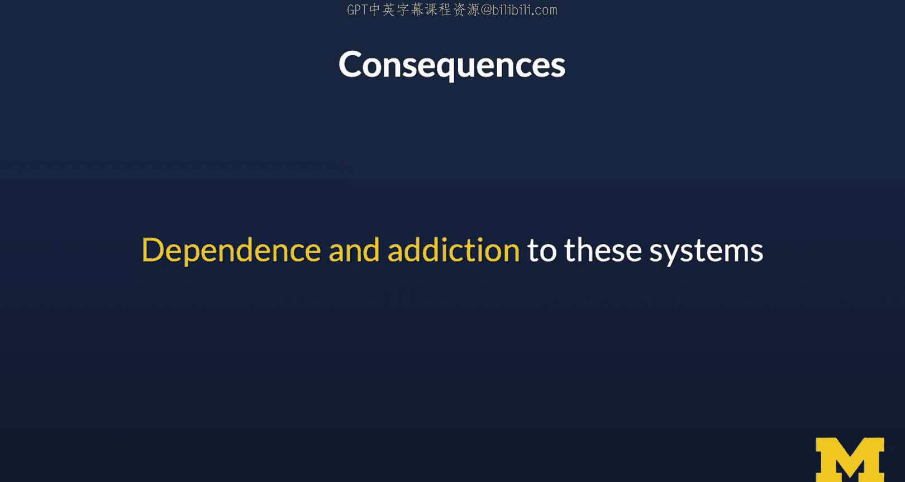
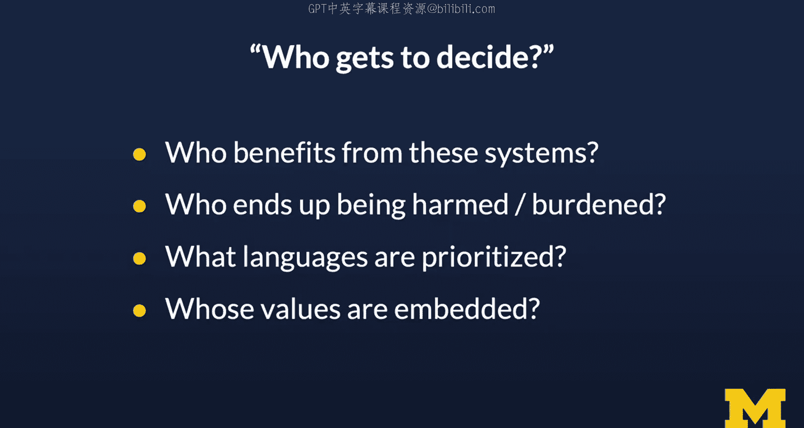
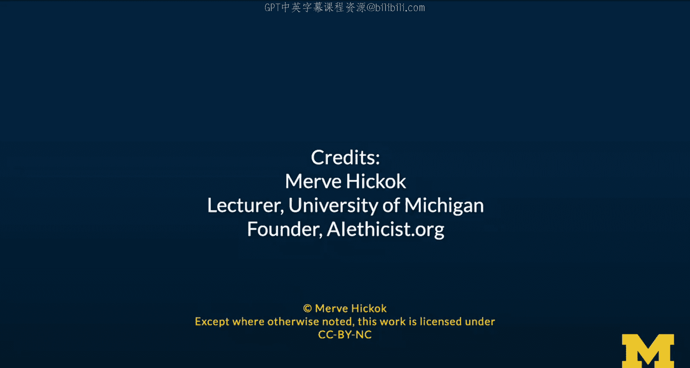

# 密歇根大学《负责任生成式AI简介（基础、对商业和社会的影响、政策、对未来的影响）｜Responsible Generative AI》中英字幕 p20 4_设计后果评估.zh_en -BV1Uf421B7sR_p20-

Anthropomorphism in the systems and lack of meaningful disclosures can lead to several serious consequences。

😔，First is the impact on how the society perceives the capabilities and limitations of generative AI systems。

Perception has cascading effects。It impacts how individual users decide to engage with the systems and for what purpose。

It impacts the kind of controls and gus we develop。

It drives the policy making and a location of responsibility and in some cases， even liability。

Some may develop over reliance on the output of these systems。And use them as if they produce facts。

Alternatively。Others may go to the opposite direction and never believe in the outcomes of the systems and avoid using them。

In certain cases， such as companion AI products。

Users may develop dependence and addition to these systems。

It is one thing to understand the limitations of the systems and make an informed judgment about using them。

For example， to find information about a subject while avoiding the judgment of another person regarding the topic。

Or when some users want to receive poster reinforcement。However。

 it is a totally different thing when the design of the system prevents you from making such informed decisions。

And the outputs are， instead， manipulative。Given such consequences。

 it is important for developers to ensure their decisions do not create over reliance。

Or unrealistic expectations from their products， responsiblesible design and deployment requires us to consider the impact and risks ahead of any deployment。

Mittigate the issues and continue to monitor for new use cases and reactions。

For responsible approaches， we can ask some fundamental questions， such as。

Who benefits from these systems。Who ends being harmed or burdened。What languages are prioritized。

Whose values are embedded。And ultimately， who gets to decide on all this。

