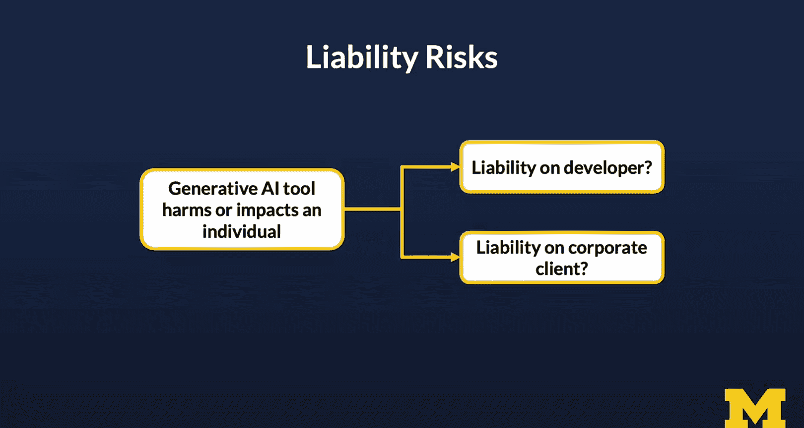
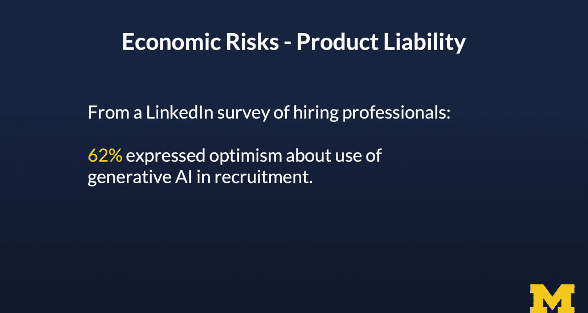
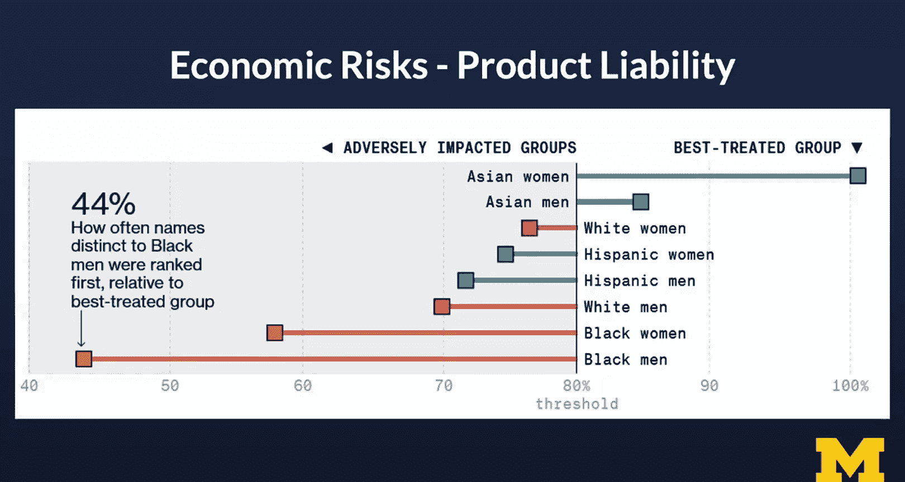
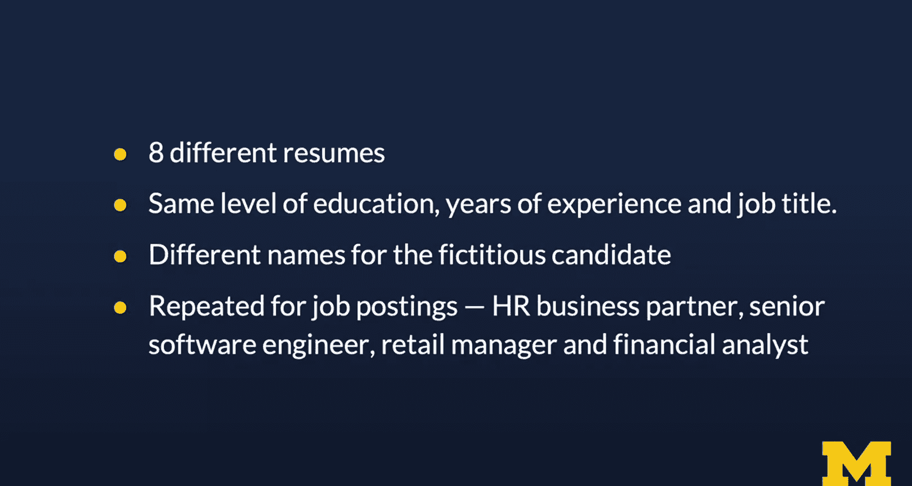
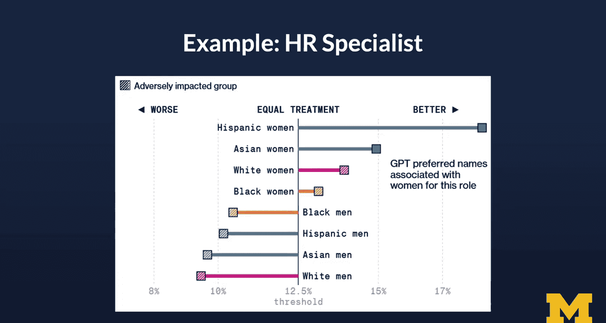
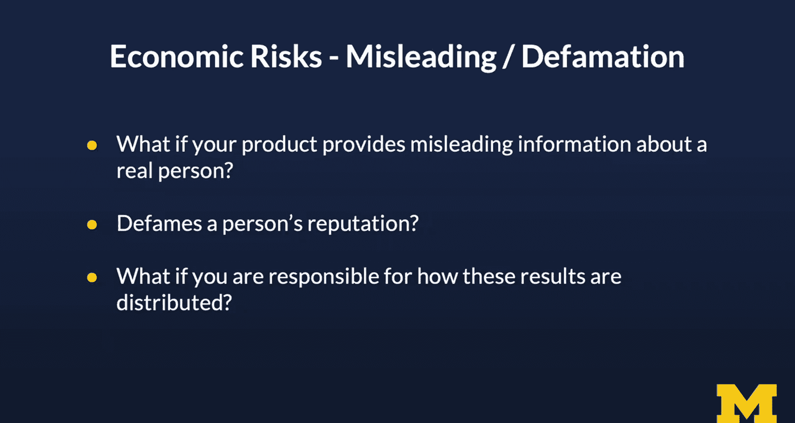

# 密歇根大学《负责任生成式AI简介（基础、对商业和社会的影响、政策、对未来的影响）｜Responsible Generative AI》中英字幕 p22 6_法律责任风险.zh_en -BV1Uf421B7sR_p22-

When a response produced by generative A system harms or negatively impacts an individual。

It is not clear how the label may be allocated。Would it be on the developers who designed and built the system。

 Would it be on the organization which deployed the system。

Would the liability and responsible to rest with the corporate client using a thirdpart geneerative AI system。

Or would it be a combination of all。

Let's take another example of how generative AI might be used in a scenario which could create product liability。

 as well as charges of disparate impact。Human resources tends to be one of the domains where new technologies are first introduced and tested。

You might be already familiar with predictive AI systems used for candidate sourcing， matching。

 resume screening。Performance management。Video game or code assessments。

HR is a domain where the scale of work to be completed by humans usually overwhelms the available resources。

 We now see generativeI products being introduced into the space to screen。

 rank or rate job candidates。😔。

In fact， in a recent survey on LinkedIn，2 out of three recruiters said that they hoped generously。

 I will make it easier to conduct their work。😔。

Recruitment is also an area where human bias， conscious or unconscious。

 easily seeps into the process。And therefore， demands companies to improve their processes。

Byers can be reduced by objective interventions in the hiring process。

 whether it is true introducing introducing control methods， by training and sometimes by tools。

As long as their designs developed and used responsibly。Hiring also happens to be a regulated area。

Where discrimination by certain criteria， such as age， gender， race， et cea， are prohibited。

A recent reporting by Bloomberg showed similar patterns of bias If generative AI was used for hiring purposes。

 In this example， reporters first create eight different resumes。

 which reflect the same level of education， experience and job title。

The difference is in the names of fictitious candidate， assigned to different resumes。

To be able to compare the outcomes， reporters first use water and census data to create a set of names that are demographically distinct。

In other words， they are associated with Americans of a particular race or ethnicity。

 at least 90 per cent of the time。These names are then randomly assigned to equally qualified resumes。

The model is not asked to rank those resumes 1000 times。

The analysis found that the model differed in the gender and racial rankings。

Depending on the particular job that a candidate was evaluated for。

The results underline several points where businesses should pay extra attention。

Just because the generatorrative air solution is available， should you use it。In other words。

 is it the best approach for your specific task。If yes。

Then the out of box models may require further customization and bias mitigation work。

If a business is considering using a vendor solution。A robust due diligence is necessary。

To reduce risk of discrimination and liability。Such due diligence needs to include the design and assumptions embedded into the system。

As well as the outcomes。In the particular domain of hiring decisions。

The vendor is regulated under business and product label to legislation。

But the employer is responsible for any charges of discrimination， disate impact or treatment。

Businesses using Geneative AI to serve their customers may also consider the impact on their own contractual obligations。

Could you or should you claim to have professional expertise。😔，If lying on generate。

 I to do the work。Is this a or malpractice。If you upload a client's data into generative AI to complete your tasks or conduct an analysis。

Could the client claim the business breach its data security or its duty is to safeguard the information。

 What if your product provides responses which are misleading about a real person and defams that person's reputation。

What if you are an intermediary party but impact how these misleading or defamatory statements are distributed。

Due to their probabilistic nature， rather than understanding the context of their outcomes。

Generative A systems may produce defamatory results， or false allegations。

This can cause a persons real reputational damage。😔，Already。

 we have seen cases of models fabricating lawsuit suits about real persons。😔。

Or generating stories about a person embezzling money。

Or creating felony convictions about another person。

Language models can fabricate quotes against real individual names。

Or associate their pictures with fabricated stories。

If your business is using a generative A eye model。

 you might be responsible for what the model produces about a real person or another legal entity。😔。

Just like the questions about copyright， there are now several cases testing the existing regulations and the core systems。

To find answers for questions of consumer fraud， defamation and misleading information。

