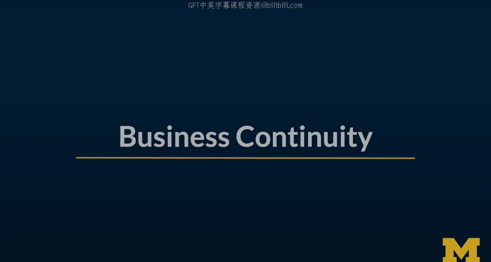
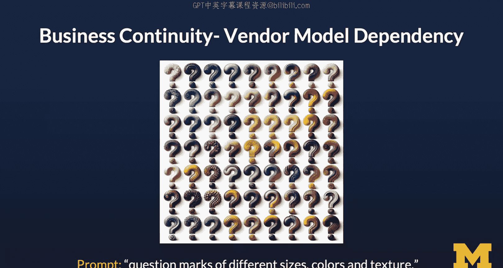
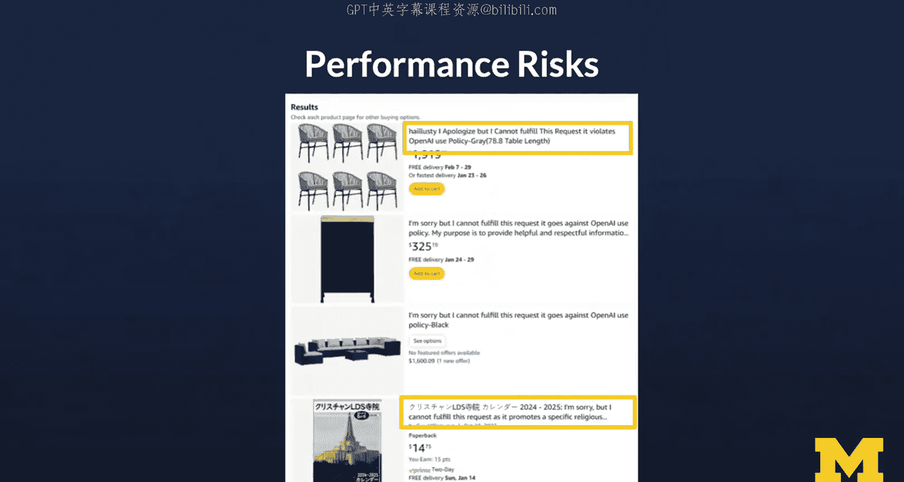
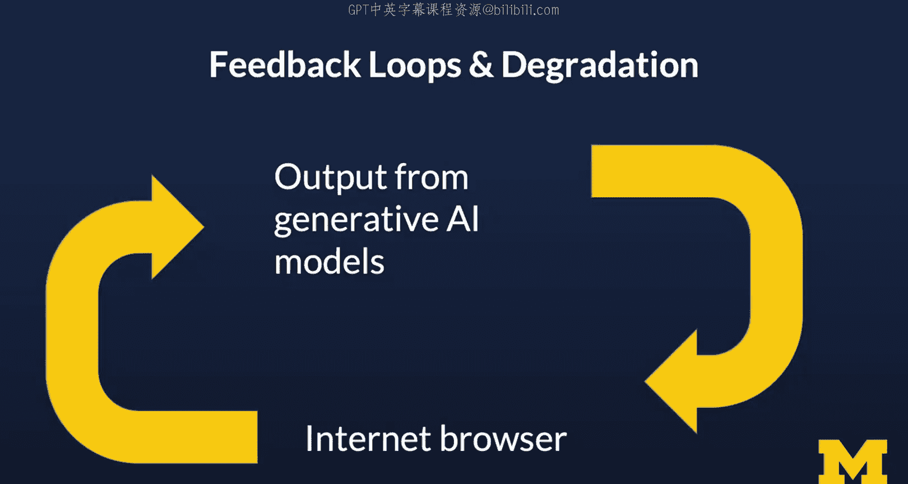
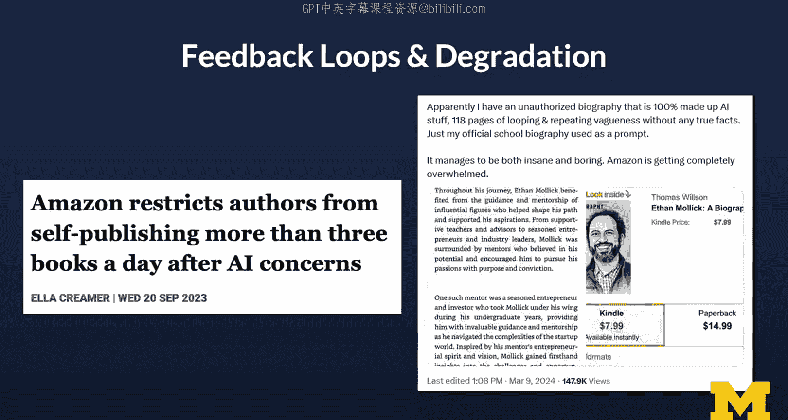
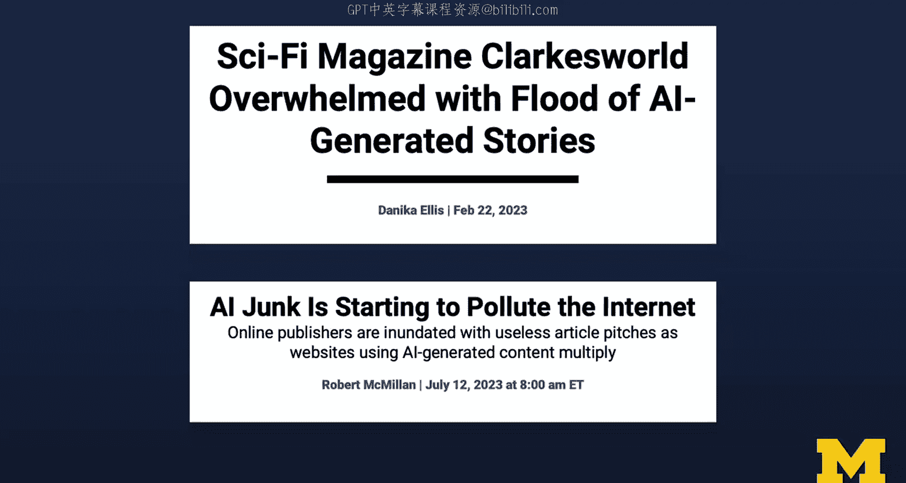

# 密歇根大学《负责任生成式AI简介（基础、对商业和社会的影响、政策、对未来的影响）｜Responsible Generative AI》中英字幕 p23 7_业务连续性保障.zh_en -BV1Uf421B7sR_p23-

Another serious business consideration is about the dependency on upstream providers。😔。

Unless you're building a generative AI system from scratch。

 you're likely to connect to an existing provider system。

Or to use a publicly available model to build your own。

What kind of questions would you need to ask to have adequate assurances from service providers about the training dataset set。

About the future availability of the model you're building on top of。😔。

How about the future updates to the model， which might have downstream implications for your own product If your product is dependent on another model to function。

What kind of guarantees would you need for performance。😔，For protection against adversarial attacks。

How would you know the degree of change and impact on your product ahead of time。😔。

Or even after the fact。Earlier in the course， I had mentioned the importance of due diligence and governance for those organizations considering to develop or deploy gen eye systems。

It is critical for businesses to understand their dependency on upstream providers。

And what kind of risk they are undertaking。We cannot make informed decisions about the risks without clearly understanding how the training data for an AI system is sourced。

Whether the data is representative of our consumer basis questions and preferences。

Or how the upstream vendor analyzes， mitigates and manages risks。

When incorporating an existing system into your business process flow。

It is also important to understand the performance， risks and limitations。

Is the chart part model you are using capable of responding to the full product range you have in mind。

Is the use case open to failure modes。For example， you may be using generate AI model to help generate product names or descriptions from images。

😔。

Given the issues about representatives in image dataset sets。And the limitations of the system。

 to understand context。Can you rely on the system to produce accurate results。

A further issue regarding ongoing performance of the model。

Is the possibility of feedback loops and the gra of the model reliability。

Generative ion models are built by data scrapd and curated from the Internet。However。

 the generated or synthetic outputs from these systems are now also bleeding into the Internet and throwing up in web search results。

😔。

When Internet content is scraped in the future。The new synthetic content may create a feedback loop。

There are many examples of fully AI generated ebooks。

 media articles which are added to the Internet and digital corpus every day。😔。

Such circularity may eventually result in AI models being trained with their own data。

 which includes hallucinations and further biases。The loops may also degrade the quality of the Internet search results themselves。

A similar issue is now absorbed in scientific journals， as well。

The issue impacts the quality of academic writing。It can also impact how unsuspecting readers may understand the issues included in these articles。

 Some researchers， in fact， warn。ote learning from data produced by other models may cause model collapse。

A degenerative process， whereby over time， models forget the true underlying data distribution。

This process is inevitable， even for cases with almost ideal conditions for long term learning，ote。

