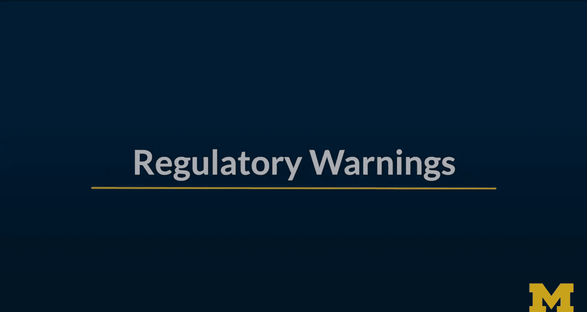
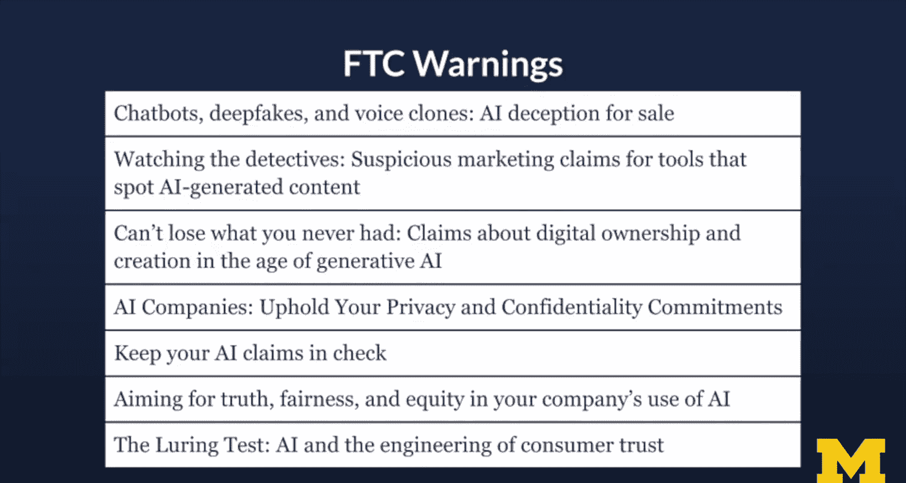
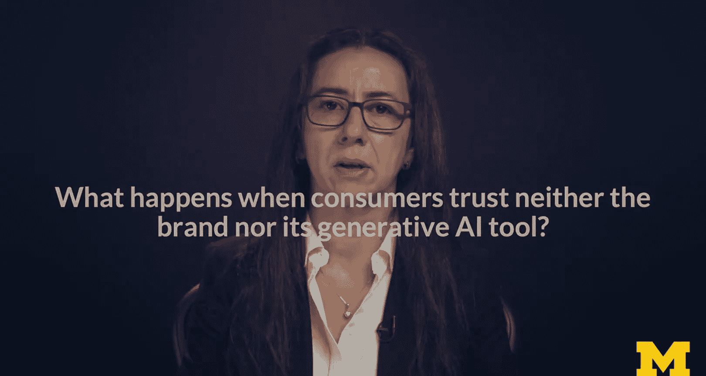
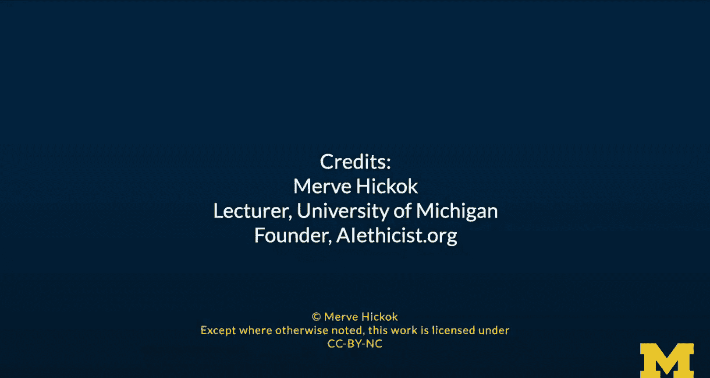

# 密歇根大学《负责任生成式AI简介（基础、对商业和社会的影响、政策、对未来的影响）｜Responsible Generative AI》中英字幕 p24 8_监管预警机制.zh_en -BV1Uf421B7sR_p24-

We will cover the global emerging approaches in the next course。 However。

 for businesses considering generate V systems。It is important to briefly mention that regulators have also provided guidance or warnings on the kind of questions businesses should ask。

To provide some examples from the United States， a few of these questions asked by the Federal Trade Commission should you even be making or selling your particular AI product。

Are you effectively mitigating the risks。Are you over relylying on post release detection。

Are you misleading people about what they're seeing， hearing or reading。😔。

Are you deceiving or misleading people about the capabilities of your AI products。

Are you quietly changing your terms and conditions。

Regulators are also warning against companies who are trying to shift liability by claiming that their product is a black box and so advance that their own developers don't understand how it works。

😔，Or that they don't have the means to test their products。

 Consumer perceptions impact the adoption of products。And how consumers rate a business trustness。

B from a governance and consumer rights lens， there are several questions responsible businesses can consider。

Before they roll out generator air products。

A first step is letting the consumers know that generative AI system is in use。

And what kind of support it can and cannot provide。Furthermore。

 if a consumer believes they are harmed due to a generous Vive output or is， in fact harmed。😔。

What kind of mechanisms are there for the consumer to provide feedback to the organization。

Or even escalate for resolution。Additionally， the consumer may need to be provided with assurances。

That the business has precautions in place to ensure fair and accurate representation。😔。

Trussses aren't。Trust needs to be maintained。When impacted negatively by the practice of a business or de generative A I told the business has developed or deployed。

 the consumer may lose trust in both the organization and these emerging technologies in general。😔。

Responsible app practicesctices and proactive safeguards play a crucial role in avoiding such undesirable outcomes。

