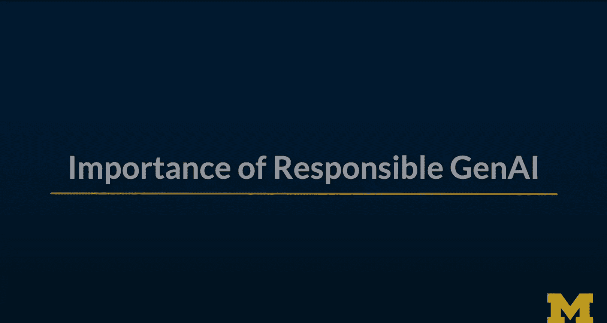
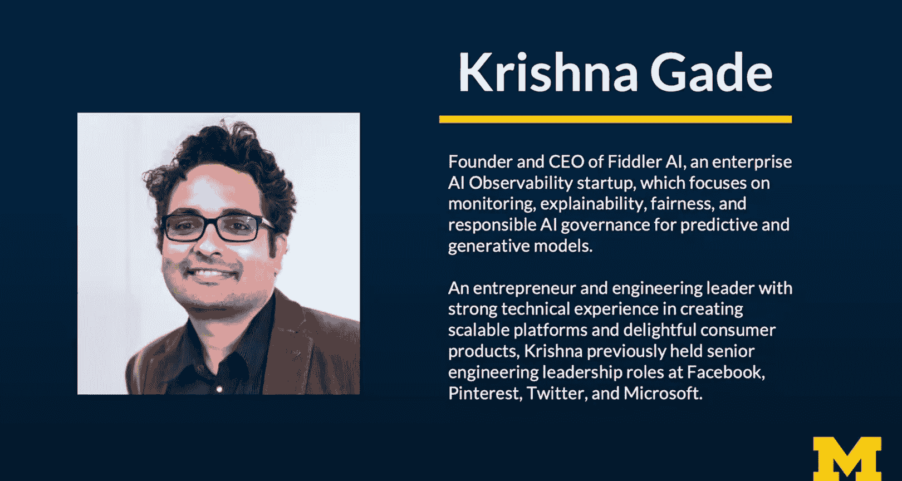

# 密歇根大学《负责任生成式AI简介（基础、对商业和社会的影响、政策、对未来的影响）｜Responsible Generative AI》中英字幕 p25 9_负责任生成式AI重要意义.zh_en -BV1Uf421B7sR_p25-

First of all， thank you Mark for having me included in this course。

 I'm very excited to talk about Fiddler and you everything related to respons AI observability and whatever stuff that we are working on。

So our journey with Fi started five and a half years ago， right。

 So we I was working at Facebook as an engineering lead on the newsfeed team。

 and I was responsible for building infrastructure for， you know。

 Ml engineers on Newfeed to you know， monitor their models monitor their experiments and and debug questions that would get from different parts of the company Like。

 Hey， why am I seeing this new story at the top of my feed。

 Why is this ad showing up at this position。 Why did I miss my friend' birthday post。

 all of these questions would get from all of our employees at the time。

And because how you know how advanced the modeling system was at Newsfeed。

 these questions were very hard to answer you know so it's almost like you have a black box system and you needed to demystify it and make it understandable and explainable for the rest of the company and so that's one of the projects that I learned in Facebook was called why am I seeing this which exposed human readable insights into the inner workings of newsfeed ranking algorithm right and so that was my journey into AI explainable team I spent about 15 years in tech working on various different infrastructure projects around search quality data analytics and then finally machine learning。

And one thing I found with machine learning was。How you know when compared to the traditional software。

 these machine learning models are very different right so they are like nondeterministic。

 they are also a black box to humans， but they provide magical results when they work。

 So the question is how do we actually how adopt Ml models and AI models with confidence and And so that experience in Facebook is what led me to start fir because I felt like companies like Facebook and Google have an army of engineers to build a lot of these internal tools themselves but。

You know when it comes to enterprise， you know banks， insurance companies， you know general。

 you know manufacturing companies， pretty much you know everybody in the world that is trying going on going to adopt AI。

 they will also have to face the same problems of trans trust and transparency in it And so we wanted to build a company that can service them and provide tools so that they don't have to build it themselves so that's how we started fiddler。

And today we have built what we call an enterprise AI observability product。In what Fiddler does。

 it basically instruments all different types of AI applications from large language model applications to simple machine learning models。

To provide insights into their performance， their model degradation， you know accuracy。

 you know bias， things like hallucinations， safety issues， all kinds of things。

 all kinds of risks that you want to monitor again for with your AI and that's what we provide with a single pane of glass so I think generative AI is interesting in when one very big dimension right so。

A lot of the generative AI applications are not built from scratch。

 A lot of the companies what they do is they take these threetrain models created by large companies like Microsoft。

 you know OpenaiI， Google， you know and they would then fine tune them or prompt engineer them with their own custom data to build LLM apps and so you know because building LLM models from scratch is also expensive you know most companies are doing this right So as part of that there are a few questions。

 you know one is you don't know how these LLM models are trained what kind of data are spread to them you know most of these large language models are trained on the entire Internet corpus。

But you are building your apps on top of those pre trained models。 So the question of like。

How will the model perform when you put into production， whether it will hallucinate。

 whether it will produce some harmful content， whether it will leak any private information top of mind for these executives？

The other notion of these large language models or gen pi models is that。

They are sort of you know they sort of can make up things on the fly。

 right so because you know they're essentially predicting the next word， the next sequence。

 the next paragraph that you're feeding them。They're not like reasoning about stuff right。

 so they're essentially trying to like you know， they're trained on this vast amount of historical data and they're basically trying to predict the next sequence of words and so as a result。

They can always you know write things as if they seem like coherent and as if like they seem like coming from a knowledge source right so that's a big problem so when a human is looking at that output it feels like it may it's reasonable but it could very well be an incorrect statement or incorrect answer。

And we have seen many cases like that， lots of people have。

 you know wrote blogs about you know how they jail broke。

 you know Chan GPT or made it utter different things right same thing with like， you know toxicity。

 you know internet has a lot of hate speech as we all know and so when you when you sort of crawl that internet and feed you to the to these models。

 it can you know they can make racist jokes， they can you know come up with harmful content。

And so that's another big problem。So the question is how do we tame these LLMs and make them useful for enterprise applications these risks are new right you know compared to like the predictive ML world because you know the predictive ML models were mostly dealing with things like model degradation。

 bias and lack of transparency which the generative models also have but there's these new set of things that got added with generative AI。

 the risk of hallucinations risk of data privacy risk of you know toxicity。Ultimately。

 we're building AI products for humans， right， you know， we're building。

Let's say you know large language model application that to support the customer contact center team。

 you know so that you know the customer support team members can deliver better service we maybe we are building like a summarization。

In an application for， you know， a legal team to summarize legal documents or we are providing like you know。

 a bank could be investing in a help desk application for their trading analysts to get answers quite quickly So whatever is use case。

 these applications are are being used by humans， you know to to you know。

 to get answers quickly for their questions to you know。

 to get insights around data right and and so the question is like。How。

 how does a human trust this machine， Right， so that human machine trust is a fundamental problem。

 because， you know， we are used to。When we are dealing with machines。

 you know imagine flying an aircraft without a cockpit。

 imagine operating a microwave without having the control panel so you're used to these interfaces where you need that constant feedback and as a human you sort of develop this intuitive sense when you're operating a machine and with AI being a black box you don't have that intuitive in interactive ways to understand it right and so that's what that's what is needed and then so when it comes to say like federal are like tools that's what we provide right so these insights are really helpful for various stakeholders you know model developers find it useful when they are debugging the model other stakeholders that are consuming the model outputs the subject matter experts。

 the business teams they find it very useful and then the compliance stakeholders that they are trying to set up governance processes within the company they want to know also how the models work behind the scenes right and so it comes down to that human machine trust problem and knowing more。

about how what's going what's going on with AI and that that's that's that's basically the root the root of all of it。

 but I think， you know one needs to have that ethical consideration when it comes to building the AI products。

 right and。And if not， we will。You know potentially created dystopian society for our kids and their kids where you know。

 unfair black box models will be making decisions and that would benefit a portion of the society。

 but a lot of other people would be you know marginalized and hopefully that is not going to be the case so I'll tell you some you know examples right so as you mentioned they're really good point。

You know these these large language models are trained on the vast internet corpus What is who authored internet corpus right it's the mostly the privileged countries privileged class that had access to electricity and internet you know and so if you see like most of the internet is like you know a lot of English do you know language you know is is what it is right and so that also authored by the western Western countries and so。

And so， you'd see like you would have a situation where these large language models that are pretrained with this vast internet corpus。

You know they they have these inherent biases baked in already right and so they you know and and so now the newer articles。

 the newer things that people are writing are actually using LLM so LLMs are feeding LLM Now we have this is in the vicious cycle already right like someone was quoting me a stat recently that 25% of the internet today you know could be genderative A output。

You know and so then what's happening， you know what what happens is that you'd see a whole bunch of voices。

 a whole bunch of different， you language styles， ethnic styles， you know。

 things like getting marginalized right so you you'd get into this sort of this uniform state which is not good for you know you know we as humans we're all very diverse you know that's what is exciting about the human society right and you know everyone has different cultures and different ways of speaking。

 different ways of going about things。So that's one and the other dangerous aspect of it is when you actually use these。

😊，Models for critical， you know， use cases， say recruiting or you know， we talked about underwriting。

 you know， or other safety impacting， you know， maybe like you know。

 like autonomous vehicles or even like even more like defense and military use cases so where it's going to impact a human life or some sort of human rights。

Then major problems can emerge and I think this is why you see countries and continents across the board coming up with legislation and guidelines around AI。

 you know theres there's European AI Act， there's Biden's AI safetyfe executive order that talk about these things right that sort of talk about hey。

 we need to make sure that。There is no inadvertent bias into these models or there needs to be continuous monitoring of model outputs。

 there needs to be explainability of model decisions or there needs to be privacy preservation happening so these fundamental principles of you know what we call the whole reI process are entering into these legislative guidelines and and I think it's very important that these things happen because we need like。

Every organization to follow these governance frameworks， right， because you know。

There has to be some checks and balances in place for us to build。A better society for the future。

 know with AI。I've been working in the technology industry over the past 20 years this is probably the biggest transformation that we are seeing in front of our eyes and I've seen like the dotcom revolution。

 I've seen the mobile revolution， I've seen the whole cloud and big data revolution where you know companies had to transform their know their cultures。

 their software products to adapt to these new age technologies and AI is probably the biggest revolution that we are seeing you know it might be actually bigger than internet revolution to be honest right so。

So therefore， you a lot of those folks that might be taking this course are probably already involved in some way or the other。

 they might be， their companies might be building you know new age AI products。

 leveraging these large language models， generative AI applications or even traditional AI applications。

So one thing I want to make sure that。People consider this is that AI is a new software。

Stack it's like it's not like an augmentation， It's not like a cloud transformation where you're taking your software app running in data center。

 moving into cloud or you're building a mobile version of that right it's actually a new way of doing software right and so and so that means that it's a refactoring of your business that's that's happening today。

 So it's one needs to take this very， very seriously。And so fundamentally。

 AI is different from traditional software in those two ways that I mentioned。

 one is it non deterministic， and number two， it's a black box。

So this is where when you're building your AI stack。

Please make sure that you have the right processes in place。

 you have checks and balances that you're basically making sure that you are testing the models thoroughly before that you're deploying them you are monitoring the models for various different things because the thing is you don't you don't want to sort of build an AI app that's going to bring your organization under disreput or or in ways actually hurts customers that you don't imagine and loses customer trust or potentially pursue your business at risk and so I think this needs to be taken very seriously as you launch your AI apps。

 it's wonderfully magical and JdgPT launched I was like use it every day I think it's amazingly useful but you also have to follow the right processes and have the right framework in place whether you call it AI govern。

Fra or responsibility I framework having having the right set of people and right set of processes and tools in place is going to be very。

 very important for the success。 So that's one thing that I want to leave as a closing thought。

