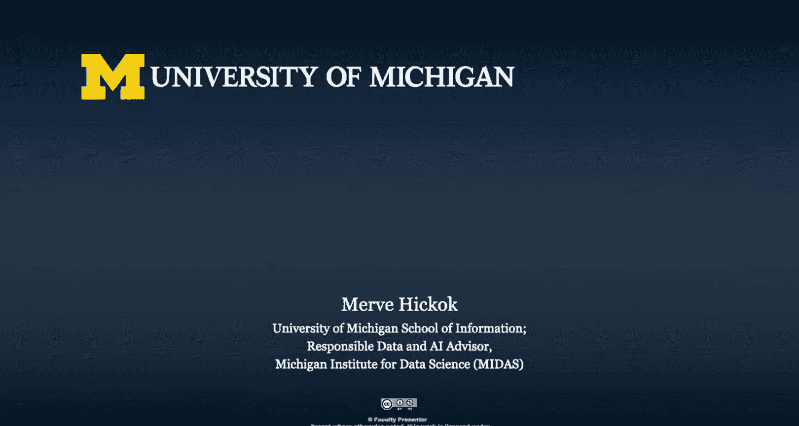

# 密歇根大学《负责任生成式AI简介（基础、对商业和社会的影响、政策、对未来的影响）｜Responsible Generative AI》中英字幕 p26 10_生成式AI社会影响力.zh_en -BV1Uf421B7sR_p26-

For many years， researchers， businesses， civil society advocates and policy makers have discussed the variety of societal and environmental impact of predictive AI systems。

😔，These are soci technical systems， if not designed， procured， and governed in a responsible way。

 AI systems can amplify stereotypes and extreme worldview。Can result in discriminatory outcomes。

Limitation or denial of access to resources or opportunities。Or infringement of rights and freedoms。

Oaque systems， untraceable or unjustifiable results can for a close contestation。

Generative AI systems can also embody these known challenges with AI systems。

Generative AI systems also introduced risks which need to be researched， mitigated and managed。

Such as misinformation， disinformation， copyright infringements。

 widening of digital divide and defect。The ease of use for generative AI and the ability to interact with the systems in natural language brings many opportunities。

 but also lowers the threshold and cost for malicious actors to conduct cyber attacks。

 defects or fraud schemes。We do not need to accept the current state。 We can。

 and we should contribute towards useful and trust innovation。If we want to build a positive future。

 we also need to think of societal impacts of generative AI。

Where social and economic benefits of generative AI are more fairly distributed。Where more cultures。

 languages and identities are represented。Where environmental impact of technologies are mitigated。

It is natural that an emerging technology and associated products will have some issues to be fixed。

It is natural that these technologies have certain limitations。

What we need now is to acknowledge these issues。Being transparent about the capabilities and limitations and put safeguards in place to prevent foreseeable harms。

To foster responsible and trustworth de generative AI， which results in positive societal impact。

 we need to build public awareness and have inclusive debates about what we want our future to look like。

