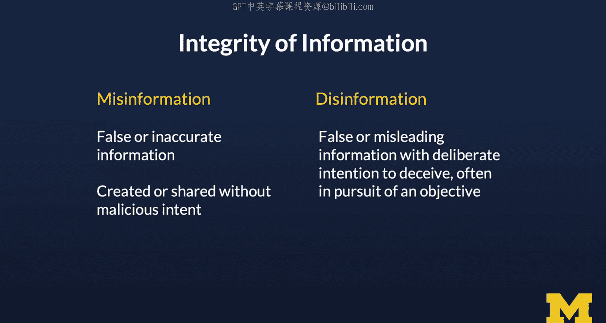
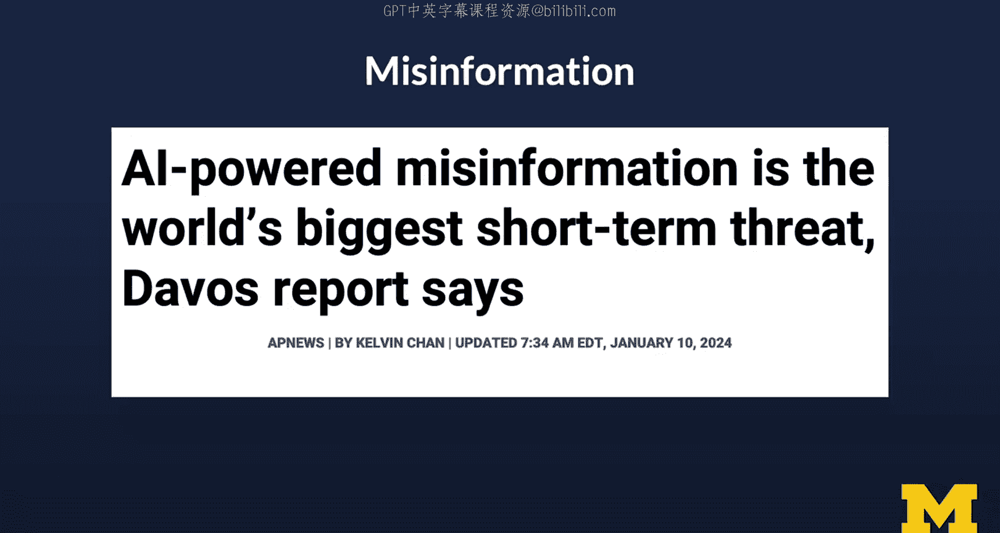
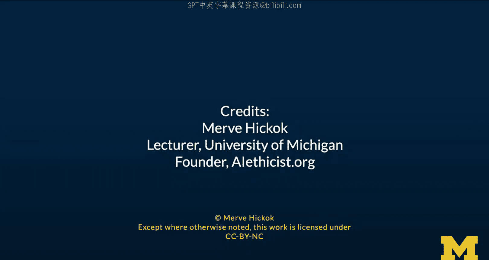

# 密歇根大学《负责任生成式AI简介（基础、对商业和社会的影响、政策、对未来的影响）｜Responsible Generative AI》中英字幕 p27 11_信息完整性保障.zh_en -BV1Uf421B7sR_p27-

Misinformation and disinformation are concepts which have been prevalent in each society for ages。

Starting with social media， digital mass media， and now generative eye capabilities。

These concepts are amplified in their impact。The integrity of information is challenged globally。

Misinformation isra encounter false， or inaccurate information。

These are created or shared without malicious intents。In contrast， this information is deliberate。

The intention is to deceive others。

Often in pursuit of a specific objective， generative AI is especially prone to creating misinformation。

 since the systems are simply based on statistical correlations and patterns。

Adding to this， the randomness effect， generative AI systems may result in recommendations which are false and have significant impact。

 One of those critical areas is， for example， using generative AI for questions about elections。

Election process and results。Potical candidates or their pulsage ons。

A recent study tested five top generative air models against questions Walters might ask。

The responses were assessed for bias， accuracy， completeness and harmfulness。The study found that。

All of the models performed poorly with regard to election information。

 Half of the AI model responses were rated as inaccurate by a majority of expert testers。😔。

More than one third of AI model responses were rated as harmful or incomplete。

When users know the limitations of generative V systems。

 they may decide not to ask such important questions to these systems。 However。

 sometimes users may completely be unaware。That the systems that they are using are powered by generative eye models。

Such models may be used to power the phone applications that people depend on。For example。

 apps that foraggerers use to distinguish edible mushrooms from toxic mushrooms in the wild。

There are now reports of users who have been hospitalized because of their sole reliance on these apps。

Generative AI systems also lowered the threshold for malicious actors to engage in deceptive and fraudulent activities。

In addition to still images generated through these systems。Genena I。

 it can be used to call on a person's voice or video。

Which can then be used in AI driven scams or deception。

Such schemes can be used to defraud people or businesses of financial means to blackmail them or even persuade them towards a certain political。

 economic or social belief。Unfortunately， these scams cause not only financial distress。

 but they can also create significant emotional traumas as well。😔。

We have now seen many incidents where an individual receives a phone call where both the voice of the call and their phone number are clone。

😔，The unsuspecting target sees the number of their loved ones。Here is their voice in distress。

 and in， in many cases， are LED to deception and fraud scheme。😔，Similarly。

 a person's likeness can also be turned into fake， sexually explicit photos of videos of them used to extort or blackmail the person。

In addition to impact on individuals， intersection of generative AI and public safety is also top of minds for AI governance actors and policymakers。

In other words， could generateI systems enable access to information or tools？

Which malicious actors may put to use。We already discussed amplification of this information。

And the effects used to solve distrust or to scam individuals。

 Other risks identified in the usage policies of current gene rare products are illegal activities such as engaging in terrorism。

 abuse or exploitation of children， human trafficking， etc ce。

A more remote concern on public safety is whether access the information via these systems make it easier for adversarial actors to develop and deploy。

For example， bio chemical weapons。Or create harmful drugs or find vulnerabilities and critical infrastructure。

Especially these last set of concerns have been used so far by some commercial actors as a reason not to disclose information about foundational models。

Or even to demand restrictions on access to open source foundational models。

Researchers debate whether these models provide any additional information beyond what is already publicly available。

In other words， can a malicious actor have more information through geneative AI systems than they could access and syntheize via internet。

There is currently no clear answer to these questions。

Since the answer also depends on the context of the action。

And whether there are existing control or chokelk points in place。

Which could prevent a malicious act， such as physical security， oversight mechanisms。

 export controls and such。 The same questions could generative eye systems enable access to information or tools which malicious actors may put to misuse。

Can also be asked in the cyber securityity context。

AI tools have long been used to detect vulnerabilities in code。😔。

And they significantly increased capabilities for cyber attack detection and response。However。

 generic I system coding functionalities can also be weaponized to develop code for attacks。

Especially on outdated infrastructures and smaller enterprises。

