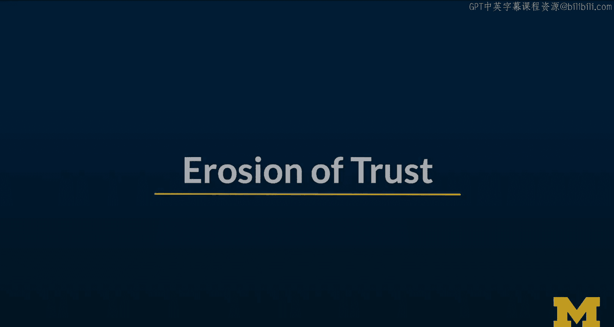
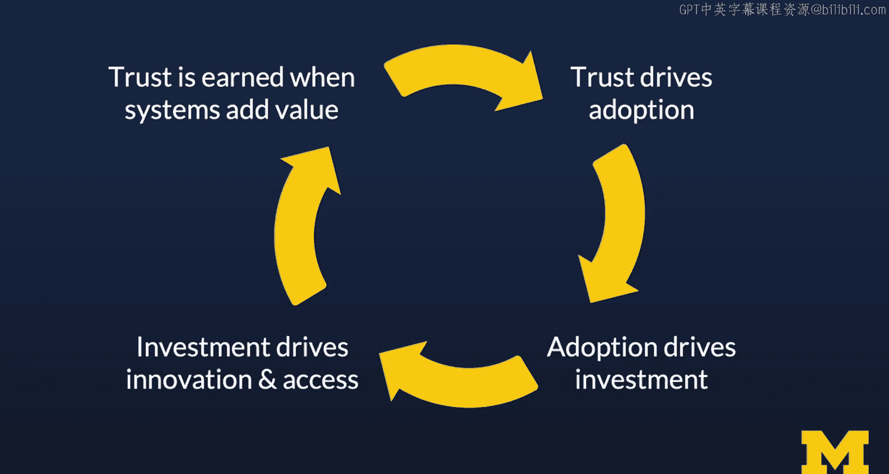
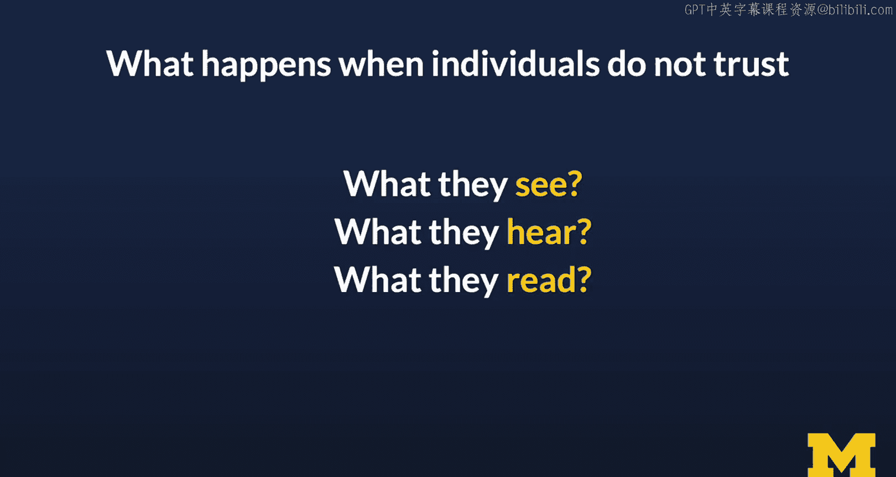
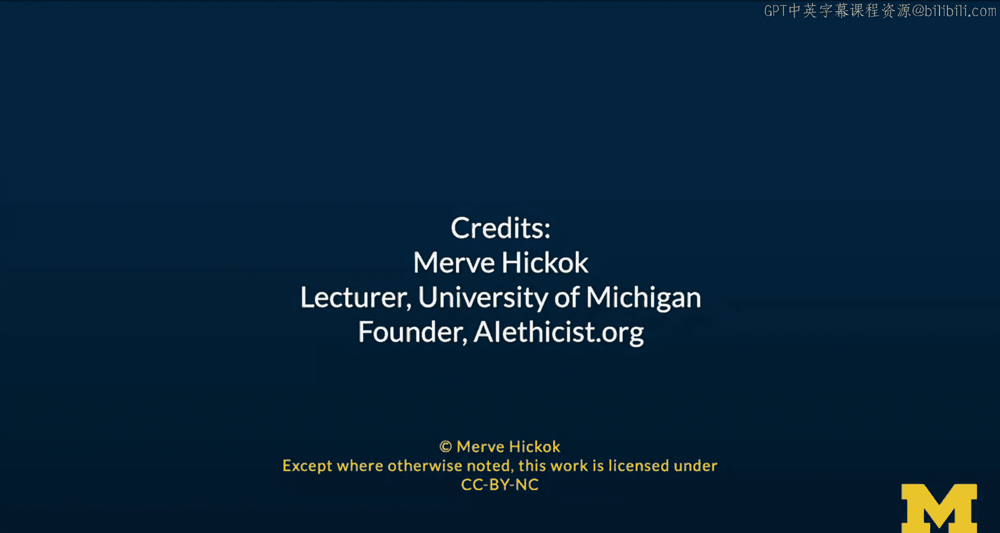

# 密歇根大学《负责任生成式AI简介（基础、对商业和社会的影响、政策、对未来的影响）｜Responsible Generative AI》中英字幕 p28 12_信任衰减防范.zh_en -BV1Uf421B7sR_p28-

At a metal level， the most important question is about trust。

Generative eye systems not developed or deployed responsibly may result in erosion of trust when systems are deployed without guardrails and for commercial priorities and incentives。

😔，This can have long term impacts。

When these systems are deployed without clear descriptions and explanation of their capabilities and limitations。

Users may get frustrated with the inaccuracies。Some of these inaccuracies or less than ideal safety and security measures mainly lead to incidents impacting one's rights。

 freedoms and safety。Miicious use of defect effectss may create financial， physical。

 emotional and reputational damages。A lot rests on the shoulders of those who are in senior positions in both business and government Hye can attract users and driver commercial gains in the short run。

However， in the long run， all these issues combined can significantly erode public confidence and trust。

😔，Trust needs to be justified。It is earned when systems add value and perform as expected and intended。

 trust drives adoption。More adoption drives more investment。More investment in business， government。

 academia tries more innovation and access to these technologies。

A short sighted approach undermines benefits and possibilities of these systems。At a societal level。

 the effects and erosion of trust is a dangerous combination。

Imagine a scenario when people do not trust what they see。😔，What they hear， what they read。

Ask yourself if you have already started questioning authenticity of what you encounter daily。

And what does that mean for the fabric of society。😔。

