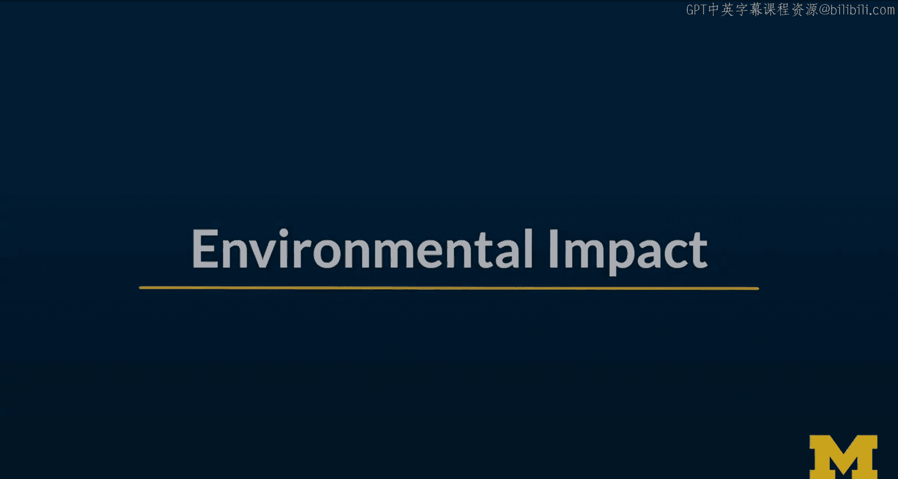
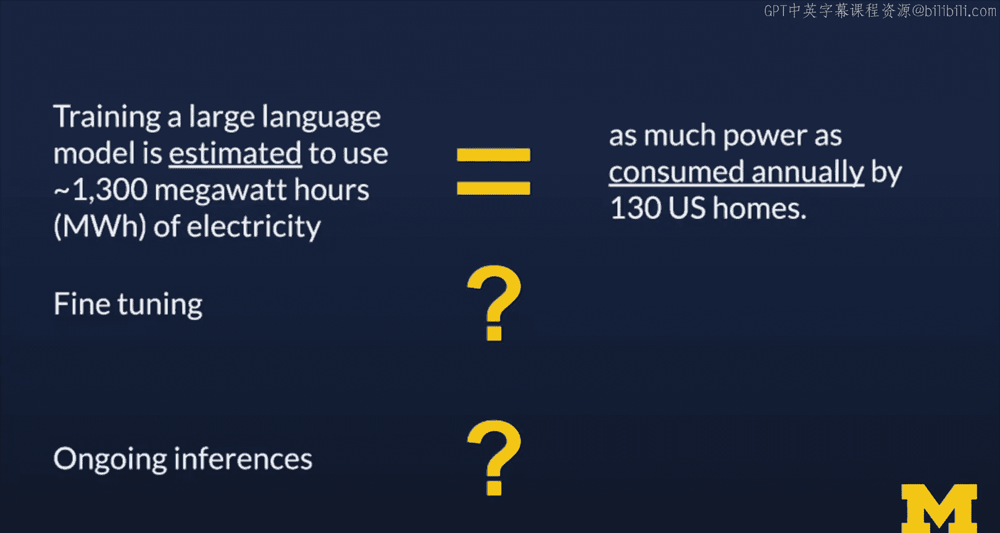
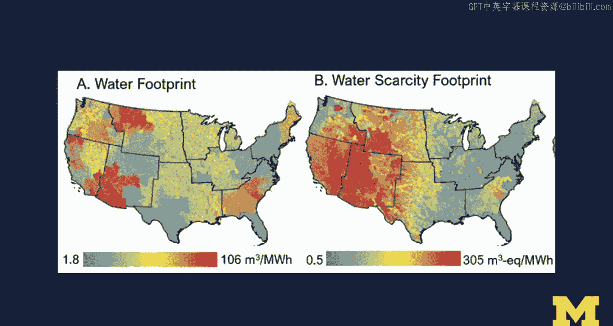
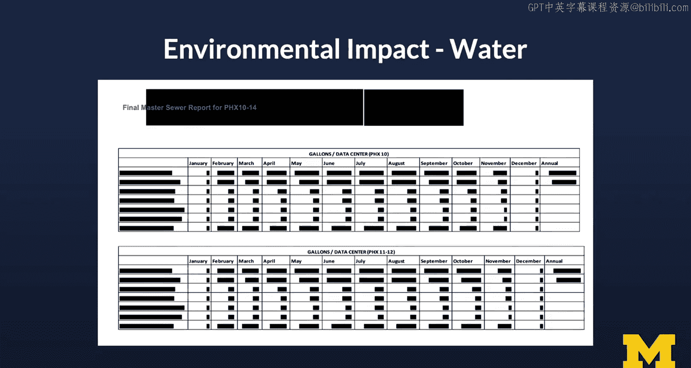
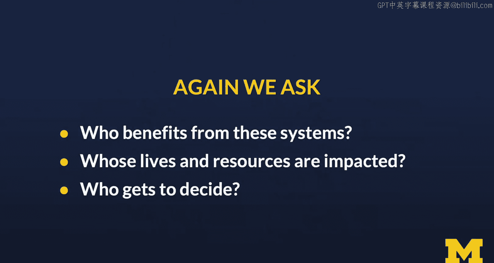
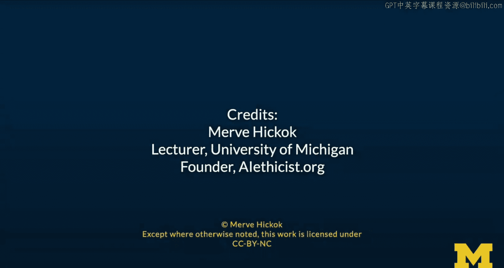

# 密歇根大学《负责任生成式AI简介（基础、对商业和社会的影响、政策、对未来的影响）｜Responsible Generative AI》中英字幕 p29 13_环境影响评估.zh_en -BV1Uf421B7sR_p29-

Genrate our systems， just like any data and compute Harry technology。Have high environmental impact。

 New research also points to significant differences between predictive and generative eye systems in terms of energy consumption。

Generative tax are found to be more energy and carbon intensive。

The study provides useful relative data and a starting point for comparison。

But notes that the numbers will change for different model use cases。However。

 as with many things re generateative AI systems。We do not know exactly how much energy these models use。

There are several factors contributing to the issue。😔，First。

 researchers point out to the lack of standardized methodology to quantify energy consumption of these models。

😔，Second， there is currently no mandate to disclose specific environmental impact。

Although there are some emerging policy and governance discussions。And finally。

 where this information is available at some level， it is shielded from disclosure。

Global data center energy consumption continues to be on the rise with the combination of generative AI and cryptocurrencies。

Researchers estimate this demand to grow even further。

Suggesting that the global data center energy consumption could equal to that of a country the size of Ireland。

 Argentina or Sweden。😔，Generatory eye systems consume significant energy throughout their th process。

Large language or image models。 now with billions of parameters。

Sometimes take months to train after deployment， the energy consumption increases even further。

 with each inference run on the system。😔。

In other words， a retirement user prompts the system to complete a text， image video or code task。

The model has a forward run， In other words， in inference and produces an outcome。

Billions of inferences are run on commercial models each day。In fact。

 Nvidia and Amazon Web services estimate that inference consume significantly more energy。

And can be up to 80 to 90% of total operational costs in deep learning。Data centers。

 which host the servers used to train or run the generative air systems。

Also requires significant amount of fresh water to cool the servers。

A 2021 article analyzing the environmental impact of data centers。

Prorovise an estimation of water footprints of data center operations。

Compared to the waters scarcity experienced across regions。

Data centers rely heavily on water basinsants， where the supply is already scarce。

 contributing to extra stress locally。

It is worth not that this picture predates the generative AI technology。

 The demand for construction of new data centres continues to increase。😔。

Cooling systems for data centers mainly use fresh portable water to avoid any undesirable components from circulating the system。

In other words， data centers share the same water supply that the local or original residents depend on。

For daily use， agricultural， industrial or municipal needs。

Since the water consumption data is also not disclosed。

 researchers try to estimate the water consumption footprint for generative eye systems。

Similar to the secrecy and energy consumption figures。

 information on water consumption is also inaccessible。

Companies do not meaningfully disclose this data。And even when the information is requested from state or local governments。

Companies can request this information to be classified as propriety and block its disclosure。

In other words， not only the residents living in a locality may not know the amount of drinking water and energy used by these companies。

But neither the consumers。If you are an environmentally conscious business。

 you might not be able to compare alternative models。

As the demand for new data centers continues to trend upwards。

 the fresh water consumption of the data centers drove significantly from local resources。

With such environmental impact and lack of information on these issues。

 we ask the fundamental to responsibly air questions again。Who benefits from these systems。

 whose lives and resources are impacted。

And ultimately， who gets to decide on all these。

