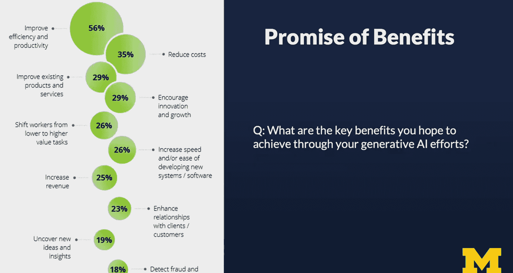
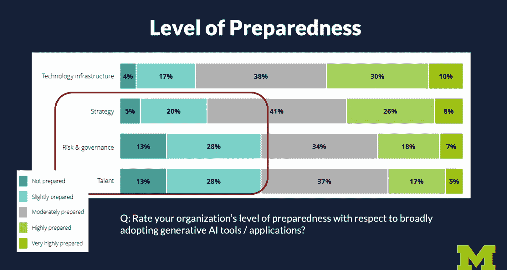
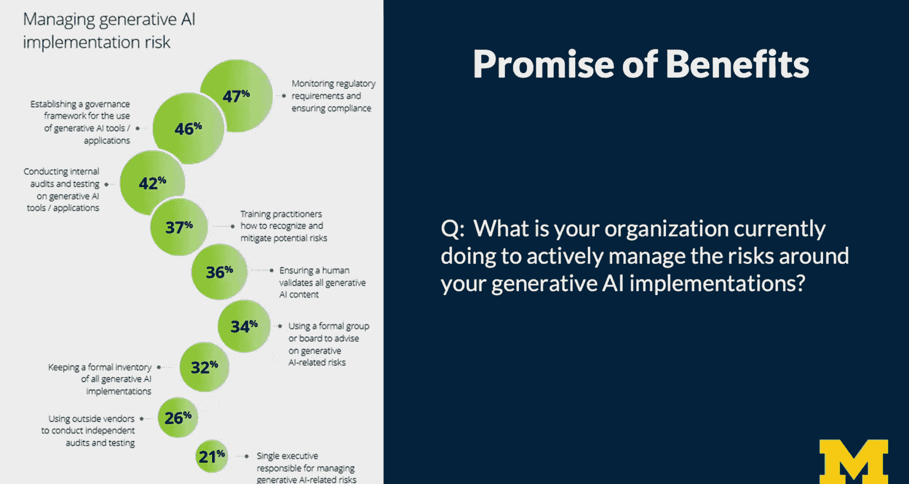
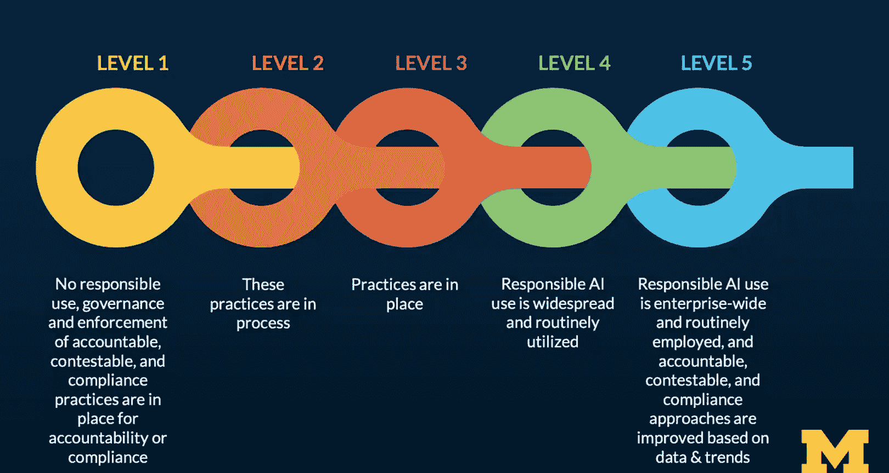
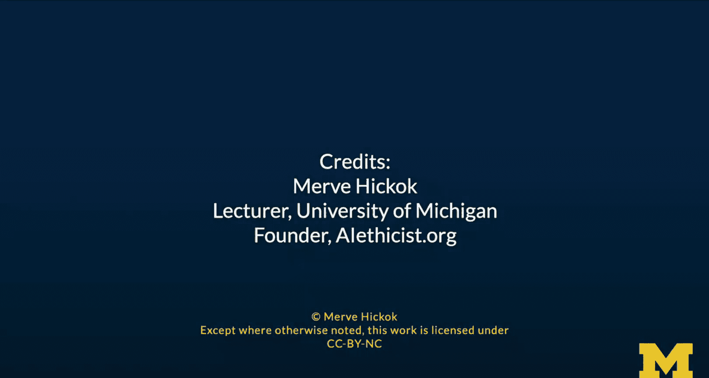

# 密歇根大学《负责任生成式AI简介（基础、对商业和社会的影响、政策、对未来的影响）｜Responsible Generative AI》中英字幕 p30 0_治理必要性探究.zh_en -BV1Uf421B7sR_p30-

Yeah。

Generative AI is expected to bring a variety of benefits to businesses。

In a deloitte consulting survey of more than 2000 directors to see level respondents across six industries and 16 countries。

 these benefits range from increasing efficiency and productivity to reducing overall costs and enhancing relationships with the clients。

Whether a business can realize its expectations will be dependent on how much the business is prepared for changes。

An organization's preparedness may be assessed by different factors， such as its data strategy。

 technology infrastructure， business strategy， governance and human capital。

The same survey of senior management shows that organizations feel more prepared in terms of their technology stack。

However， the main enabler or obstacle of any major development will be the human factor。

 whether it is the talent needed to develop generative AI or talent necessary to execute strategy or to manage risk or governances of these systems。

Investment in human capital is a necessity for any business。

 considering developing or deploying generative AI。

Every organization will go through a journey of exploration。

 analysis and preparation before deploying its Gennai use case。

Some of these preparations will involve understanding the regulatory and compliance requirements。

 and the landscape。Establishing a corresponding internal governance framework and roles。

And training to those who will be involved in the process。

Organizations will move through higher levels of responsible AI maturity as the enterprise adopts and establishes best practices。

And where these practices become standard operating procedure。A target maturity level。

 in other words， where the organization aims to be for optimal level depends on its mission。

 practices and objectives。Every enterprise starts from an exploration level。

What is important is to keep an eye on the strategy and the final goals。

And routinely assess the gaps between the current situation and the target。

In a responsible AI mature organization， the responsible use。

 governance and enforcement practices are routinely employed。They become part of doing business。

And are improved as new data or trends emerge。But what is governance， for some。

 governance may initially mean legal compliance。 However。

 governance actually encompasses an organization's own rulemaking。

 implementation and enforcement mechanisms to guide its functions。

Govers is a collection of mechanisms， roles and responsibilities， rules， processes， procedures。

 policy guidelines and limitations， Aka A guardrails。

Ideal corporate governance creates transparency about the values， the rules。

 the goals and the controls。It guides the work of the organization and help build trust with employees。

 customers， community regulators and investors。Specific to AI and generative AI governance means ensuring that potential risks are minimized and benefits are maximized in the design。

 development and use of generative AI。That organization has control or how these systems impact the processes and decision making at large within the organization。

And that the organization's practices are contestable and lead to accountability。

With responsible AI governance in place， organizations can invest in talent。

 data and infrastructure while laying out the expectations and responsibilities in all stages of the life cyclee from designing。

 training， development， testing， security and deployment。

 as well as the monitoring of generative AI systems。

When you make a decision to develop or adopt a generative AI system。

 you make a commitment to continues to monitor the system's performance and improve its functions。

AI or generative AI are not static systems。So from the very beginning。

 organizations need to think of governance and accountability mechanisms。

Changes the existing roles and responsibilities。Internal monitoring and control methods。

 documentation and the communication flow for the tasks and decisions impacted by the use of generative AI。

It is important to embed， ir responsible and trustworthy approach to your systems from the very start。

And engage with internal and external stakeholders understand there is， both positive and negative。

An impact of your proposed system on these groups。Similar to predictive AI systems。

 generative AI is the state's strong goness for several reasons。Training data can contain toxic。

 harmful， illegal content。Moels are complex and opaque。

Systems can be attacked and manipulated by malicious actors。

Users may interact with the system in ways unforeseen or unpredicted by its developers。

Opening up whole name concerns。Responses may be inaccurate or biased。And finally。

 if something unexpected happens， the impact may be significant on individuals and organization。

