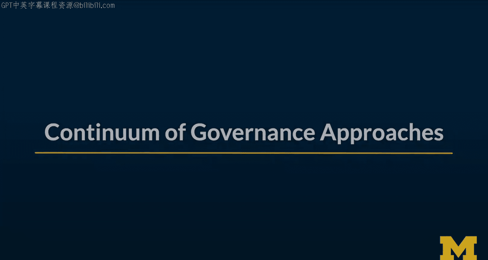
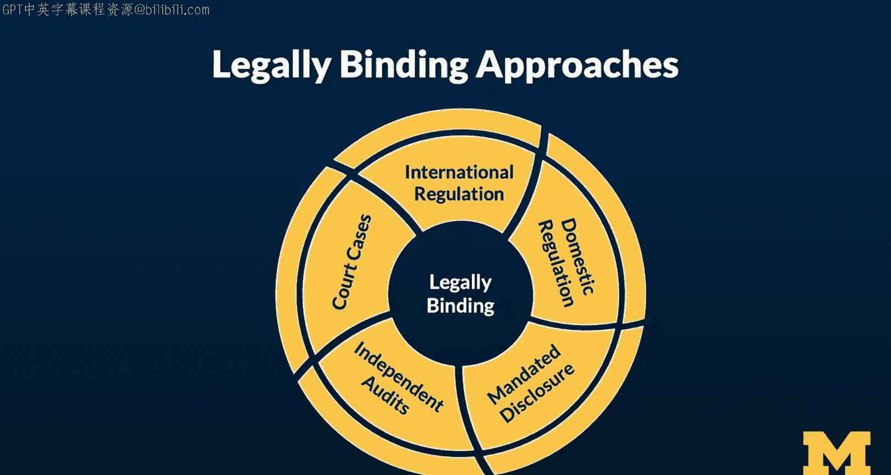
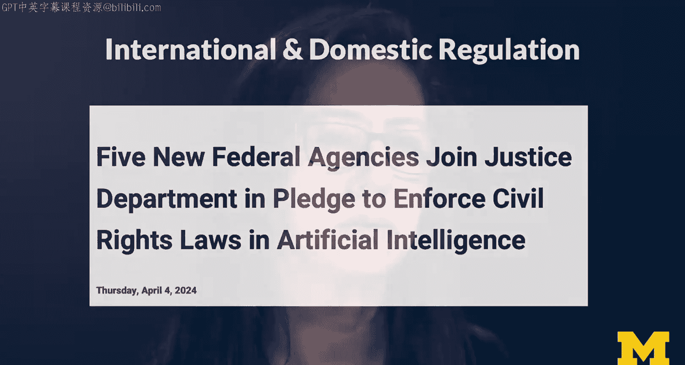
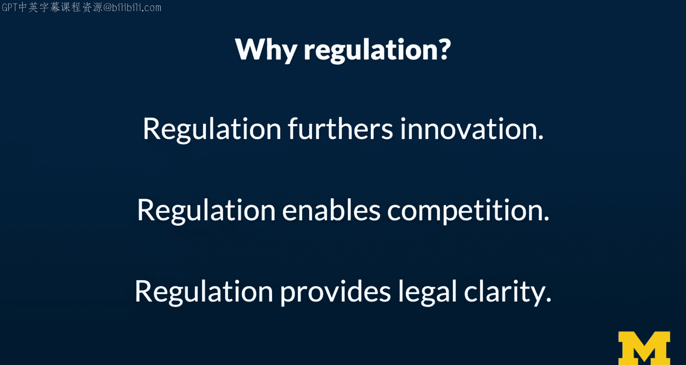
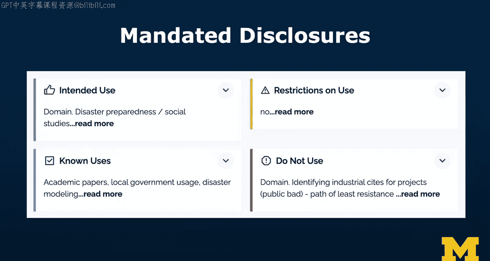
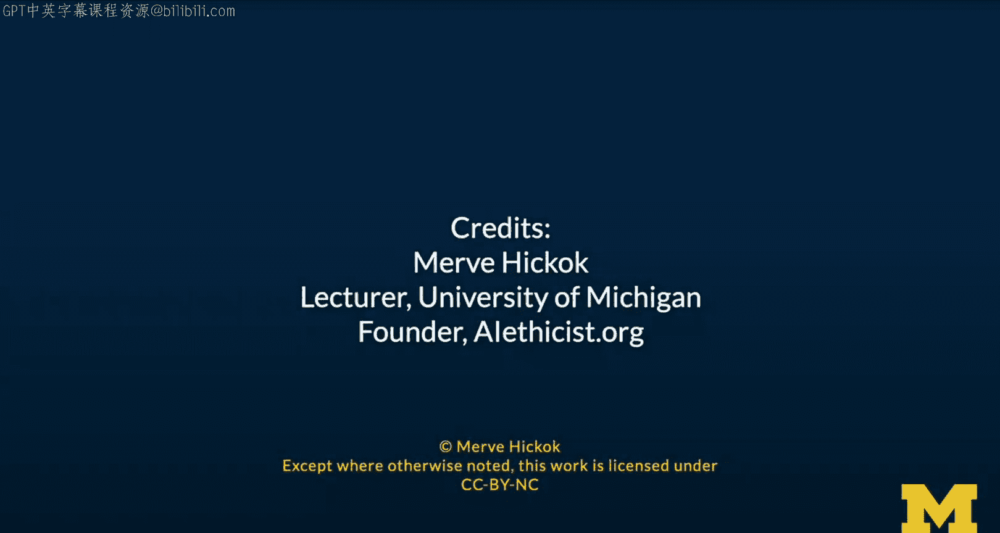

# 密歇根大学《负责任生成式AI简介（基础、对商业和社会的影响、政策、对未来的影响）｜Responsible Generative AI》中英字幕 p31 1_治理方法连续体.zh_en -BV1Uf421B7sR_p31-

With governance， there are now one size fit all solutions。

Business decision makers need to understand what works for their organization and those that they serve。

One can think of the approaches on a continuium of how low to softflow mechanisms。Or in other words。

 legal a binding requirements to warrant actions。Many of these approaches will have to coexist and complement each other in an agile manner。

😔，Generative AI systems will rarely operate in a single jurisdiction or culture。

And the nature of these systems and their emerging use cases will require an understanding of all possibilities within the continuum。

Let's start with legally binding approaches first。 These， as the name suggests。

 either put obligations on organizations for its current actions。

Or liability for the impact the system may create。In the case of court decisions。

 they set precedent for future interpretations of law and practices。

Breaking or disregarding the rules may mean the organization may face with monetary or operational sanctions。

It is a myth that there are no regulations in place for AI or generative AI systems。

Many jurisdictions already have established laws and regulations。

 which will continue to apply to the outcomes of these systems。

Such as nondiscrimination or equality laws， data protection or privacy laws。

 children's safety or fair business practice or consumer protection laws。

Just because there is a new technology doesn't mean the existing laws do not apply。

If it is illegal to discriminate or to deceive， it is illegal to discriminate or to deceive using generative AI design and deployment of these systems need to reflect the legal requirements。

In fact， one agency after another make it clear that they quote。

Stand ready to hold accountable those entities that fail to address the unfair and discriminatory outcomes that may result。

 We are mounting a whole of government approach to enforcing civil rights and related laws when it comes to automated systems。

 including AI， uncle。Additionally， new regulations are coming into effect such as the EU U AI Act。

 requiring incident monitoring for generative AI systems。

Or the Chinese AI regulation requiring generative AI systems pass a secure self assessment。

And the synthetically generated content to be labeled as such。In the United States。

 requirements for water marking or labeling of synthetic content is also gaining traction in both the state and federal government levels。

Across the borders， the Council of Europe's draft AI treaty will be the first international treaty on AI。

 In due time， both domestic and international regulations will adopt to specific use cases and impact of AI systems。

 just like a private organization， most experience and learning and advances its governance maturity。

 Reg approaches will also mature for new technologies over time。

 One may ask why regulation is necessary for an emerging technology。

This is because new technology creates new methods and use cases。

 which may impact the markets and society。Regulation furthers innovation by creating the rules of the game。

Constraints make for more deliberate and thoughtful design and engineering processes。

Think of safety belts and cards or analysis of side effects for medications。

Regulation enables competition by preventing monopolistic business practices by larger corporations。

This creates opportunities for smaller businesses to attract new investors and inventors。

By drawing the boundaries， regulation provides clarity for what is acceptable。😔。

So that the businesses and consumers can make informed decisions。

Let's take a look at some of these legal a binding approaches。

In addition to requiring generative AI developers and deploys to assess， mitigate and monitor risk。

 regulations can also mandate public disclosure of certain information about generative AI systems。

The information may range from simply disclosing that a generative AI system is in place。

Or to publishing technical documentation about the system。Or reporting of incidents。

US government， for example， mandated the disclosure of the use of AI systems by federal governments in a registry。

As well as transparency about certain details of these systems。

E U requires providers of high risk AI systems to similarly disclose information。

Such disclosures provide the end users with information they can then use to assess the outcomes of the systems。

Or contest， if necessary。Another method is independent audits。

Mandated independent audits have been in place for a very long time。For example。

 you may think of financial audits for publicly traded companies。Tax audit for individuals。

Or cyber security audits for companies processing personal data。Given the complexity。

 the opaqueness and impact of generative AI systems。

Independent third party audits are one of the possible goness mechanisms。

Where a trusted party examines the system on behalf of the regulator or the public。

Audit is an official methodological examination and verification of an organization's records。

Independency， is the principle where the individuals who conduct audits do not have any conflicts。

 Financial or other interests regarding the entity day audit。

Which allows them to remain free for their assessment and conclusions。As a governing field。

 algorithmic audits may include a combination of model design， model outcomes， data quality。

 prominence， internal documentation of the organization。

 as well as the fidelity between intended use and the actual performance。

