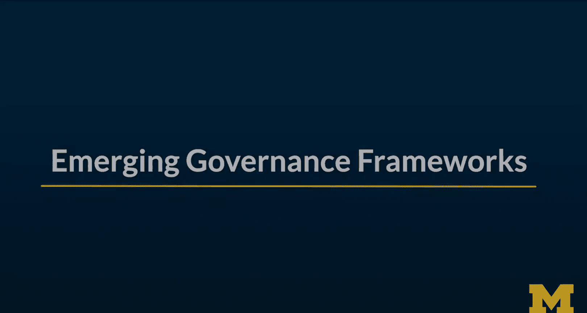
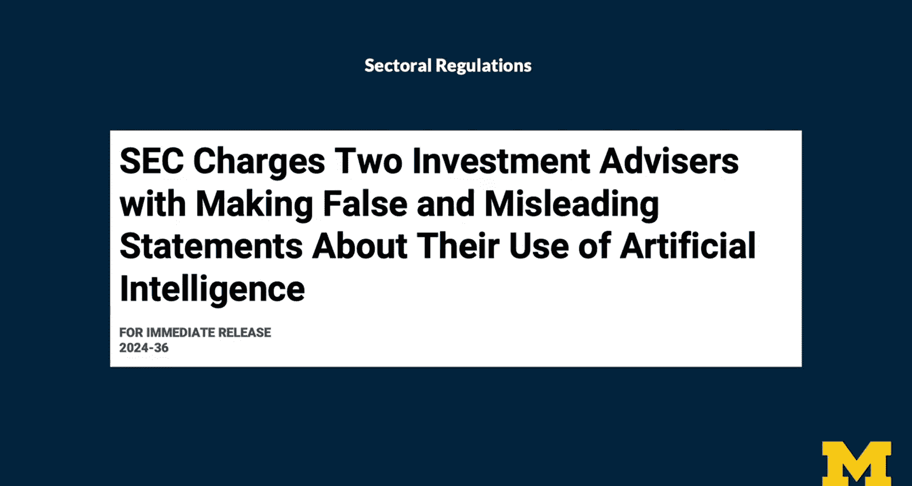
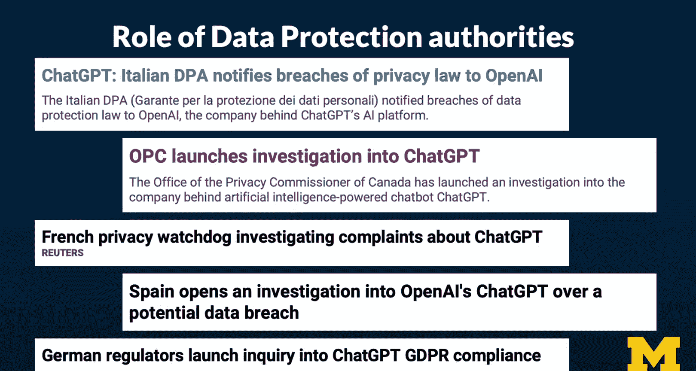
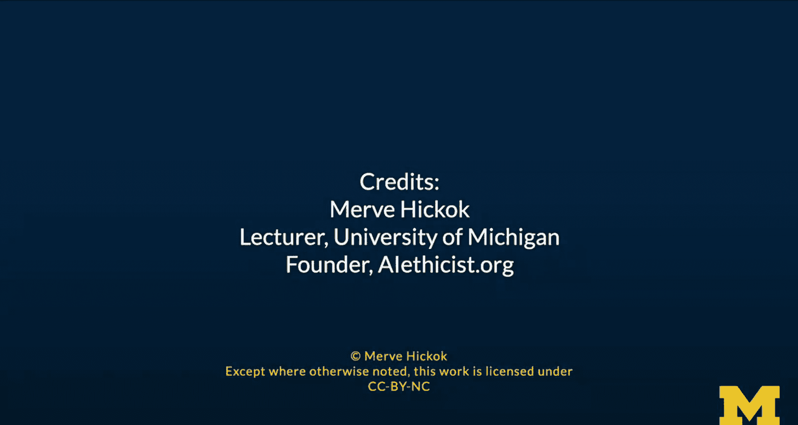

# 密歇根大学《负责任生成式AI简介（基础、对商业和社会的影响、政策、对未来的影响）｜Responsible Generative AI》中英字幕 p32 2_新兴治理框架演进.zh_en -BV1Uf421B7sR_p32-

As previously mentioned， several court cases are currently testing application and interpretation of existing laws。

For example， copyright and intellectual property， as well as liability and defamation loans。

 are actively discussed in the courts across the world。

The international trade agreements and data flow arrangements are also still applicable。

 but being reinterpreted for the nuances of generative AI systems。

As mentioned in the previous course， the regulators across the world are also using their existing investigation and enforcement powers。

To ensure companies selling geneative AI services or products do not undermine consumer protections。

Or conduct business in an unfair or deceptive manner。

Existing regulations apply to these technologies。Over the last couple of years。

 the Federal Trade Commission in the US， for example。

 published a number of warnings and guidances in the space。FTC has also taken enforcement action。

 imposing significant monetary fines。And even disgment decisions where companies were ordered to delete their dataset sets and models train on those dataset sets。

Seectctoral regulators may also come into the picture。

 such as the case of the Securities and Exchange Commission。

 settling charges against two investment advisers for making false and misleading claims about their purported use of AI。

These firms misled the public by saying they were using an AI model when they were not。

And agreed to settle the Se's charges and pay 400000 in total civil penalties。Similarly。

 in jurisdictions where data protection or privacy regulations exist。

 these authorities may also take enforcement action to ensure the rights of data subjects are protected withingenrative AI systems and business models。

Protections such as right to access one's data， right to rectify objection to the use of data。

Or right to be forgotten， right to private action are central to many privacy regulations。

Although many of the current investigations are focused on one company。

This is more of a function of being a first mover in the market。

And not a signal that other renders are certified to be fully in compliance with data protection or privacy regulations。

The actions and guidance from these data protection authorities will be applicable to any company using personal data in generative Aspace。

As mentioned previously in the course， questions about regulatory compliance should be asked in data collection and model training stages。

As well as for the data used and created as part of the user prompts and responses。In Europe。

 the E U AI Act voted in 2024， brings obligations for both predictive AI systems and general purpose AI systems。

 E U AI Act provides a risk based approach to regulating AI use cases and practices。

The Act starts with a list of prohibited use cases。

Then a number of users or domains are listed as high risk。In other words。

 AI systems used in domains such as healthcare， recruitment， education， law enforcement， etc ce。

 are considered potential to be high risk since they can impact a person's health safety or access to resources and opportunities。

For these high riskI systems， the Act requires the providers of the system to conduct excellent assessments。

Dircument technical aspects of the data set and models and have risk and call to management systems in place。

E UAI Act also covers generative AI technologies， albeit with different levels of obligations on the providers。

General purposepo AI systems are systems that can perform a variety of general functions such as text。

 audio， video recognition or generation。And can be repurposed by downstream users for tasks both intended and unintended by the original developers。

 E U AI Act differentiates between two levels for these systems， as per their impact。

Foundation model providers are required to comply with E U copyright law。

Have technical documentation on the dataset sets and models。

Which would help downstream users to make more informed decisions。

For high impact models with systemic risk， there are more stringent obligations。

 which include systemic risk assessment and mitigation。Monitoring serious incidents。

Conducting adversarial testing and reporting on energy use。

Other systems used simply for generative AI purposes， have labeling requirements。

Semi voluntaryunary governance mechanisms come into the picture when an organization is not mandated to take in action。

 but is expected to do so by industrial norms and standards， market norms。

 repetal concerns or even by investors。 One of these mechanisms is standard setting。😔。

It is one of the most effective ways to set expectations from new technologies and industries。

 where our legislation doesn't yet exist or does not need to exist。This is when the professional。

 community and interested parties come together。To agree on the most important elements for the development。

 deployment and management of these new technologies。

They set the minimum standards to which organizations are expected to abide by。In some cases。

 the regulators may decide that complying with the established technical standards is enough to comply with the legal obligations。

In other words， technical standards become the operational interpretation of the legislation。

Currently， this is a possibility for the EU UAI Act。

Technical standard setting bodies are working on the interpretation of assessment and documentation obligations of the EU U AI Act。

