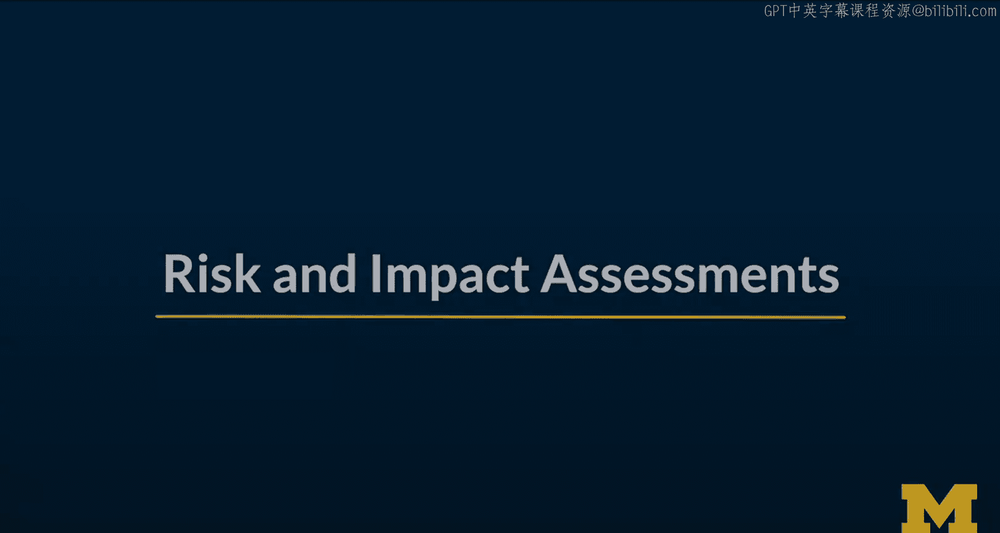
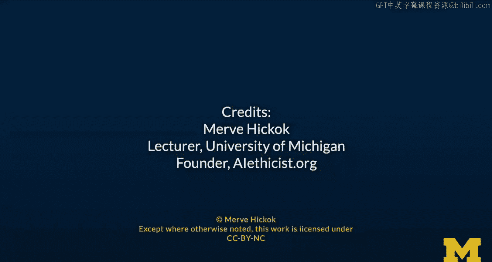

# 密歇根大学《负责任生成式AI简介（基础、对商业和社会的影响、政策、对未来的影响）｜Responsible Generative AI》中英字幕 p33 3_风险与影响评估体系.zh_en -BV1Uf421B7sR_p33-

Risk and impact assessments are also expected from developers and employers。

 While there is a possibility filtertor to have this mandated in the future。

Different actors come into play throughout the lifecycl of data。

 when we use data or develop products or services built on data。

Our intention is usual to solve a problem， to make processes more efficient or affordable。

 to make the outcomes better。Unless we have malicious intent， in which case。

 the concept of accountability itself is irrelevant。

The objective is to provide benefits to individuals or society at large。

As we the benefits of our work， a responsible approach also requires us to understand possible harms or negative impact we might be creating。

And mitigate those before harm is inflicted。Responsible governance requires us to conduct X ante。

 post ho and ongoing analysis and take action accordingly， X ante means before they went。

As we make decisions about our data sets and design。

We work with a set of stakeholders to mappart the possible harms and assess the impact。

Once we understand what could go wrong in this ex analysis。

We are faced with the need to make a decision。In certain high risk cases。High stake situations。

 The harms you have surfaced might be unacceptable to continue the development。

Or he might need to invest further until they become acceptable and the risk to inflict harm is removed or mitigated。

Through these processes of discovery， mapping and mitigation。

 it is crucial for us to document the decisions we make。

Responsibility and accountability by design requires us to document both qualitative and quantitative characteristics of our dataset sets。

What were our data sources and the context in which they were collected。

What quotationous matters have we applied。How would we train our models。

 What are known limitations of our data sets， the models and the systems。

Sometimes even with the best of intentions， things go wrong once they are used by different actors or by using the new contacts。

We need to be able to understand why it happened and put controls in place to ensure it doesn't happen again。

This is where postdoc accountability comes into play。 Postdoc means after the event。Users， media。

 civil society and auditors can all be involved in different ways to keep the actors accountable。

Ideally， we want this feedback to contribute to the products and services。

And we want this feedback to be a constructive process， whenever possible。

In addition to Xant accountability， we have a responsibility to continuously to monitor the changes in our dataset sets and outcomes。

Whereas predictive AI systems are built with specific objective functions and performance evaluation methodologies。

Geneneer A systems do not。Users will create many previously unforeseen use cases and interactions with these systems。

Some of them for malicious purposes， too。Since the use cases may vary and multiply。

Organizations developing and deploying Gene systems。

Must have an effective way of monitoring the evolution of users。

Receive and respond to feedback from users， respond to incidents and also actively prevent the use of systems for prohibited or dangerous domains。

Robust governance mechanisms require clear cut responsibilities assigned to certain roles within the organization。

As well as providing them with effective tools to monitor change， document and report impact。

