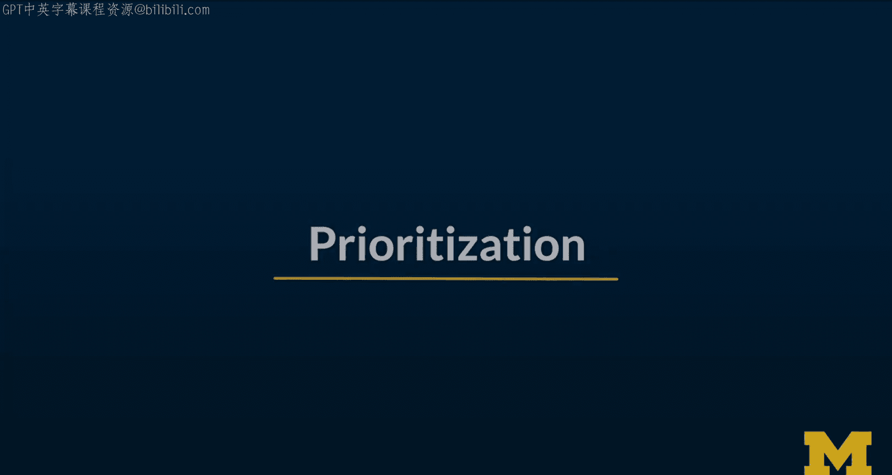
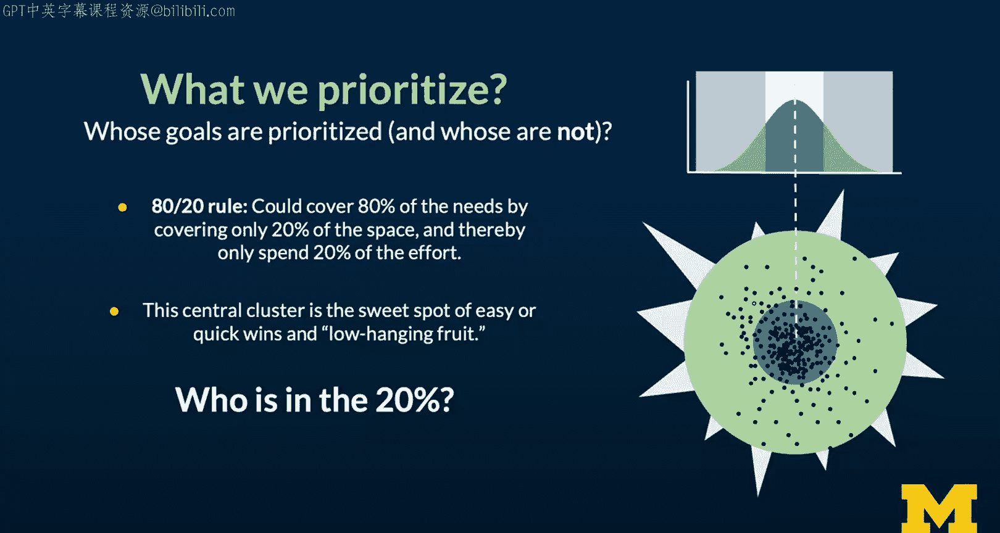
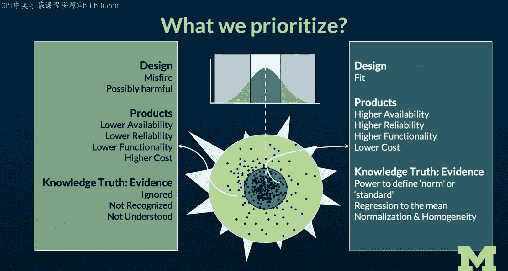
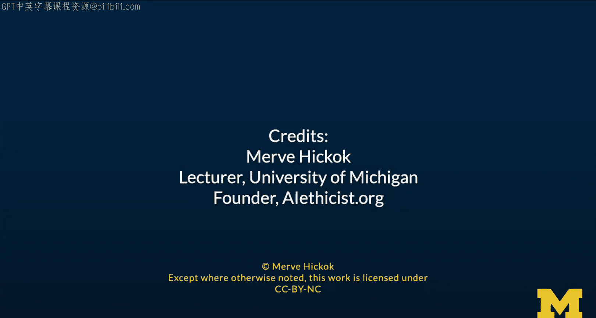

# 密歇根大学《负责任生成式AI简介（基础、对商业和社会的影响、政策、对未来的影响）｜Responsible Generative AI》中英字幕 p34 4_优先级划分原则.zh_en -BV1Uf421B7sR_p34-

As I noted， external actors may surface unintended responses and provide feedback to the organizations。

However， this doesn't mean external actors should bear the brunt of that work。😔。

Geneerative AI systems should be deployed after developers can ensure they are safe。

 secure and trustworthy。However， as mentioned before。

 we have a very skewe distribution of who has the means to develop these advanced systems。

And therefore， who gets to make those decisions。You might be familiar with the 820 rule。

It can translate into an efficiency， focused approach。Meaning。

 you could cover 80% of the needs by covering only 20% of the space。And thereby。

 only spent 20% of the effort。It means that in a fast moving decision or product space。

 you are going for the easy and quick wins and not necessarily spending effort to understand why some people fall in the outside space。

Or why some people always roll in the outside area。

Professor Tverrans prompts us to think about the consequences of ignoring the needs of the 20%。😔。

We know that in statistics， there will always be a difference in distribution。However。

 we also make conscious decisions about how we define the mean， the norm， the average。

And then compare the population against that decision。

When we make decisions about whose goals and needs we prioritize。

We also make a choice about how much we value those in the 20 per cent outer space。

 What happens if we ignore those 20 per cent。What are we missing in ignoring 8% of the knowledge terrain。

😔，What happens if you find yourself among those difficult in a person。

For those who do not fit the majority or the defined norm。

The outcomes may be significantly different。A repeating pattern of such exclusion。

Might also have a cumulative effect across multiple domains。For example。

 the design might not be a fit for the person。Or a group of people sharing similar characteristics。

Sometimes it might be outright harmful。Previously， we talked about this in the context of linguistic or image diversity in generative AI systems。

 The products which could work for this otter population， might be less available。😔。

Might have a lower reliability， accuracy or functionality。

If there is no intentional effort to understand the needs of these groups， In other words。

 who does this data represent。What might be causing them to be on the edges。Is this a bug feature。

Is this a recurring problem， et cea。

They will continue to face the harms， the risks and the costs。😔，Although being a recent technology。

Consumers and many businesses already expect vendors to have a certain level of responsibility in direction regarding generative AI。

Consumers are excited and concerned， at the same time。

And it will be up to the businesses which develop and deploy these systems to meet the expectations and establish trust。

It is the expectation of the investors and consumers that organizations act responsibly。

